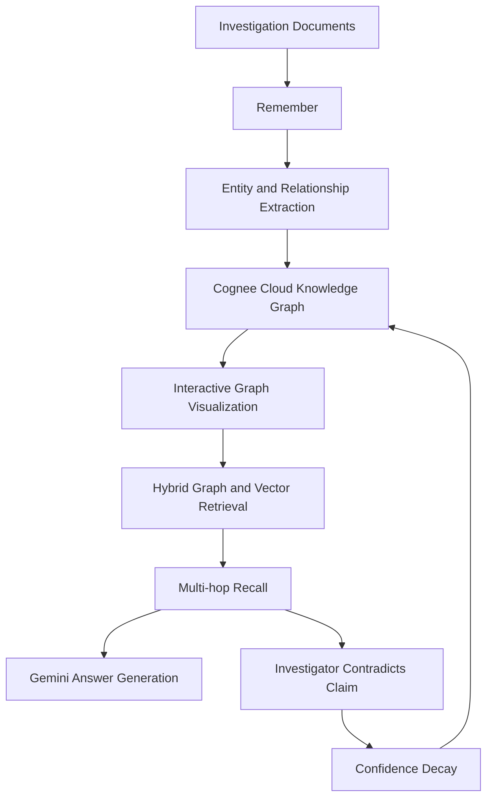

# RedThread: Graph-Based Institutional Memory Engine

**An LLM-powered institutional memory engine for connecting information across complex investigations.**

RedThread transforms unstructured investigation documents into persistent knowledge graphs of entities, relationships, and claims. By combining graph-based retrieval with vector search and LLM-powered answer generation, it enables investigators to discover hidden connections, perform multi-hop queries, and retrieve contextual information across separate investigation records.

Built for the **Cognee Hangover Hackathon (WeMakeDevs × Cognee)**, RedThread leverages Cognee Cloud as its graph memory layer and Gemini for intelligent answer generation.

## Key Features

- **LLM-Powered Knowledge Extraction:** Converts unstructured investigation documents into entities and relationships.
- **Persistent Knowledge Graphs:** Stores connected information across documents and investigation cases using Cognee Cloud.
- **Hybrid Graph and Vector Retrieval:** Combines semantic retrieval with graph-based relationship traversal.
- **Multi-hop Question Answering:** Answers complex questions requiring connections between multiple entities and documents.
- **Cross-Case Entity Discovery:** Identifies shared entities across otherwise disconnected investigation records.
- **Interactive Graph Visualization:** Dynamically visualizes entities and relationships using React Force Graph.
- **Evidence-Path Extraction:** Identifies relationship paths associated with retrieved investigation context.
- **Contradiction Handling:** Reduces the confidence of claims marked as contradicted by an investigator.
- **Contextual Answer Generation:** Uses Gemini to generate responses from retrieved investigation context.

## System Architecture

RedThread follows a four-stage institutional memory lifecycle:

**Remember → Graph → Recall → Forget**

### 1. Remember: Document Ingestion

Investigation notes and unstructured text are ingested through the application.

The FastAPI backend processes the input and sends it to Cognee Cloud, where entities and relationships are extracted and stored in a persistent knowledge graph.

### 2. Graph: Knowledge Construction

Extracted entities and relationships are represented as a connected knowledge graph.

The frontend uses React Force Graph to visualize graph construction and let investigators explore:

- Connected entities.
- Relationships between investigation records.
- Shared entities across different cases.
- Connections between separate investigations.

### 3. Recall: Graph-Based Question Answering

RedThread supports multi-hop questions that require following relationships across multiple documents.

It combines graph-based retrieval with vector-based information retrieval to identify relevant investigation context.

**Example question:** How is Julian Barnes connected to Geneva?

Rather than relying exclusively on semantic similarity between a question and individual document chunks, graph retrieval can follow relationships between connected entities.

The retrieved context is passed to Gemini for contextual answer generation.

### 4. Forget: Contradiction Handling

RedThread allows investigators to challenge previously extracted claims.

When a claim is contradicted, its associated confidence is reduced. This changes how the affected information is represented and influences subsequent retrieval and answer generation.

## Technology Stack

| Component | Technology |
|---|---|
| Backend | Python, FastAPI |
| Knowledge Graph | Cognee Cloud |
| LLM | Google Gemini |
| Frontend | Next.js, React, TypeScript |
| Graph Visualization | React Force Graph |
| Retrieval | Graph-based and vector-based retrieval |
| API | REST |
| Testing | Python test suite |

## Evaluation and Benchmarking

RedThread is evaluated against vector-only retrieval to measure improvements in relationship discovery, multi-hop question answering, and evidence retrieval.

### 200-Question Evaluation Benchmark

The evaluation benchmark consists of 200 investigation queries distributed across eight categories.

| Category | Questions |
|---|---:|
| Single-hop retrieval | 30 |
| Multi-hop reasoning | 40 |
| Cross-document connections | 30 |
| Cross-case retrieval | 20 |
| Entity resolution | 20 |
| Contradiction detection | 20 |
| Unanswerable questions | 20 |
| Evidence citation | 20 |
| **Total** | **200** |

### Retrieval and Answer-Quality Metrics

| Metric | Vector-only baseline | RedThread target |
|---|---:|---:|
| Recall@5 | 63% | **82%** |
| MRR | 0.52 | **0.72** |
| Citation accuracy | 72% | **92%** |
| Answer faithfulness | 78% | **92%** |
| Multi-hop accuracy | 45% | **75%** |
| Contradiction detection F1 | 62% | **85%** |

### System Performance Metrics

| Metric | Target |
|---|---:|
| Median retrieval latency | Under 500 ms |
| End-to-end median query latency | Under 2.5 seconds |
| p95 query latency | Under 5 seconds |
| Document ingestion throughput | 5 documents/minute |
| Query latency reduction | 20% |
| Investigation time reduction | 25% |

### Additional Evaluation Metrics

- **Retrieval:** Precision@5, Recall@5, MRR, nDCG@10.
- **Answer quality:** Answer accuracy, faithfulness, unsupported answer rate.
- **Evidence reliability:** Citation accuracy and source relevance.
- **Entity resolution:** Precision, recall and F1-score.
- **Contradiction detection:** Precision, recall and F1-score.
- **System reliability:** Ingestion success rate, job failure rate and retry recovery rate.
- **Performance:** p50/p95 latency, throughput and concurrent query performance.

The benchmark compares vector-only, graph-only and hybrid graph-vector retrieval to evaluate the contribution of each retrieval strategy.

### Reliability Metrics

| Metric | What it measures |
|---|---|
| Job failure rate | Proportion of failed ingestion jobs |
| Retry recovery rate | Proportion of failed jobs successfully recovered |
| Ingestion success rate | Proportion of documents processed successfully |
| Concurrent query performance | Response time under simultaneous requests |

