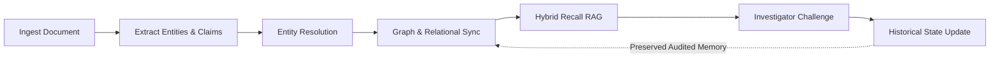

# RedThread Documentation

Welcome to the technical documentation for **RedThread**, an investigative intelligence platform that converts unstructured, fragmented documents into a structured, interconnected, and verifiable evidence system.

---

## 📌 Executive Summary

Organizations investigate complex situations using information spread across hundreds or thousands of heterogeneous documents (PDFs, emails, transcripts, financial ledgers, and research reports). Traditional keyword searches and vanilla vector-based RAG (Retrieval-Augmented Generation) fail when:
1. Relationships span across multiple distinct documents (multi-hop connections).
2. Information across documents is contradictory, outdated, or disputed.
3. Generated AI answers lack granular, verifiable evidence citations.

RedThread addresses these challenges through three foundational tenets:
- **Evidence-First**: Every answer and relationship is grounded in source documents with page-level offsets.
- **Graph-Based Memory**: Cross-document relationships are preserved as traversable entities and attributed claims.
- **Historical Accountability**: Contradictions never silently overwrite past evidence; claims follow an audited lifecycle.

---

## 📚 Documentation Index

| Section | Document | Description |
| :--- | :--- | :--- |
| **System Architecture** | [Architecture Guide](file:///home/rushikeshbathe096/hackathons/Redthread/docs/architecture.md) | High-level topology, modular monolith structure, component interactions, and tech stack. |
| **Database Design** | [Database Design](file:///home/rushikeshbathe096/hackathons/Redthread/docs/database-design.md) | PostgreSQL relational schema, entity relationships, claim versioning, indexing, and RLS. |
| **API Specification** | [API Specification](file:///home/rushikeshbathe096/hackathons/Redthread/docs/api-specification.md) | REST API v1 endpoints (`/auth`, `/cases`, `/documents`, `/entities`, `/claims`, `/recall`). |
| **Security & Multi-Tenancy** | [Security Model](file:///home/rushikeshbathe096/hackathons/Redthread/docs/security-model.md) | RBAC matrix, tenant isolation, IDOR defenses, token lifecycle, and prompt injection hardening. |
| **Ingestion Pipeline** | [Document Ingestion](file:///home/rushikeshbathe096/hackathons/Redthread/docs/ingestion-pipeline.md) | Async processing lifecycle, Celery workers, file parsers, idempotency, and extraction schemas. |
| **Entity Resolution** | [Entity Resolution](file:///home/rushikeshbathe096/hackathons/Redthread/docs/entity-resolution.md) | Weighted scoring formula, fuzzy matching, candidate retrieval, alias indexing, merge/unmerge. |
| **Claim Lifecycle & Forgetting** | [Contradiction Management](file:///home/rushikeshbathe096/hackathons/Redthread/docs/contradiction-and-claim-lifecycle.md) | Active vs. Disputed vs. Retracted claims, `claim_events` audit trail, and retrieval behavior. |
| **Hybrid Recall & RAG** | [Hybrid Recall](file:///home/rushikeshbathe096/hackathons/Redthread/docs/hybrid-recall-and-rag.md) | Graph traversal algorithms (BFS, Dijkstra), vector semantic search, and citation synthesis. |
| **Development Roadmap** | [Development Roadmap](file:///home/rushikeshbathe096/hackathons/Redthread/docs/roadmap.md) | 12-week phased implementation plan, P0/P1/P2/P3 priorities, and deployment architecture. |

---

## 🏛️ Architecture Decision Records (ADRs)

Key architectural choices are formally documented in the [ADR Directory](file:///home/rushikeshbathe096/hackathons/Redthread/docs/decisions/):
* **[ADR-001: Hybrid PostgreSQL and Cognee Architecture](file:///home/rushikeshbathe096/hackathons/Redthread/docs/decisions/ADR-001-postgresql-and-cognee-hybrid-storage.md)**: Designating PostgreSQL as the relational source of truth and Cognee as the graph-backed memory accelerator.
* **[ADR-002: Asynchronous Job-Based Document Ingestion](file:///home/rushikeshbathe096/hackathons/Redthread/docs/decisions/ADR-002-asynchronous-ingestion-pipeline.md)**: Decoupling HTTP upload acknowledgment from document processing using Celery and Redis.
* **[ADR-003: Hybrid Graph-Vector Retrieval for Multi-Hop Inquiries](file:///home/rushikeshbathe096/hackathons/Redthread/docs/decisions/ADR-003-hybrid-graph-vector-recall.md)**: Pairing dense vector similarity with knowledge graph traversal for complex intelligence questions.
* **[ADR-004: Versioned Claim Lifecycle and Intelligent Forgetting](file:///home/rushikeshbathe096/hackathons/Redthread/docs/decisions/ADR-004-claim-lifecycle-and-intelligent-forgetting.md)**: Preserving contradictory evidence through an append-only event log rather than destructive updates.
* **[ADR-005: Weighted Multi-Attribute Entity Resolution](file:///home/rushikeshbathe096/hackathons/Redthread/docs/decisions/ADR-005-weighted-entity-resolution.md)**: Implementing calibrated string, attribute, and token similarity with human-in-the-loop fallback.

---

## 📊 Benchmarks & Evaluations

* **[Evaluation Framework](file:///home/rushikeshbathe096/hackathons/Redthread/docs/benchmarks/evaluation-framework.md)**: Methodology for testing single-hop, multi-hop, cross-case, and contradiction queries against ground truth datasets.
* **[Performance Targets](file:///home/rushikeshbathe096/hackathons/Redthread/docs/benchmarks/performance-targets.md)**: SLA targets, p95 latency budgets, and concurrency benchmarks for API and worker workloads.

---

## 🔄 Core Intelligence Loop

For setup and development instructions, please refer to the main repository [README.md](file:///home/rushikeshbathe096/hackathons/Redthread/README.md).
