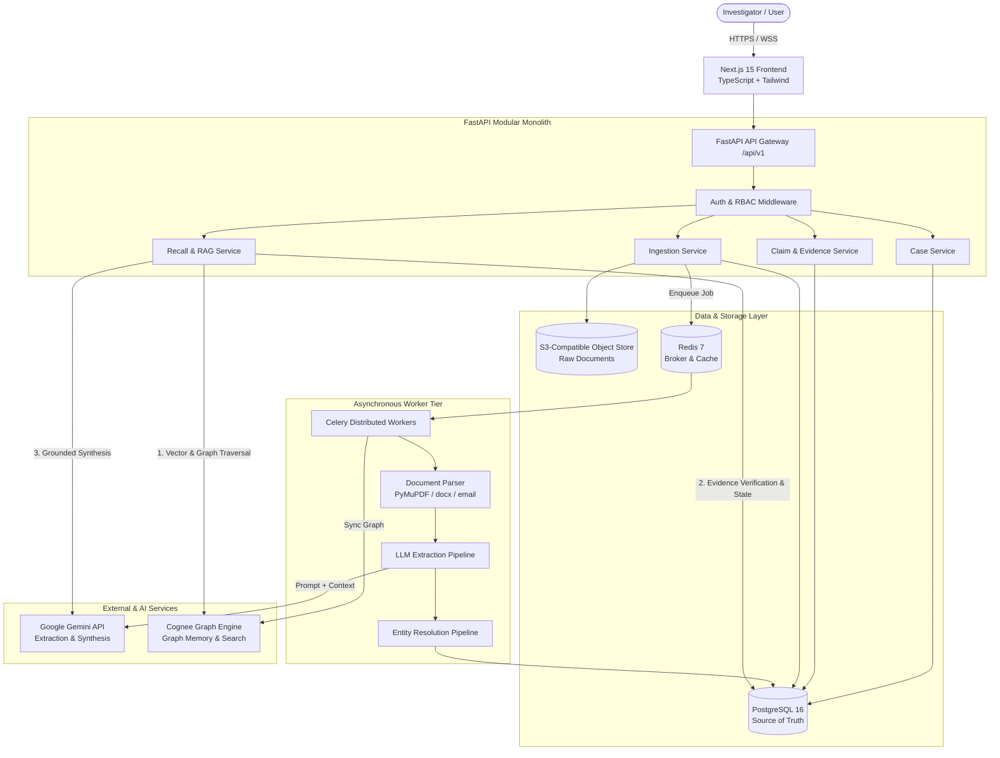

# RedThread System Architecture

## 1. System Overview

RedThread is designed as a **modular monolith** at the application tier, coupled with distributed background processing and hybrid persistence engines. It bridges standard relational domain models (organizations, users, cases, access policies) with an AI-native knowledge graph for multi-hop evidence analysis.

---

## 2. High-Level Architecture Diagram



---

## 3. Technology Stack

| Layer | Technology | Primary Responsibility |
| :--- | :--- | :--- |
| **Frontend** | Next.js 15 (App Router), TypeScript, Tailwind CSS | High-performance interactive UI, force-directed graph exploration, split-screen document viewer. |
| **State Management** | TanStack Query v5 | Server state synchronization, optimistic UI updates, request deduplication, cache invalidation. |
| **Backend Framework** | FastAPI (Python 3.11+) | Async REST API endpoints, OpenAPI documentation, strict request/response serialization. |
| **Data Validation** | Pydantic v2 | High-throughput data validation, LLM response parsing with strict type guarantees. |
| **ORM / Data Access** | SQLAlchemy 2.0 (Async) + Alembic | Declarative schema management, connection pooling, transactional migrations. |
| **Primary Relational DB** | PostgreSQL 16 | ACID source of truth: users, organizations, cases, documents, claims, sources, and audit logs. |
| **Cache & Task Broker** | Redis 7 | Celery message broker, real-time job lock management, query result caching. |
| **Task Queue** | Celery 5.x | Asynchronous background processing of multi-page files, idempotent retries, backoff handling. |
| **Graph Intelligence** | Cognee Cloud / Engine | Graph-backed memory, multi-hop relationship exploration, semantic knowledge connections. |
| **Language Model (LLM)** | Google Gemini 1.5 Pro / Flash | Structured information extraction, entity normalization, citation synthesis, contradiction analysis. |
| **Embeddings** | Text-Embedding-004 / Sentence Transformers | Passage semantic retrieval, entity token similarity scoring. |
| **File Storage** | S3-Compatible Storage (AWS S3 / Cloudflare R2 / MinIO) | Immutable storage of raw uploaded files (PDF, DOCX, TXT, CSV, EML). |
| **Observability** | Structlog, Prometheus, OpenTelemetry | Structured JSON logs, latency tracing, worker queue metrics, external API health tracking. |

---

## 4. The Hybrid Storage Rationale: PostgreSQL + Cognee

A foundational architectural decision in RedThread is separating **domain governance** from **graph reasoning**.

### PostgreSQL: Domain Source of Truth
* **Ownership & Tenancy**: Strict enforcement of Organization $\rightarrow$ Case $\rightarrow$ Document relationships with Row-Level Security (RLS) and foreign keys.
* **Auditability & Claim State**: Immutable records of every claim change, contradiction, and investigator review (`claim_events` table).
* **Idempotency & Processing State**: Ingestion job state machine, attempt counters, and document deduplication hashes.

### Cognee: Graph & Vector Intelligence Accelerator
* **Graph Traversal**: Subgraph extraction, path finding between disparate entities, and bounded relationship queries across multi-document clusters.
* **Vector Indexing**: High-dimensional vector searches for semantic passage retrieval.
* **Topology Management**: Maintaining visual adjacency and graph connectivity structures.

> [!IMPORTANT]
> **Authorization Boundary Invariant**: Cognee is an accelerator, not the authorization authority. No graph edge or node returned from Cognee is exposed to an end user until verified against PostgreSQL permissions for the user's active case membership.

---

## 5. Architectural Directory Layout

The application follows clean separation of concerns within a modular monolith:

```
backend/
├── app/
│   ├── main.py                  # FastAPI initialization & middleware registration
│   ├── dependencies.py          # Database sessions, current user, tenant context
│   ├── api/
│   │   └── v1/                  # HTTP Routers (auth, cases, documents, recall, etc.)
│   ├── core/
│   │   ├── config.py            # Pydantic BaseSettings (environment variables)
│   │   ├── security.py          # Password hashing (Argon2id), JWT generation/validation
│   │   └── exceptions.py        # Centralized HTTP and domain error definitions
│   ├── models/                  # SQLAlchemy ORM declarative models
│   ├── schemas/                 # Pydantic DTOs for requests and responses
│   ├── repositories/            # Database query abstractions
│   ├── services/                # Pure business logic services
│   ├── workers/                 # Celery app configuration and task definitions
│   ├── integrations/            # Third-party adapters (Cognee, Gemini, S3, Embeddings)
│   ├── graph/                   # Traversal algorithms, entity resolution scorers
│   └── evaluation/              # AI benchmarks, synthetic datasets, metrics calculators
├── migrations/                  # Alembic database migration scripts
└── tests/                       # Unit, integration, security, and eval test suites
```

---

## 6. End-to-End Data Flows

### A. Document Ingestion Flow
1. **Upload**: Client sends multipart document to `POST /api/v1/cases/{id}/documents`.
2. **Validation & Hashing**: Backend validates MIME type, computes SHA-256 hash (deduplication check), stores file in S3, and writes `documents` and `ingestion_jobs` records in PostgreSQL.
3. **Queueing**: FastAPI dispatches a job ID to Redis queue and responds immediately with `202 Accepted` (`{"job_id": "...", "status": "QUEUED"}`).
4. **Execution**: Celery worker parses text, chunks content, invokes Gemini for structured extraction (entities, claims, offsets), runs entity resolution, and commits records to PostgreSQL.
5. **Sync**: Worker updates Cognee graph with extracted entities and edges, then transitions the job state in PostgreSQL to `COMPLETED`.

### B. Hybrid Recall Flow
1. **Query**: Investigator submits query to `POST /api/v1/cases/{id}/recall`.
2. **Intent Parsing**: LLM identifies target entities, search constraints, and scope.
3. **Dual Retrieval**:
   - **Vector Search**: Finds semantically relevant raw text chunks.
   - **Graph Traversal**: Traverses paths between identified entities in Cognee.
4. **Authorization & State Filtering**: Graph paths and passages are cross-referenced with PostgreSQL. Retracted claims are filtered out; disputed claims are annotated.
5. **Grounded Generation**: Gemini synthesizes an answer referencing only verified claims with exact citations and path traces.
