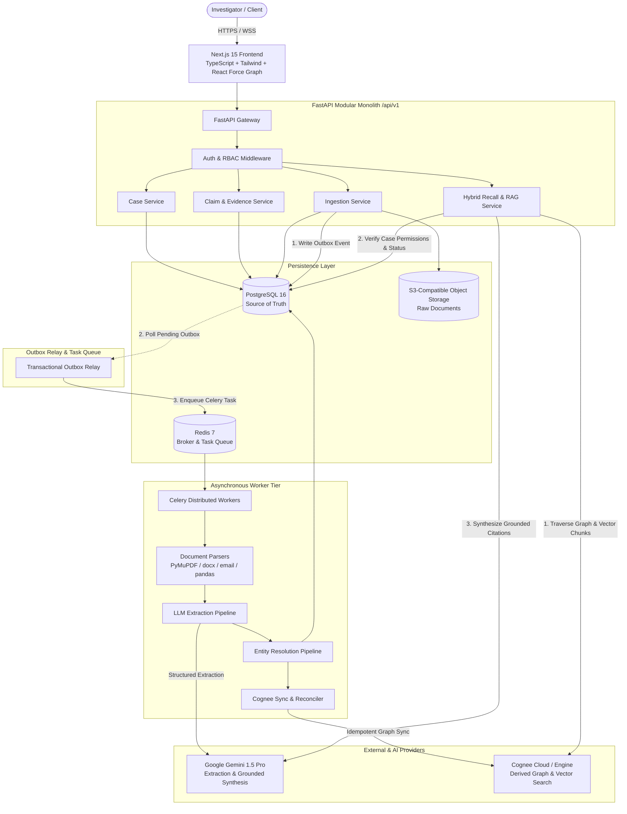

# RedThread System Architecture

> **Document Status**: `DESIGN`  
> **Canonical Blueprint**: Modular monolith architecture, component boundaries, asynchronous pipelines, and hybrid persistence.

---

## 1. System Overview & Core Principles

RedThread is engineered as a **modular monolith** at the application layer, coupled with distributed background processing and a dual-datastore architecture:
- **Evidence-First**: Every answer and relationship is grounded in source documents with exact character offsets.
- **Graph-Based Memory**: Cross-document relationships are preserved as traversable entities and attributed claims.
- **Historical Accountability**: Contradictions never silently overwrite past evidence; claims follow an audited lifecycle.

---

## 2. High-Level Architecture Diagram



---

## 3. Technology Stack & Component Responsibilities

| Layer | Technology | Version | Architectural Responsibility |
| :--- | :--- | :--- | :--- |
| **Frontend** | Next.js (App Router), React, TypeScript | 15.x / 19.x | Investigative workspace, interactive 3-panel UI, force-directed graph. |
| **Styling & State** | Tailwind CSS, TanStack Query | v4 / v5 | Server state caching, request deduplication, optimistic UI updates. |
| **API Framework** | FastAPI | 0.111+ | High-throughput async REST endpoints, OpenAPI contracts, dependency injection. |
| **Data Validation** | Pydantic | 2.7+ | Strict schema validation, DTOs, and Gemini structured output extraction. |
| **ORM & Migrations**| SQLAlchemy (Async) + Alembic | 2.0+ | ACID transactions, declarative models, schema migration management. |
| **Primary Database**| PostgreSQL | 16 | Authoritative source of truth: users, cases, documents, claims, sources, and audit logs. |
| **Task Queue & Cache**| Redis + Celery | 7 / 5.4+ | Distributed asynchronous job processing, exponential backoff, worker leasing. |
| **Graph Accelerator**| Cognee Cloud / Local Engine | 1.2+ | Derived graph-backed memory, vector search, multi-hop path traversal. |
| **LLM Provider** | Google Gemini (via `google-genai`) | 1.5 Pro | Extraction of entities, claims, offsets, and strictly grounded citation synthesis. |
| **Object Storage** | S3-Compatible (R2 / MinIO / S3) | - | Immutable binary file storage with randomized UUID tenant keys. |
| **Test Suites** | Pytest, pytest-asyncio, Playwright | - | Unit, integration, security, idempotency, and browser E2E workflows. |

---

## 4. PostgreSQL and Cognee Hybrid Storage Design

A fundamental rule of RedThread is that **PostgreSQL is the source of truth, and Cognee is a derived graph/retrieval accelerator**.

### Division of Responsibilities:
```
PostgreSQL 16 (Authoritative Source of Truth)
├── Multi-tenancy & IAM (Users, Organizations, Memberships, Case Access)
├── File Metadata & Ingestion State Machine (Documents, Chunks, Jobs)
├── Canonical Evidence Ledger (Claims, Claim Sources, Claim Events)
├── Reversible Entity Resolution (Entities, Aliases, Entity Merges)
└── Outbox Events & Audit Logs

Cognee (Derived Graph & Retrieval Accelerator)
├── Graph Construction & Adjacency Indexing
├── Bounded Path Traversal (BFS, Shortest Path)
└── Vector Semantic Similarity Indexing
```

### Authorization Boundary Invariant
> [!IMPORTANT]
> **Zero Trust in Derived Layers**: Cognee does not enforce application tenancy or case permissions. Every node, edge, and passage returned from Cognee must be cross-referenced against PostgreSQL case permissions before returning to the user.

---

## 5. Ingestion & Graph Synchronization Resilience

### 5.1 Transactional Outbox Pattern
To prevent distributed transaction failures between PostgreSQL and Redis:
1. When a document upload is accepted, the API writes the document record and inserts a `DOCUMENT_INGESTION_REQUESTED` row into `outbox_events` in the **same database transaction**.
2. An asynchronous outbox publisher reads pending outbox events and pushes tasks to Redis.
3. This guarantees that a document record is never orphaned without a corresponding processing task.

### 5.2 Independently Retryable & Idempotent Graph Synchronization
Because external network calls to Cognee or Gemini cannot be rolled back by PostgreSQL database transactions:
- The worker executes database writes (persisting entities and claims) **first**.
- Next, the worker synchronizes entities and relationships into Cognee using an **idempotent sync function** (keyed by entity and claim UUIDs).
- If Cognee synchronization fails due to a network timeout or provider outage, the job is transitioned to `FAILED` with retry backoff.
- On retry, existing database records are recognized via unique constraints, and the synchronization resumes without creating duplicate nodes or edges.
- A periodic **Reconciliation Worker** runs background consistency audits between PostgreSQL claims and Cognee graph edges.

---

## 6. End-to-End Request Lifecycles

### 6.1 Ingestion Request Lifecycle
1. `POST /api/v1/cases/{id}/documents` $\rightarrow$ Validate MIME magic bytes & compute SHA-256.
2. Store file bytes in S3; write `documents`, `ingestion_jobs`, and `outbox_events` (`status: PENDING`) in PostgreSQL.
3. Return `202 Accepted` with `job_id` and `document_id`.
4. Outbox relay dispatches task to Redis $\rightarrow$ Celery worker picks up task.
5. Worker parses pages (PyMuPDF), chunks text, calls Gemini for structured extraction, runs weighted entity resolution, and commits records to PostgreSQL.
6. Worker syncs nodes/edges to Cognee, marks `ingestion_jobs` as `COMPLETED`, and emits SSE event.

### 6.2 Hybrid Recall Request Lifecycle
1. `POST /api/v1/cases/{id}/recall` $\rightarrow$ Authenticate user & verify case membership.
2. Query Understanding extracts target entity names and intent.
3. Execute dual retrieval:
   - **Graph Traversal**: Discover shortest paths and bounded neighborhoods in Cognee.
   - **Vector Retrieval**: Fetch top-$K$ semantic text chunks.
4. Filter out retracted claims, flag disputed claims, and verify all claims belong to authorized cases.
5. Synthesize grounded answer via Gemini using strictly formatted citations (`[Claim #ID]`).
6. Return answer, verified graph path, and source citations.
