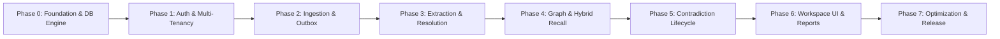
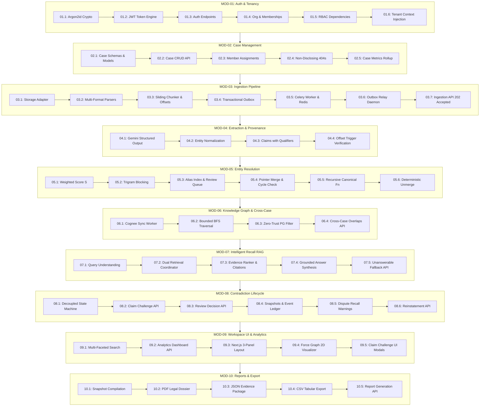

# RedThread Phased Modular Implementation Plan

> **Plan Status**: `ACTIVE`  
> **Target System**: RedThread Production Modular Monolith  
> **Specification Reference**: [Final Documentation Audit](FINAL_DOCUMENTATION_AUDIT.md) & [Implementation Readiness Checklist](IMPLEMENTATION_READINESS_CHECKLIST.md)

---

## 1. Overview & Phased Architecture

To transform the complete 10-module RedThread specification into manageable, testable, and verifiable units of work, the implementation is decomposed into **8 sequential phases** comprising **45 granular engineering tasks**.

---

## 2. Granular Task Breakdown by Module & Phase

### 🟢 Phase 0: System Foundation, Infrastructure & Database Engine
*Focus: Clean modular monolith layout, configuration loading, local containerized services, SQLAlchemy 2.0 async engine, 18-table relational models, Alembic migrations, and test harness.*

- [ ] **Task 0.1: Project Directory Reorganization**
  - Establish `backend/app/` (`core/`, `api/v1/`, `models/`, `repositories/`, `services/`, `workers/`, `schemas/`).
  - Establish `infrastructure/` and `backend/tests/` (`unit/`, `integration/`, `security/`).
- [ ] **Task 0.2: Configuration & Structured Logging**
  - Implement `backend/app/core/config.py` using `pydantic_settings.BaseSettings` for `.env` loading.
  - Implement `backend/app/core/logging.py` for structured JSON logs with correlation IDs.
- [ ] **Task 0.3: Containerized Infrastructure Definition**
  - Create `infrastructure/docker-compose.yml` defining PostgreSQL 16, Redis 7, and MinIO.
- [ ] **Task 0.4: SQLAlchemy 2.0 Async Models (All 18 Tables)**
  - Implement complete models in `backend/app/models/` matching the audited schema: `organizations`, `users`, `memberships`, `cases`, `case_members`, `documents`, `document_chunks`, `ingestion_jobs`, `entities`, `entity_aliases`, `entity_merge_events`, `case_entities`, `claims`, `claim_sources`, `claim_versions`, `claim_events`, `outbox_events`, `audit_logs`, `reports`.
  - Include ENUMs (`claim_type`, `claim_status`, `review_outcome`, `org_role`, `case_status`, `ingestion_status`, `outbox_status`, `claim_event_type`).
  - Include composite foreign keys and constraints (`chk_claim_target_exclusivity`, `chk_doc_offsets_valid`, `chk_chunk_offsets_valid`).
- [ ] **Task 0.5: Alembic Migration Harness & Database Setup**
  - Configure `alembic/` with async migration runner (`run_migrations_online`).
  - Create initial migration revision `0001_initial_schema.py` containing complete DDL, triggers (`trg_prevent_entity_merge_cycles`, `trg_validate_claim_source_chunk_offsets`), functions (`fn_get_canonical_entity_id`, `app.has_case_access`), and RLS policies.
- [ ] **Task 0.6: Baseline Test Harness**
  - Create `backend/tests/conftest.py` with async database fixtures and transaction rollback wrappers.
  - Add unit tests validating configuration loading and model schemas.

---

### ⚪ Phase 1: Authentication & Multi-Tenancy (MOD-01)
*Focus: Cryptographic password hashing, rotating JWT sessions, organization boundaries, RBAC matrix, and PostgreSQL Row-Level Security.*

- [ ] **Task 1.1: Cryptographic Engine**
  - Implement `backend/app/core/security.py` with Argon2id password hashing and JWT access/refresh token generation.
- [ ] **Task 1.2: Authentication Service & Endpoints**
  - Implement `backend/app/api/v1/auth.py` (`POST /register`, `POST /login`, `POST /refresh`, `POST /logout`).
  - Implement refresh token rotation and reuse revocation in `backend/app/services/auth_service.py`.
- [ ] **Task 1.3: Organization Management Service & APIs**
  - Implement `backend/app/api/v1/organizations.py` (organization provisioning, member invitations, role updates).
- [ ] **Task 1.4: RBAC Dependency Injection**
  - Implement FastAPI dependencies (`get_current_user`, `require_org_admin`, `require_investigator`, `require_reviewer`).
- [ ] **Task 1.5: Database Session Tenant Context Injection**
  - Update database session dependency to execute `SET LOCAL app.current_org_id` and `SET LOCAL app.current_user_id`.
- [ ] **Task 1.6: Security & Isolation Test Suite**
  - Implement `backend/tests/security/test_tenant_isolation.py` and `test_token_security.py`.

---

### ⚪ Phase 2: Case Management & Document Ingestion (MOD-02 & MOD-03)
*Focus: Case workspaces, S3 storage client, multi-format parsers, sliding-window chunking, Transactional Outbox, and Celery workers.*

- [ ] **Task 2.1: Case Management Domain & APIs**
  - Implement `backend/app/api/v1/cases.py` (case creation, listing, member assignment, non-disclosing 404s).
- [ ] **Task 2.2: Object Storage Adapter**
  - Implement `backend/app/core/storage.py` (S3/MinIO upload, download, presigned URLs).
- [ ] **Task 2.3: Document Format Parsers**
  - Implement `backend/app/services/parsers/` (PyMuPDF for PDF, python-docx for DOCX, email for EML, pandas for CSV).
  - Implement magic byte MIME validation via `python-magic`.
- [ ] **Task 2.4: Sliding-Window Text Chunker**
  - Implement `backend/app/services/chunker.py` (500-token chunks with 50-token overlap, tracking exact start/end character offsets).
- [ ] **Task 2.5: Transactional Outbox Event Publisher**
  - Implement `backend/app/services/outbox_service.py` to write `outbox_events` within document creation transactions.
- [ ] **Task 2.6: Celery Worker & Redis Broker Setup**
  - Implement `backend/app/workers/celery_app.py` and ingestion task worker.
- [ ] **Task 2.7: Outbox Relay Daemon**
  - Implement outbox poller using `FOR UPDATE SKIP LOCKED` and Celery task dispatch.
- [ ] **Task 2.8: Document Upload API & State Machine**
  - Implement `POST /api/v1/cases/{id}/documents` (returns `202 Accepted` with job tracking).

---

### ⚪ Phase 3: Knowledge Extraction & Entity Resolution (MOD-04 & MOD-05)
*Focus: Gemini structured extraction, verbatim offset tracking, weighted entity resolution, pointer-based merges, and Cognee sync.*

- [ ] **Task 3.1: Gemini 1.5 Pro Extraction Service**
  - Implement `backend/app/services/extraction_service.py` using `google-genai` and Pydantic structured output.
- [ ] **Task 3.2: Evidence Offset Alignment & Trigger Verification**
  - Implement `backend/app/repositories/claim_source_repository.py` enforcing offset containment.
- [ ] **Task 3.3: Weighted Entity Resolution Service**
  - Implement scoring $S = 0.35N + 0.25A + 0.25C + 0.15T$ and RapidFuzz candidate blocking.
- [ ] **Task 3.4: Alias Indexing & Review Queue APIs**
  - Implement `backend/app/api/v1/entities.py` (entity search, alias management, manual review queue).
- [ ] **Task 3.5: Pointer-Based Reversible Merge Hierarchy**
  - Implement entity merge service (`entities.merged_into_id`) with cycle check trigger and audit logging.
- [ ] **Task 3.6: Recursive Canonical Resolution & Deterministic Unmerge**
  - Implement unmerge workflow resetting `merged_into_id = NULL` without mutating claims.
- [ ] **Task 3.7: Idempotent Cognee Graph Synchronization Worker**
  - Implement Cognee edge synchronization with aggregate version sequence checks.

---

### ⚪ Phase 4: Knowledge Graph & Hybrid Recall (MOD-06 & MOD-07)
*Focus: Intent parsing, dual graph-vector retrieval, permission filtering, citation verification, grounded prompt synthesis, and unanswerable fallback.*

- [ ] **Task 4.1: Query Understanding & Entity Extraction**
  - Extract entities and relation intents from user query.
- [ ] **Task 4.2: Dual Retrieval Coordinator**
  - Implement simultaneous vector similarity search + bounded BFS graph traversal ($N \le 4$).
- [ ] **Task 4.3: PostgreSQL Permission Filter (Zero Trust in Cognee)**
  - Validate all traversed nodes and edges against user case authorization in PostgreSQL.
- [ ] **Task 4.4: Cross-Case Entity Overlap Discovery API**
  - Implement `GET /api/v1/cases/{id}/overlaps`.
- [ ] **Task 4.5: Evidence Ranker & Citation Offset Verifier**
  - Verify that `claim_sources` character offsets match verbatim text in raw document bytes.
- [ ] **Task 4.6: Grounded Answer Synthesis**
  - Implement Gemini synthesis with strict `[Claim #ID]` tokens.
- [ ] **Task 4.7: Fallback & Recall API**
  - Implement `POST /api/v1/cases/{id}/recall` with *"The available evidence does not establish a connection"* fallback.

---

### ⚪ Phase 5: Contradiction Management & Claim Lifecycle (MOD-08)
*Focus: Decoupled claim states, dispute challenge endpoints, review decisions, immutable versioning, dispute recall warnings, and reinstatement.*

- [ ] **Task 5.1: Claim Domain Service & Repository**
  - Implement decoupled `status` and `review_outcome` transitions in `backend/app/services/claim_service.py`.
- [ ] **Task 5.2: Dispute Challenge API**
  - Implement `POST /api/v1/claims/{id}/challenge` with counter-document attribution.
- [ ] **Task 5.3: Review Decision API**
  - Implement `POST /api/v1/claims/{id}/review` (`UPHELD`, `REJECTED`, `INCONCLUSIVE`).
- [ ] **Task 5.4: Immutable Snapshots & Audit Ledger**
  - Write immutable entries to `claim_versions` and `claim_events` on every transition.
- [ ] **Task 5.5: Contradiction Recall Adaptation**
  - Inject dispute warnings for `DISPUTED` claims and exclude `RETRACTED` claims from default recall.
- [ ] **Task 5.6: Claim Reinstatement API**
  - Implement `POST /api/v1/claims/{id}/reinstate`.

---

### ⚪ Phase 6: Frontend Investigation Workspace & Reports (MOD-09 & MOD-10)
*Focus: Next.js 15 App Router, 3-panel workspace, Force Graph 2D with dispute styling, claim challenge modals, and frozen dossier export.*

- [ ] **Task 6.1: Next.js 15 App Shell & Auth Provider**
  - Configure App Router, TanStack Query v5, and authentication context.
- [ ] **Task 6.2: 3-Panel Investigation Workspace Layout**
  - Build Left Panel (documents/cases), Center Panel (graph/reader), Right Panel (evidence/claims).
- [ ] **Task 6.3: Force Graph 2D Component with Dispute Styling**
  - Render entity nodes and directed edges with amber dashed dispute styling.
- [ ] **Task 6.4: Claim Challenge & Review Modal Dialogs**
  - Implement UI workflows for challenging and reviewing evidence.
- [ ] **Task 6.5: Multi-Faceted Search & Analytics Dashboard**
  - Implement entity search, status filtering, and throughput metrics.
- [ ] **Task 6.6: Frozen Dossier Report Generation (PDF, JSON, CSV)**
  - Implement `POST /api/v1/cases/{id}/reports` and downloadable evidentiary dossier.

---

### ⚪ Phase 7: Optimization, Benchmark & Production Readiness
*Focus: Index tuning, Redis subgraph caching, 200-question ground-truth benchmark suite, latency SLA validation, and automated CI/CD.*

- [ ] **Task 7.1: Database Index Tuning & Redis Caching**
  - Verify query execution plans via EXPLAIN ANALYZE and implement Redis subgraph caching.
- [ ] **Task 7.2: 200-Question Ground-Truth Benchmark Runner**
  - Implement evaluation runner across Dev (60), Val (40), and Held-Out Test (100) splits.
- [ ] **Task 7.3: Accuracy, Faithfulness & Citation Verification**
  - Measure Faithfulness ($\ge 98\%$), Unsupported Rate ($0.0\%$), and Citation Precision.
- [ ] **Task 7.4: Concurrency & Latency SLA Load Testing**
  - Validate median retrieval latency $< 500\text{ ms}$ and p95 query latency $< 5.0\text{ s}$ via Locust.
- [ ] **Task 7.5: Production CI/CD Pipeline**
  - Implement GitHub Actions workflow running linting, type checks (`mypy`), tests, and build.

---

## 3. Independent Module-by-Module Decomposition (MOD-01 through MOD-10)

Each of RedThread's 10 modules is partitioned into independent, self-contained sub-phases. Every sub-phase specifies clear input contracts, required components, output artifacts, and dedicated test verification targets.

---

### Detailed Specification for Each Independent Module:

#### 1. Module 01: Authentication & Organization Management (`MOD-01`)
*Responsibility: Multi-tenant identity, session lifecycle, cryptographic security, and RBAC matrix.*

| Sub-Phase | Title | Deliverables | Verification Command |
| :--- | :--- | :--- | :--- |
| **MOD-01.1** | Cryptographic Primitives | `backend/app/core/security.py` (Argon2id hasher, salt generator, password verifier) | `pytest backend/tests/unit/test_crypto.py` |
| **MOD-01.2** | JWT Token Engine | Access token (15m) + rotating refresh token (7d) generation, SHA-256 hash storage | `pytest backend/tests/unit/test_tokens.py` |
| **MOD-01.3** | Auth Endpoints | `/api/v1/auth` (`/register`, `/login`, `/refresh`, `/logout`) | `pytest backend/tests/integration/test_auth_api.py` |
| **MOD-01.4** | Organization & Memberships | `/api/v1/organizations` (org creation, invites, member role updates) | `pytest backend/tests/integration/test_org_api.py` |
| **MOD-01.5** | RBAC Dependencies | FastAPI dependencies: `get_current_user`, `require_org_admin`, `require_investigator` | `pytest backend/tests/security/test_rbac_deps.py` |
| **MOD-01.6** | Tenant Context Session | DB session wrapper injecting `SET LOCAL app.current_org_id` and `app.current_user_id` | `pytest backend/tests/security/test_tenant_isolation.py` |

---

#### 2. Module 02: Case Management (`MOD-02`)
*Responsibility: Isolated investigation workspaces, investigator assignments, and cross-case boundaries.*

| Sub-Phase | Title | Deliverables | Verification Command |
| :--- | :--- | :--- | :--- |
| **MOD-02.1** | Case Schemas & Models | Pydantic schemas: `CaseCreate`, `CaseUpdate`, `CaseResponse`, `CaseMemberAdd` | `pytest backend/tests/unit/test_case_schemas.py` |
| **MOD-02.2** | Case Workspace API | `/api/v1/cases` (list, create, get, update status: `ACTIVE`, `ARCHIVED`, `CLOSED`) | `pytest backend/tests/integration/test_case_crud.py` |
| **MOD-02.3** | Investigator Assignment | `/api/v1/cases/{id}/members` (assign, remove, update member roles) | `pytest backend/tests/integration/test_case_members.py` |
| **MOD-02.4** | Security IDOR Guards | Non-disclosing 404 handler when unauthorized user requests another tenant's case UUID | `pytest backend/tests/security/test_idor_probes.py` |
| **MOD-02.5** | Case Metrics Rollup | Summary rollups: document count, entity count, claim count, active disputes | `pytest backend/tests/integration/test_case_metrics.py` |

---

#### 3. Module 03: Document Ingestion Pipeline (`MOD-03`)
*Responsibility: Asynchronous multi-format document parsing, chunking, S3 storage, and Transactional Outbox.*

| Sub-Phase | Title | Deliverables | Verification Command |
| :--- | :--- | :--- | :--- |
| **MOD-03.1** | Object Storage Client | `backend/app/core/storage.py` (S3/MinIO upload, download, presigned URLs) | `pytest backend/tests/integration/test_storage.py` |
| **MOD-03.2** | Multi-Format Parsers | `backend/app/services/parsers/` (PyMuPDF for PDF, python-docx, EML, CSV) | `pytest backend/tests/unit/test_parsers.py` |
| **MOD-03.3** | Sliding-Window Chunker | `backend/app/services/chunker.py` (500 tokens, 50 overlap, exact document offsets) | `pytest backend/tests/unit/test_chunking.py` |
| **MOD-03.4** | Transactional Outbox | `backend/app/services/outbox_service.py` (atomic commit of doc + `outbox_events`) | `pytest backend/tests/integration/test_outbox_commit.py` |
| **MOD-03.5** | Celery Worker Setup | `backend/app/workers/celery_app.py` & ingestion task with exponential backoff | `pytest backend/tests/integration/test_celery_task.py` |
| **MOD-03.6** | Outbox Relay Daemon | Outbox poller using `SELECT ... FOR UPDATE SKIP LOCKED` and Celery dispatch | `pytest backend/tests/integration/test_outbox_relay.py` |
| **MOD-03.7** | Ingestion API | `POST /api/v1/cases/{id}/documents` (returns `202 Accepted` with `job_id`) | `pytest backend/tests/integration/test_ingest_api.py` |

---

#### 4. Module 04: Entity and Relationship Extraction (`MOD-04`)
*Responsibility: Gemini 1.5 Pro structured extraction, Pydantic validation, verbatim offset tracking, and typed qualifiers.*

| Sub-Phase | Title | Deliverables | Verification Command |
| :--- | :--- | :--- | :--- |
| **MOD-04.1** | Gemini Extraction | `backend/app/services/extraction_service.py` with `google-genai` and `ExtractionResult` | `pytest backend/tests/integration/test_gemini_extraction.py` |
| **MOD-04.2** | Schema Validation | Pydantic schemas validating extracted entities, relationships, confidence scores | `pytest backend/tests/unit/test_extraction_schemas.py` |
| **MOD-04.3** | Typed Qualifiers | Extraction of structured qualifiers (`amount`, `currency`, `date`) into `qualifiers JSONB` | `pytest backend/tests/unit/test_qualifiers.py` |
| **MOD-04.4** | Coordinate Verification | Verifying `chunk_local_start_offset = doc_start_offset - chunk.start_char` trigger | `pytest backend/tests/integration/test_offset_trigger.py` |

---

#### 5. Module 05: Entity Resolution (`MOD-05`)
*Responsibility: Weighted scoring ($S$), trigram candidate blocking, alias index, review queue, and pointer-based merges.*

| Sub-Phase | Title | Deliverables | Verification Command |
| :--- | :--- | :--- | :--- |
| **MOD-05.1** | Weighted Scoring Engine | Formula $S = 0.35N + 0.25A + 0.25C + 0.15T$ implementation in `resolution_service.py` | `pytest backend/tests/unit/test_scoring.py` |
| **MOD-05.2** | Trigram Blocking | PostgreSQL GIN trigram candidate search on `canonical_name` and `alias` ($< 50$ pool) | `pytest backend/tests/integration/test_trigram_search.py` |
| **MOD-05.3** | Review Queue API | `/api/v1/cases/{id}/entity-review` (listing candidates with $S \in [0.70, 0.90)$) | `pytest backend/tests/integration/test_review_queue.py` |
| **MOD-05.4** | Pointer Merge Hierarchy | Entity merge setting `entities.merged_into_id = B`, cycle prevention trigger check | `pytest backend/tests/integration/test_entity_merge.py` |
| **MOD-05.5** | Recursive Resolution | `fn_get_canonical_entity_id(UUID)` walking merge chains to canonical root | `pytest backend/tests/integration/test_canonical_fn.py` |
| **MOD-05.6** | Deterministic Unmerge | Resetting `merged_into_id = NULL` without mutating claims or corrupting provenance | `pytest backend/tests/integration/test_entity_unmerge.py` |

---

#### 6. Module 06: Knowledge Graph & Cross-Case Intelligence (`MOD-06`)
*Responsibility: Cognee graph synchronization, bounded BFS traversal, zero-trust filtering, and cross-case overlaps.*

| Sub-Phase | Title | Deliverables | Verification Command |
| :--- | :--- | :--- | :--- |
| **MOD-06.1** | Cognee Edge Sync | Worker synchronizing claims to Cognee edges; ignores out-of-order versions | `pytest backend/tests/integration/test_cognee_sync.py` |
| **MOD-06.2** | Bounded BFS Traversal | Traversal discovering paths between seed entities up to fixed depth ($N \le 4$) | `pytest backend/tests/unit/test_bfs_traversal.py` |
| **MOD-06.3** | Zero-Trust Filtering | SQL filter stripping Cognee nodes/edges belonging to unauthorized cases | `pytest backend/tests/security/test_graph_permissions.py` |
| **MOD-06.4** | Cross-Case Overlaps | `/api/v1/cases/{id}/overlaps` (discovering shared entities across authorized cases) | `pytest backend/tests/integration/test_cross_case_api.py` |

---

#### 7. Module 07: Intelligent Recall & Grounded RAG (`MOD-07`)
*Responsibility: 13-stage hybrid recall pipeline, citation offset validation, grounded answer synthesis, and fallback handling.*

| Sub-Phase | Title | Deliverables | Verification Command |
| :--- | :--- | :--- | :--- |
| **MOD-07.1** | Query Understanding | Extracting seed entities and intent from investigator natural language query | `pytest backend/tests/unit/test_query_parser.py` |
| **MOD-07.2** | Dual Retrieval | Simultaneous vector similarity search on chunks + bounded BFS graph traversal | `pytest backend/tests/integration/test_dual_retrieval.py` |
| **MOD-07.3** | Evidence Ranker | Ranking claims by extraction confidence, authority, and path length | `pytest backend/tests/unit/test_evidence_ranking.py` |
| **MOD-07.4** | Grounded Synthesis | Gemini prompt synthesizing answers citing only verified `[Claim #ID]` tokens | `pytest backend/tests/integration/test_grounded_synthesis.py` |
| **MOD-07.5** | Unanswerable Fallback | Returning exact *"The available evidence does not establish a connection"* fallback | `pytest backend/tests/integration/test_unanswerable_fallback.py` |

---

#### 8. Module 08: Contradiction Detection & Intelligent Forgetting (`MOD-08`)
*Responsibility: Decoupled claim states, dispute challenge endpoints, review decisions, immutable snapshots, and audited historical recall.*

| Sub-Phase | Title | Deliverables | Verification Command |
| :--- | :--- | :--- | :--- |
| **MOD-08.1** | Decoupled State Machine | Domain logic enforcing `status` (`ACTIVE`, `DISPUTED`, `RETRACTED`) vs `review_outcome` | `pytest backend/tests/unit/test_claim_states.py` |
| **MOD-08.2** | Dispute Challenge API | `POST /api/v1/claims/{id}/challenge` (transition to `DISPUTED` with counter-evidence) | `pytest backend/tests/integration/test_claim_challenge.py` |
| **MOD-08.3** | Review Decision API | `POST /api/v1/claims/{id}/review` (`UPHELD`, `REJECTED`, `INCONCLUSIVE`) | `pytest backend/tests/integration/test_claim_review.py` |
| **MOD-08.4** | Immutable Snapshots | Appending rows to `claim_versions` and audit transitions in `claim_events` | `pytest backend/tests/integration/test_claim_versions.py` |
| **MOD-08.5** | Dispute Recall Warnings | Injecting amber dispute warnings and counter-citations into RAG synthesis | `pytest backend/tests/integration/test_dispute_recall.py` |
| **MOD-08.6** | Reinstatement API | `POST /api/v1/claims/{id}/reinstate` (transition from `RETRACTED` back to `ACTIVE`) | `pytest backend/tests/integration/test_claim_reinstatement.py` |

---

#### 9. Module 09: Search, Analytics & Investigation Workspace (`MOD-09`)
*Responsibility: Multi-faceted search, throughput analytics, 3-panel UI workbench, and Force Graph 2D component.*

| Sub-Phase | Title | Deliverables | Verification Command |
| :--- | :--- | :--- | :--- |
| **MOD-09.1** | Multi-Faceted Search | `/api/v1/search` (filtering by entity type, date range, case number, status) | `pytest backend/tests/integration/test_search_api.py` |
| **MOD-09.2** | Analytics Dashboard | `/api/v1/analytics/dashboard` (throughput, failure rates, claim status counts) | `pytest backend/tests/integration/test_analytics_api.py` |
| **MOD-09.3** | 3-Panel Workspace Shell | Next.js 15 App layout (Left: case/docs, Center: graph/reader, Right: evidence) | `npx playwright test tests/e2e/workspace_layout.spec.ts` |
| **MOD-09.4** | Force Graph 2D Visualizer | Graph rendering with amber dashed lines for disputed claims | `npx playwright test tests/e2e/graph_render.spec.ts` |
| **MOD-09.5** | Dispute UI Modals | Modal dialogs for submitting claim challenges and viewing version history | `npx playwright test tests/e2e/claim_modals.spec.ts` |

---

#### 10. Module 10: Reports and Export (`MOD-10`)
*Responsibility: Frozen evidentiary dossier snapshots, legal PDF dossiers, JSON machine-readable packages, and CSV exports.*

| Sub-Phase | Title | Deliverables | Verification Command |
| :--- | :--- | :--- | :--- |
| **MOD-10.1** | Snapshot Compilation | `backend/app/services/report_service.py` (freezing claims, sources, and dispute states) | `pytest backend/tests/unit/test_report_compilation.py` |
| **MOD-10.2** | Legal PDF Generator | Formatted evidentiary dossier with entity rosters, claim tables, and offset citations | `pytest backend/tests/integration/test_pdf_export.py` |
| **MOD-10.3** | JSON Package Export | Machine-readable JSON package including full graph topology and provenance | `pytest backend/tests/integration/test_json_export.py` |
| **MOD-10.4** | CSV Tabular Export | Tabular CSV export of entities, relationships, and audit trail timeline | `pytest backend/tests/integration/test_csv_export.py` |
| **MOD-10.5** | Report API Endpoints | `/api/v1/cases/{id}/reports` (generate, list, download frozen reports) | `pytest backend/tests/integration/test_report_api.py` |

---

## 4. Related Documents
- [Master Documentation Index](../README.md)
- [Final Documentation Audit](FINAL_DOCUMENTATION_AUDIT.md)
- [Implementation Readiness Checklist](IMPLEMENTATION_READINESS_CHECKLIST.md)
- [Development Roadmap](../roadmap.md)

