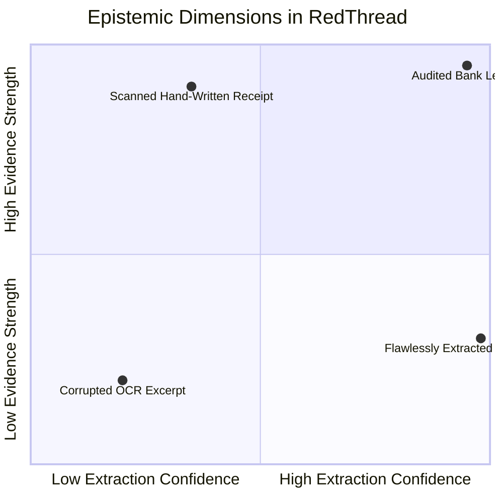
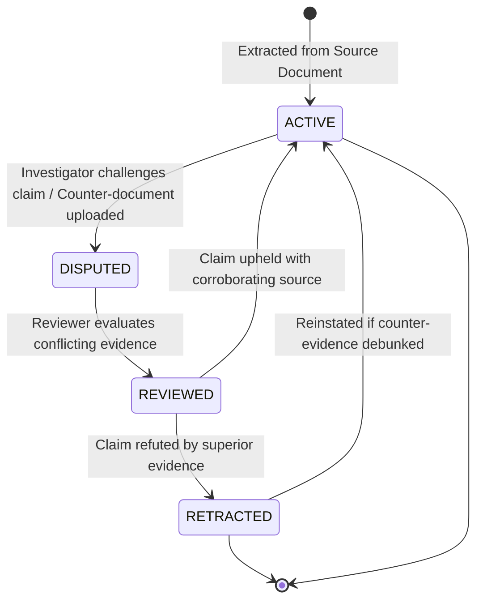

# RedThread Contradiction Management & Claim Lifecycle

## 1. Signature Differentiator: Historical Accountability

In real-world investigations, facts evolve and testimonies clash:
* **Report 1 (June 2025)**: *"John Smith initiated wire transfer #892 to Offshore Account X."*
* **Report 2 (October 2025)**: *"Forensic audit proves wire transfer #892 was executed by a rogue financial officer using John Smith's compromised credentials."*

Traditional RAG and vector databases handle this destructively: they either overwrite the old vector embedding, return an incoherent blend of contradictory passages, or hallucinate an impossible compromise.

**RedThread preserves both pieces of evidence, tracks the controversy explicitly, and models contradictory claims as first-class graph elements.**

---

## 2. The Three Orthogonal Dimensions of Truth

A critical architectural principle in RedThread is avoiding the temptation to collapse evidence quality into a single floating-point number:



1. **Extraction Confidence ($E_c \in [0, 1]$)**: The LLM/parser's certainty that the document *actually states* what was extracted. (e.g., clear digital text = $0.99$; blurry scan = $0.60$).
2. **Evidence Strength ($E_s \in [0, 1]$)**: The evidentiary weight of the underlying document (e.g., sworn affidavit / audited ledger vs. hearsay email / unverified rumor).
3. **Review Status ($R_s \in \{\text{ACTIVE}, \text{DISPUTED}, \text{REVIEWED}, \text{RETRACTED}\}$)**: The formal investigative status of the claim assigned by an authorized human investigator.

---

## 3. Claim State Machine

Claims progress through a strictly audited state machine:



### State Behavior in Retrieval & Graph Views:
* **`ACTIVE`**: Fully included in knowledge graph traversal, path finding, and default LLM recall answers.
* **`DISPUTED`**: Included in graph queries, rendered with visual alert styling (dashed amber lines). The LLM is **required** to explicitly cite the dispute and present both viewpoints.
* **`REVIEWED`**: Indicates a formal review decision has been recorded; status transitions to `ACTIVE` or `RETRACTED`.
* **`RETRACTED`**: Excluded from default graph path traversal and standard AI recall answers. Retained in database and visible in historical audit tabs and report generation.

---

## 4. The `claim_events` Immutable Ledger

Every claim state transition writes an append-only event record:

```sql
INSERT INTO claim_events (
    claim_id,
    event_type,
    actor_id,
    prior_status,
    new_status,
    reason,
    metadata
) VALUES (
    'c101-uuid',
    'CLAIM_CHALLENGED',
    'user-bob-uuid',
    'ACTIVE',
    'DISPUTED',
    'Report B (Doc #45, Page 12) demonstrates account takeover prior to transfer.',
    '{"counter_document_id": "doc-45-uuid", "page": 12}'
);
```

---

## 5. Concrete Query Answer Transformation

### Query: *"What was John Smith's involvement in the transfer to Offshore Account X?"*

#### Scenario A: Prior to Contradiction (Claim Status: `ACTIVE`)
> **Answer**:  
> John Smith initiated a wire transfer of $50,000 to Offshore Account X on 14 June 2025.  
> **Evidence**:  
> - Wire Transfer Summary Report (Doc #12, Page 4).  
> **Graph Path**:  
> `John Smith` $\xrightarrow{\text{INITIATED}}$ `Transfer #892` $\xrightarrow{\text{CREDITED\_TO}}$ `Offshore Account X`.

#### Scenario B: After Contradiction (Claim Status: `DISPUTED`)
> **Answer**:  
> The attribution of wire transfer #892 to John Smith is **currently disputed**.  
> - **Initial Claim**: Wire Transfer Summary Report (Doc #12, Page 4) documents the transfer under John Smith's name.  
> - **Counter Evidence**: Forensic IT Audit (Doc #45, Page 12) asserts John Smith's credentials were compromised prior to the transaction, attributing the transfer to an unauthorized party.  
> - **Conclusion**: The available evidence does not establish John Smith's direct involvement conclusively.  
> **Warnings**:  
> ⚠️ *Claim #c101 is marked DISPUTED by Investigator Bob.*
