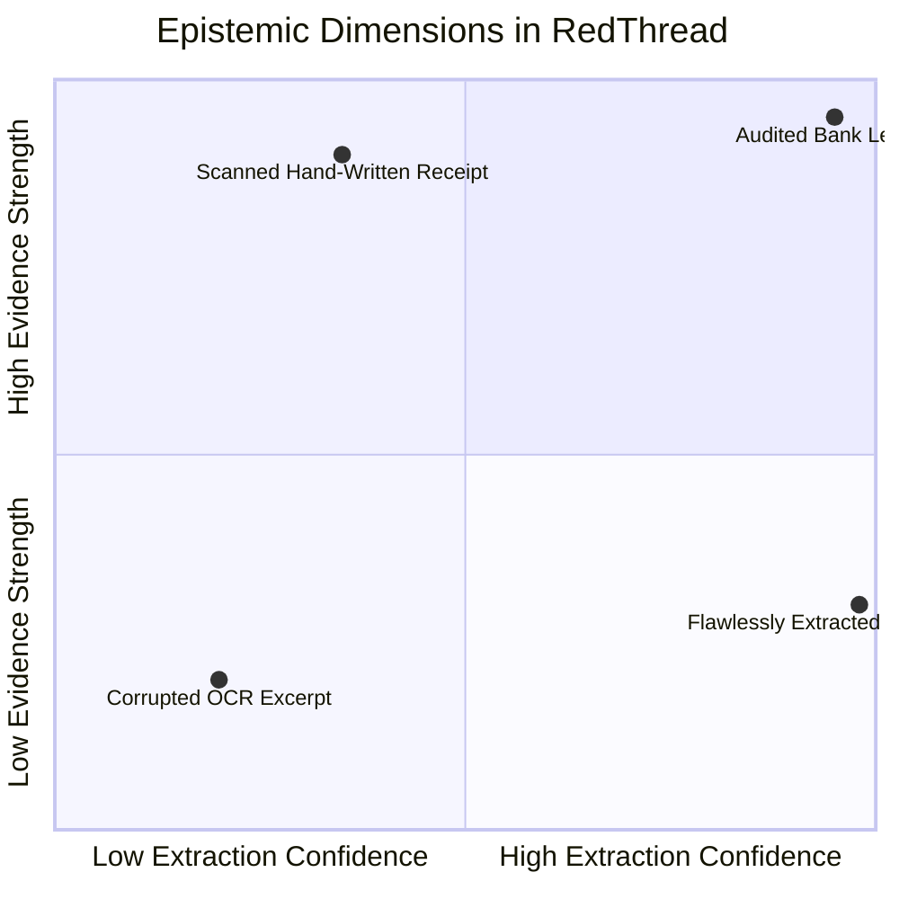
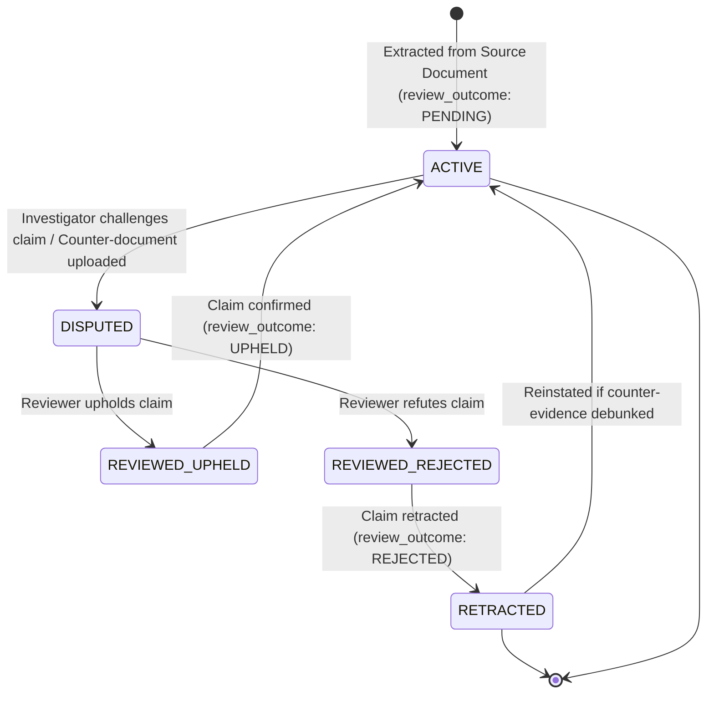

# RedThread Contradiction Management & Claim Lifecycle

> **Document Status**: `DESIGN`  
> **Signature Differentiator**: Non-destructive evidence handling, explicit dispute states, and historical accountability.

---

## 1. The Core Philosophy: Historical Accountability

In real-world investigations, facts evolve and testimonies clash:
* **Report 1 (June 2025)**: *"John Smith initiated wire transfer #892 to Offshore Account X."*
* **Report 2 (October 2025)**: *"Forensic audit proves wire transfer #892 was executed by a rogue financial officer using John Smith's compromised credentials."*

Traditional RAG and vector databases handle this destructively: they either overwrite the old vector embedding, return an incoherent blend of contradictory passages, or hallucinate an impossible compromise.

**RedThread preserves both pieces of evidence, tracks the controversy explicitly, and models contradictory claims as first-class graph elements.**

---

## 2. Separation of Claim Status vs. Review Outcome

A critical architectural requirement in RedThread is separating the **operational state of a claim** from the **investigative review outcome**:

| Concept | Enum Values | Meaning |
| :--- | :--- | :--- |
| **Claim Status (`status`)** | `ACTIVE` | Normal evidence; included in default graph traversal and AI recall. |
| | `DISPUTED` | Claim has been formally challenged; highlighted with dispute styling and mandatory counter-citations. |
| | `RETRACTED` | Claim has been refuted; excluded from active graph traversal and normal recall answers. |
| **Review Outcome (`review_outcome`)** | `PENDING` | Default initial state; awaiting formal investigative review. |
| | `UPHELD` | Reviewer examined conflicting sources and confirmed the claim is substantiated. |
| | `REJECTED` | Reviewer determined the claim is refuted by superior evidence. |
| | `INCONCLUSIVE` | Available evidence is insufficient to confirm or refute; claim remains flagged. |

---

## 3. The Three Orthogonal Dimensions of Truth

RedThread strictly avoids collapsing evidentiary truth into a single floating-point number:



1. **Extraction Confidence ($E_c \in [0, 1]$)**: The LLM/parser's certainty that the document *actually states* what was extracted.
2. **Evidence Strength ($E_s \in [0, 1]$)**: The evidentiary weight of the underlying document (e.g., sworn affidavit / audited ledger vs. hearsay email).
3. **Review Status ($R_s \in \{\text{ACTIVE}, \text{DISPUTED}, \text{RETRACTED}\}$)**: The formal investigative status assigned by an authorized investigator or reviewer.

---

## 4. Claim State Machine & Workflow



---

## 5. The `claim_events` Immutable Ledger

Every claim state transition writes an append-only event record:

```sql
INSERT INTO claim_events (
    claim_id,
    event_type,
    actor_id,
    prior_status,
    new_status,
    prior_review_outcome,
    new_review_outcome,
    reason,
    metadata
) VALUES (
    'c101-uuid',
    'CLAIM_CHALLENGED',
    'user-bob-uuid',
    'ACTIVE',
    'DISPUTED',
    'PENDING',
    'PENDING',
    'Report B (Doc #45, Page 12) demonstrates account takeover prior to transfer.',
    '{"counter_document_id": "doc-45-uuid", "page": 12}'
);
```

---

## 6. Concrete Query Answer Transformation

### Query: *"What was John Smith's involvement in the transfer to Offshore Account X?"*

#### Scenario A: Prior to Contradiction (Claim Status: `ACTIVE`)
> **Answer**:  
> John Smith initiated a wire transfer of $50,000 to Offshore Account X on 14 June 2025 [Claim #c101].  
> **Evidence**:  
> - Wire Transfer Summary Report (Doc #12, Page 4).  
> **Graph Path**:  
> `John Smith` $\xrightarrow{\text{INITIATED}}$ `Transfer #892` $\xrightarrow{\text{CREDITED\_TO}}$ `Offshore Account X`.

#### Scenario B: After Contradiction (Claim Status: `DISPUTED`)
> **Answer**:  
> The attribution of wire transfer #892 to John Smith is **currently disputed** [Claim #c101].  
> - **Initial Claim**: Wire Transfer Summary Report (Doc #12, Page 4) documents the transfer under John Smith's name.  
> - **Counter Evidence**: Forensic IT Audit (Doc #45, Page 12) asserts John Smith's credentials were compromised prior to the transaction, attributing the transfer to an unauthorized party.  
> - **Conclusion**: The available evidence does not establish John Smith's direct involvement conclusively.  
> **Warnings**:  
> ⚠️ *Claim #c101 is marked DISPUTED by Investigator Bob.*

---

## 7. Related Documents
- [Database Design](database-design.md)
- [Hybrid Recall & RAG](hybrid-recall-and-rag.md)
- [ADR-004: Versioned Claim Lifecycle](decisions/ADR-004-claim-lifecycle-and-intelligent-forgetting.md)
