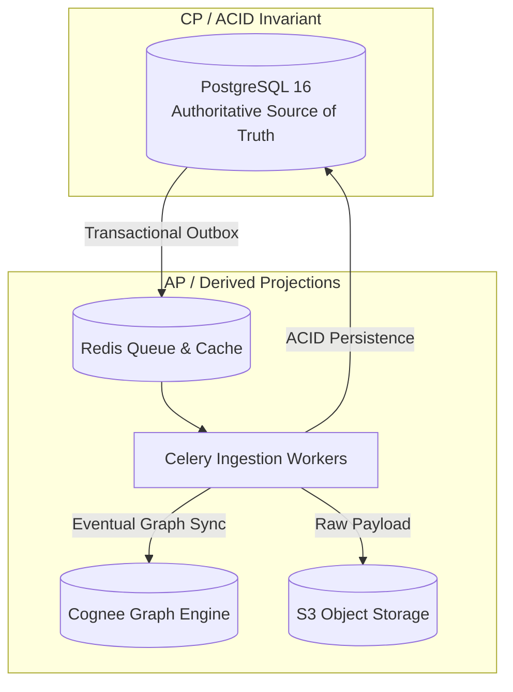

# RedThread Data Consistency, CAP Theorem & Synchronization Architecture

> **Document Status**: `DESIGN`  
> **Role**: Distributed Consistency, CAP Analysis, Outbox Pattern, and Failure Recovery  
> **Core Principle**: PostgreSQL guarantees ACID Strong Consistency for truth; Cognee and Redis provide Eventual Consistency for performance and async transport.

---

## 1. CAP Theorem & Consistency Model

RedThread's distributed topology comprises five distinct systems:
1. **PostgreSQL 16**: Primary ACID Relational Store.
2. **Redis 7**: Distributed Task Transport & Temporary Cache.
3. **Celery Workers**: Stateless Distributed Compute.
4. **Cognee Cloud / Local Engine**: Derived Graph Memory & Vector Accelerator.
5. **S3-Compatible Object Store**: Raw Document Storage.

### 1.1 Data Consistency Classification Matrix

| Data Domain | Storage Engine | Required Consistency | Partition Behavior (P) | Recovery Mechanism |
| :--- | :--- | :---: | :--- | :--- |
| **User Credentials & Auth** | PostgreSQL | **Strong** | CP: Reject auth if DB is partitioned. | Immediate ACID rollback. |
| **Organization Memberships** | PostgreSQL | **Strong** | CP: Prevent role elevation or unauthorized access. | ACID transaction. |
| **Case Permissions & RBAC** | PostgreSQL | **Strong** | CP: Non-disclosing 404 on access denial. | ACID transaction. |
| **Claims & Canonical Edges** | PostgreSQL | **Strong** | CP: Uncommitted claims are invisible to queries. | ACID transaction. |
| **Claim Review History** | PostgreSQL | **Strong** | CP: Immutable event log; append-only. | Database triggers & constraints. |
| **Document Metadata** | PostgreSQL | **Strong** | CP: File hash uniqueness strictly enforced. | Unique constraint rollback. |
| **Ingestion Job State** | PostgreSQL | **Strong** | CP: Single source of truth for job lifecycle. | Distributed lock + atomic SQL state transition. |
| **Redis Job Delivery** | Redis | **At Least Once** | AP: Task redelivered on worker timeout. | Idempotent consumers + distributed leases. |
| **Cognee Graph Projection** | Cognee | **Eventual** | AP: Continues servicing reads; sync lags temporarily. | Idempotent background sync + hourly reconciliation worker. |
| **Redis Cache (Aliases/Auth)**| Redis | **Eventual** | AP: Cache miss falls back to PostgreSQL. | TTL expiration (15m) + explicit cache invalidation. |
| **Analytics Aggregates** | PostgreSQL / Redis | **Eventual** | AP: Rollup metrics tolerate minor lag ($< 60\text{ s}$). | Periodic materialized view refresh. |

---

## 2. The Transactional Outbox Pattern

To eliminate distributed transaction failures (dual-write problem) between PostgreSQL and Redis:
1. When an investigator uploads a document, the API writes to `documents`, `ingestion_jobs`, and inserts a row into `outbox_events` (`status = 'PENDING'`) **inside the exact same database transaction**.
2. If Redis is down, the database transaction still commits successfully. No jobs are lost.
3. A lightweight **Outbox Relay Daemon** polls `outbox_events WHERE status = 'PENDING'` using `SELECT ... FOR UPDATE SKIP LOCKED` and dispatches tasks to Redis.
4. Once Redis acknowledges task receipt, the relay marks the outbox event as `PUBLISHED`.

---

## 3. Failure Scenarios & Self-Healing Guarantees

| Failure Scenario | Immediate Impact | Self-Healing Recovery Mechanism |
| :--- | :--- | :--- |
| **PostgreSQL Commits, Redis is Unavailable** | Outbox event remains in `PENDING` state in PostgreSQL. Document is safely stored in S3. | Outbox relay retries dispatching with exponential backoff. Once Redis recovers, jobs are drained in FIFO order. |
| **Redis Receives Duplicate Event** | Two worker instances receive the identical task payload. | Worker checks distributed lock on `lock:document:{document_id}` and runs atomic `UPDATE ingestion_jobs SET status = 'PROCESSING' WHERE status = 'QUEUED'`. The second worker gets row count `0` and exits safely. |
| **Worker Crashes Mid-Extraction** | Chunks or claims partially extracted in worker memory; database uncommitted. | Database transaction rolls back completely. Celery redelivers task (`acks_late=True`) to another worker. |
| **Cognee Cloud is Down / Unreachable** | Extracted claims are committed in PostgreSQL, but graph sync fails. | Worker records `ingestion_jobs.status = 'RETRYING'` with backoff. PostgreSQL claims remain intact; Cognee sync is retried independently. |
| **Cognee Succeeds, Worker Dies Before DB Update** | Graph edges created in Cognee, but `ingestion_jobs` not marked `COMPLETED`. | Retried task re-runs idempotent sync. Because Cognee nodes and edges are keyed by PostgreSQL UUIDs, existing graph elements are updated in place without duplication. |
| **Object Storage Upload Succeeds, DB Insert Fails** | Orphaned binary file in S3. | Daily S3 cleanup cron sweeps unreferenced files older than 24 hours. |
| **Claim Changes During Active Graph Sync** | Investigator disputes a claim while background worker is syncing graph. | Claim status `DISPUTED` in PostgreSQL is immediately authoritative. Hybrid Recall queries filter by PostgreSQL claim status at runtime, so stale Cognee edges are never exposed. |

---

## 4. The Periodic Reconciliation Worker

A background daemon executes hourly:
1. Audits all `ACTIVE` and `DISPUTED` claims updated in the last 24 hours against Cognee graph nodes and edges.
2. Identifies any missing or orphaned edges.
3. Automatically triggers an idempotent reconciliation sync.
4. Records an audit summary in `audit_logs` (`action = 'RECONCILIATION_AUDIT_COMPLETED'`).

---

## 5. Related Documents
- [Database Design Specification](database-design.md)
- [Database Transactions Specification](database-transactions.md)
- [System Architecture](architecture.md)
