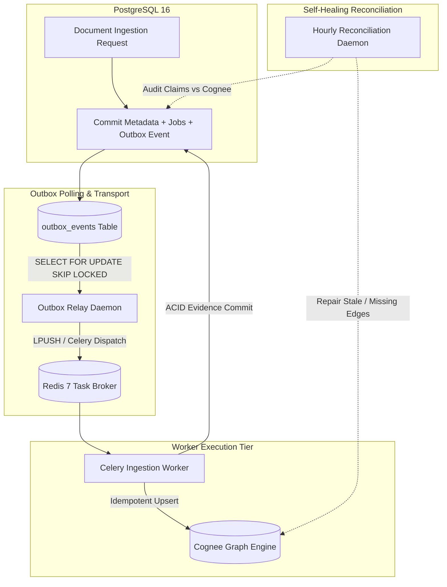
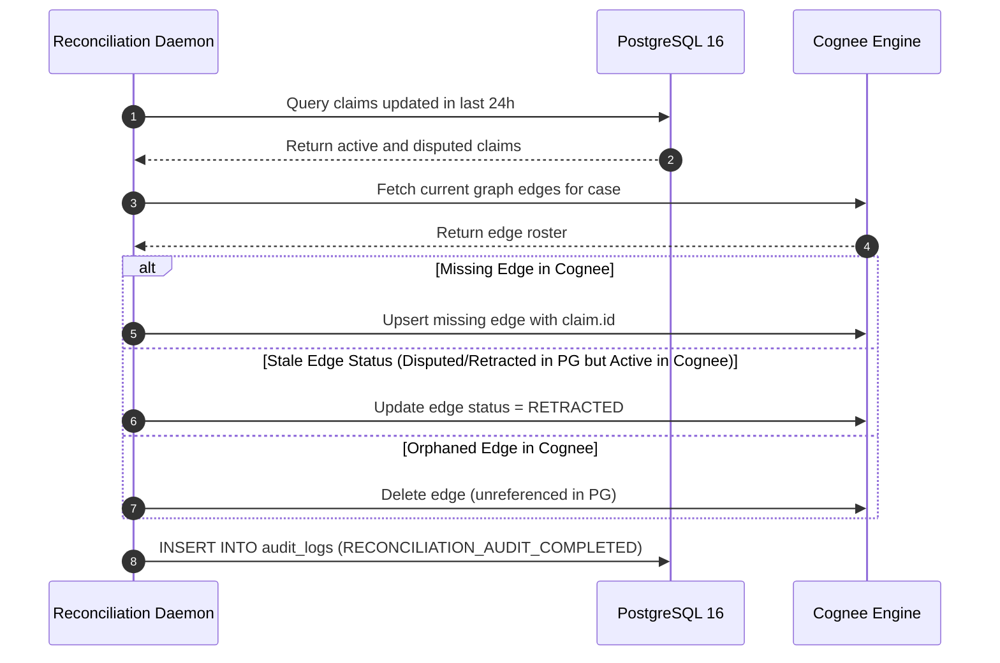

# RedThread Distributed Data Consistency, Transactional Outbox & Eventual Synchronization

> **Document Status**: `DESIGN`  
> **Role**: Distributed Consistency, Outbox State Machine, Idempotent Processing, and Self-Healing Reconciliation  
> **Target System**: PostgreSQL 16 $\leftrightarrow$ Redis 7 $\leftrightarrow$ Celery 5.4+ $\leftrightarrow$ Cognee Cloud Engine  
> **Core Distributed Invariant**: **At-Least-Once Delivery with Idempotent Processing**. PostgreSQL is strongly consistent (CP); the derived Cognee graph projection is eventually consistent (AP).

---

## 1. The Distributed Ingestion & Synchronization Challenge

RedThread coordinates state across multiple independent systems that do not share a two-phase commit (2PC) protocol:
- **PostgreSQL 16**: Primary ACID database.
- **S3-Compatible Object Storage**: Binary file payloads.
- **Redis 7**: Distributed in-memory task broker.
- **Cognee Cloud / Local Engine**: Derived knowledge graph index.



---

## 2. The Transactional Outbox State Machine

To prevent the classic dual-write failure (where a database commit succeeds but Redis dispatch fails, or vice-versa), events are written to `outbox_events` inside the exact same database transaction that updates domain state.

### 2.1 Outbox Schema Definition
```sql
CREATE TYPE outbox_status AS ENUM ('PENDING', 'PROCESSING', 'PUBLISHED', 'FAILED');

CREATE TABLE outbox_events (
    id UUID PRIMARY KEY DEFAULT uuid_generate_v4(),
    organization_id UUID NOT NULL REFERENCES organizations(id) ON DELETE RESTRICT,
    aggregate_type VARCHAR(64) NOT NULL,       -- 'DOCUMENT', 'CLAIM', 'ENTITY'
    aggregate_id UUID NOT NULL,                -- document_id or claim_id
    aggregate_version INT NOT NULL DEFAULT 1,  -- Sequence number for causal ordering
    event_type VARCHAR(64) NOT NULL,           -- 'DOCUMENT_INGESTION_REQUESTED', 'CLAIM_DISPUTED'
    payload_version INT NOT NULL DEFAULT 1,    -- Schema version of payload JSON
    payload JSONB NOT NULL,
    status outbox_status NOT NULL DEFAULT 'PENDING',
    lease_owner VARCHAR(64),                   -- Worker identifier claiming lease
    lease_expires_at TIMESTAMPTZ,              -- Lease timeout for crash recovery
    retry_count INT NOT NULL DEFAULT 0,
    next_retry_at TIMESTAMPTZ NOT NULL DEFAULT NOW(),
    created_at TIMESTAMPTZ NOT NULL DEFAULT NOW(),
    processed_at TIMESTAMPTZ
);
CREATE INDEX idx_outbox_pending_dispatch ON outbox_events(status, next_retry_at, created_at) 
    WHERE status = 'PENDING';
CREATE INDEX idx_outbox_aggregate_seq ON outbox_events(aggregate_id, aggregate_version);
```

### 2.2 Concurrent Worker Lease Acquisition (`FOR UPDATE SKIP LOCKED`)
Multiple outbox relay processes poll and claim pending outbox events concurrently without row-lock contention or duplicate task dispatches:

```sql
WITH claimable AS (
    SELECT id 
    FROM outbox_events
    WHERE (status = 'PENDING' AND next_retry_at <= NOW())
       OR (status = 'PROCESSING' AND lease_expires_at < NOW()) -- Stale lease recovery
    ORDER BY aggregate_id, aggregate_version ASC, created_at ASC
    LIMIT 50
    FOR UPDATE SKIP LOCKED
)
UPDATE outbox_events
SET status = 'PROCESSING',
    lease_owner = :worker_id,
    lease_expires_at = NOW() + INTERVAL '30 seconds',
    retry_count = retry_count + 1
FROM claimable
WHERE outbox_events.id = claimable.id
RETURNING outbox_events.*;
```

---

## 3. Causal Ordering & Out-of-Order Graph Event Protection

In distributed systems, network jitter can cause an older event (`CLAIM_DISPUTED`) to arrive at the graph synchronization worker *after* a newer event (`CLAIM_RETRACTED`).

### 3.1 Aggregate Version Sequence Guard
1. Every domain mutation increments `claims.version`.
2. The outbox event carries this version as `aggregate_version`.
3. In Cognee, each edge metadata block stores `last_applied_version`:
   ```python
   async def sync_claim_to_cognee(claim: Claim):
       existing_edge = await cognee_engine.get_edge(claim.id)
       if existing_edge and existing_edge.metadata.get("version", 0) >= claim.version:
           logger.warning(
               f"Ignoring out-of-order event for claim {claim.id}: "
               f"Cognee has version {existing_edge.metadata.get('version')} >= event version {claim.version}"
           )
           return  # Drop stale update
           
       await cognee_engine.upsert_edge(
           source=claim.subject_entity_id,
           target=claim.object_entity_id,
           predicate=claim.predicate,
           edge_id=claim.id,
           status=claim.status,
           metadata={"version": claim.version, "case_id": claim.case_id}
       )
   ```

---

## 4. Consumer Idempotency Strategy

Celery guarantees **at-least-once delivery**. A worker may crash after executing extraction, or network issues may cause Celery to re-deliver the job. Every consumer must be strictly idempotent.

### 4.1 Ingestion Task Idempotency Guard
1. **Document Content Hash Check**: `uq_case_document_hash` rejects duplicate uploads.
2. **Chunk Upsert**: `uq_document_chunk_idx (document_id, chunk_index)`:
   ```sql
   INSERT INTO document_chunks (...) VALUES (...)
   ON CONFLICT (document_id, chunk_index) DO NOTHING;
   ```
3. **Claim Grounding Deduplication**: `uq_claim_source_span (claim_id, document_id, doc_start_offset, doc_end_offset)`:
   ```sql
   INSERT INTO claim_sources (...) VALUES (...)
   ON CONFLICT (claim_id, document_id, doc_start_offset, doc_end_offset) DO NOTHING;
   ```

### 4.2 Handling Partial Ingestion Failures
- **Scenario**: Gemini structured extraction succeeds; entities and claims commit to PostgreSQL; but Cognee graph synchronization times out.
- **System Behavior**:
  1. The database transaction has committed; **entities and claims are safe in PostgreSQL**.
  2. The Celery task catches the Cognee timeout, logs `COGNEE_SYNC_TIMEOUT`, and records `ingestion_jobs.status = 'RETRYING'`.
  3. The task retries with exponential backoff ($5s \rightarrow 10s \rightarrow 20s$).
  4. On retry, the worker detects that chunks, entities, and claims are already present in PostgreSQL (via deterministic surrogate UUIDs), skips re-calling the LLM, and jumps directly to retrying the Cognee graph synchronization step.

---

## 5. Self-Healing Graph Reconciliation Engine

Because Cognee operations do not participate in PostgreSQL transactions, divergence can theoretically occur if an external process crashes mid-synchronization. The **Periodic Reconciliation Worker** runs hourly to enforce convergence:



---

## 6. Related Documents
- [Database Design Specification](database-design.md)
- [Database Transactions Specification](database-transactions.md)
- [System Architecture](architecture.md)
