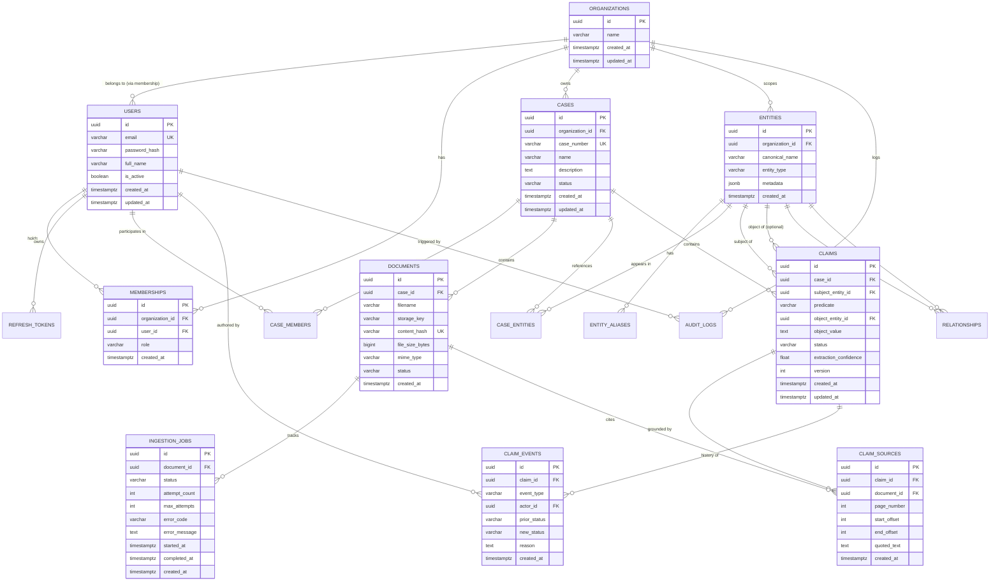

# RedThread Database Design & Schema Specification

## 1. Relational Entity-Relationship Diagram



---

## 2. Table Specifications & DDL

### 2.1 Identity & Access Management

```sql
CREATE TABLE organizations (
    id UUID PRIMARY KEY DEFAULT gen_random_uuid(),
    name VARCHAR(255) NOT NULL,
    created_at TIMESTAMPTZ NOT NULL DEFAULT NOW(),
    updated_at TIMESTAMPTZ NOT NULL DEFAULT NOW()
);

CREATE TABLE users (
    id UUID PRIMARY KEY DEFAULT gen_random_uuid(),
    email VARCHAR(255) NOT NULL UNIQUE,
    password_hash VARCHAR(255) NOT NULL,
    full_name VARCHAR(255) NOT NULL,
    is_active BOOLEAN NOT NULL DEFAULT TRUE,
    created_at TIMESTAMPTZ NOT NULL DEFAULT NOW(),
    updated_at TIMESTAMPTZ NOT NULL DEFAULT NOW()
);
CREATE INDEX idx_users_email ON users(email);

CREATE TYPE org_role AS ENUM ('ORGANIZATION_ADMIN', 'INVESTIGATOR', 'REVIEWER', 'VIEWER');

CREATE TABLE memberships (
    id UUID PRIMARY KEY DEFAULT gen_random_uuid(),
    organization_id UUID NOT NULL REFERENCES organizations(id) ON DELETE CASCADE,
    user_id UUID NOT NULL REFERENCES users(id) ON DELETE CASCADE,
    role org_role NOT NULL DEFAULT 'VIEWER',
    created_at TIMESTAMPTZ NOT NULL DEFAULT NOW(),
    CONSTRAINT uq_membership_org_user UNIQUE (organization_id, user_id)
);
CREATE INDEX idx_memberships_user ON memberships(user_id);
CREATE INDEX idx_memberships_org ON memberships(organization_id);

CREATE TABLE refresh_tokens (
    id UUID PRIMARY KEY DEFAULT gen_random_uuid(),
    user_id UUID NOT NULL REFERENCES users(id) ON DELETE CASCADE,
    token_hash VARCHAR(64) NOT NULL UNIQUE, -- SHA256 of raw refresh token
    expires_at TIMESTAMPTZ NOT NULL,
    revoked_at TIMESTAMPTZ,
    created_at TIMESTAMPTZ NOT NULL DEFAULT NOW()
);
CREATE INDEX idx_refresh_tokens_hash ON refresh_tokens(token_hash);
```

### 2.2 Case Workspace

```sql
CREATE TYPE case_status AS ENUM ('ACTIVE', 'ARCHIVED', 'CLOSED');

CREATE TABLE cases (
    id UUID PRIMARY KEY DEFAULT gen_random_uuid(),
    organization_id UUID NOT NULL REFERENCES organizations(id) ON DELETE CASCADE,
    case_number VARCHAR(64) NOT NULL,
    name VARCHAR(255) NOT NULL,
    description TEXT,
    status case_status NOT NULL DEFAULT 'ACTIVE',
    created_at TIMESTAMPTZ NOT NULL DEFAULT NOW(),
    updated_at TIMESTAMPTZ NOT NULL DEFAULT NOW(),
    CONSTRAINT uq_org_case_number UNIQUE (organization_id, case_number)
);
CREATE INDEX idx_cases_org_status ON cases(organization_id, status);

CREATE TABLE case_members (
    id UUID PRIMARY KEY DEFAULT gen_random_uuid(),
    case_id UUID NOT NULL REFERENCES cases(id) ON DELETE CASCADE,
    user_id UUID NOT NULL REFERENCES users(id) ON DELETE CASCADE,
    role org_role NOT NULL DEFAULT 'INVESTIGATOR',
    assigned_at TIMESTAMPTZ NOT NULL DEFAULT NOW(),
    CONSTRAINT uq_case_member UNIQUE (case_id, user_id)
);
CREATE INDEX idx_case_members_user ON case_members(user_id);
```

### 2.3 Documents & Ingestion Jobs

```sql
CREATE TYPE document_status AS ENUM ('UPLOADED', 'PROCESSING', 'INDEXED', 'FAILED');

CREATE TABLE documents (
    id UUID PRIMARY KEY DEFAULT gen_random_uuid(),
    case_id UUID NOT NULL REFERENCES cases(id) ON DELETE CASCADE,
    filename VARCHAR(255) NOT NULL,
    storage_key VARCHAR(512) NOT NULL, -- S3/R2 path
    content_hash VARCHAR(64) NOT NULL, -- SHA-256
    file_size_bytes BIGINT NOT NULL,
    mime_type VARCHAR(128) NOT NULL,
    status document_status NOT NULL DEFAULT 'UPLOADED',
    page_count INT,
    created_at TIMESTAMPTZ NOT NULL DEFAULT NOW(),
    updated_at TIMESTAMPTZ NOT NULL DEFAULT NOW(),
    CONSTRAINT uq_case_document_hash UNIQUE (case_id, content_hash)
);
CREATE INDEX idx_documents_case_status ON documents(case_id, status);

CREATE TYPE job_status AS ENUM ('QUEUED', 'PROCESSING', 'COMPLETED', 'FAILED', 'RETRYING', 'DEAD_LETTER');

CREATE TABLE ingestion_jobs (
    id UUID PRIMARY KEY DEFAULT gen_random_uuid(),
    document_id UUID NOT NULL REFERENCES documents(id) ON DELETE CASCADE,
    status job_status NOT NULL DEFAULT 'QUEUED',
    attempt_count INT NOT NULL DEFAULT 0,
    max_attempts INT NOT NULL DEFAULT 3,
    error_code VARCHAR(64),
    error_message TEXT,
    started_at TIMESTAMPTZ,
    completed_at TIMESTAMPTZ,
    created_at TIMESTAMPTZ NOT NULL DEFAULT NOW(),
    updated_at TIMESTAMPTZ NOT NULL DEFAULT NOW()
);
CREATE INDEX idx_ingestion_jobs_status ON ingestion_jobs(status);
CREATE INDEX idx_ingestion_jobs_doc ON ingestion_jobs(document_id);
```

### 2.4 Entities & Aliases

```sql
CREATE TYPE entity_type AS ENUM (
    'PERSON', 'ORGANIZATION', 'FINANCIAL_ACCOUNT', 'MONETARY_AMOUNT',
    'LOCATION', 'DOCUMENT_REF', 'DATE_TIME', 'TRANSACTION'
);

CREATE TABLE entities (
    id UUID PRIMARY KEY DEFAULT gen_random_uuid(),
    organization_id UUID NOT NULL REFERENCES organizations(id) ON DELETE CASCADE,
    canonical_name VARCHAR(255) NOT NULL,
    entity_type entity_type NOT NULL,
    metadata JSONB NOT NULL DEFAULT '{}'::jsonb,
    created_at TIMESTAMPTZ NOT NULL DEFAULT NOW(),
    updated_at TIMESTAMPTZ NOT NULL DEFAULT NOW(),
    CONSTRAINT uq_org_entity_name_type UNIQUE (organization_id, canonical_name, entity_type)
);
CREATE INDEX idx_entities_canonical ON entities(organization_id, canonical_name);
CREATE INDEX idx_entities_gin_metadata ON entities USING GIN (metadata);

CREATE TABLE entity_aliases (
    id UUID PRIMARY KEY DEFAULT gen_random_uuid(),
    entity_id UUID NOT NULL REFERENCES entities(id) ON DELETE CASCADE,
    alias VARCHAR(255) NOT NULL,
    source VARCHAR(64) DEFAULT 'INGESTION',
    confidence FLOAT NOT NULL DEFAULT 1.0,
    created_at TIMESTAMPTZ NOT NULL DEFAULT NOW(),
    CONSTRAINT uq_entity_alias UNIQUE (entity_id, alias)
);
CREATE INDEX idx_entity_aliases_alias ON entity_aliases(alias);

CREATE TABLE case_entities (
    case_id UUID NOT NULL REFERENCES cases(id) ON DELETE CASCADE,
    entity_id UUID NOT NULL REFERENCES entities(id) ON DELETE CASCADE,
    first_seen_at TIMESTAMPTZ NOT NULL DEFAULT NOW(),
    PRIMARY KEY (case_id, entity_id)
);
CREATE INDEX idx_case_entities_entity ON case_entities(entity_id);
```

### 2.5 Claims, Sources, and Historical Events

```sql
CREATE TYPE claim_status AS ENUM ('ACTIVE', 'DISPUTED', 'REVIEWED', 'RETRACTED');

CREATE TABLE claims (
    id UUID PRIMARY KEY DEFAULT gen_random_uuid(),
    case_id UUID NOT NULL REFERENCES cases(id) ON DELETE CASCADE,
    subject_entity_id UUID NOT NULL REFERENCES entities(id) ON DELETE RESTRICT,
    predicate VARCHAR(64) NOT NULL, -- e.g. TRANSFERRED_TO, OPERATES_THROUGH
    object_entity_id UUID REFERENCES entities(id) ON DELETE RESTRICT, -- Nullable if object_value is a literal
    object_value TEXT, -- Nullable if object_entity_id is set
    status claim_status NOT NULL DEFAULT 'ACTIVE',
    extraction_confidence FLOAT NOT NULL DEFAULT 0.0,
    version INT NOT NULL DEFAULT 1,
    created_at TIMESTAMPTZ NOT NULL DEFAULT NOW(),
    updated_at TIMESTAMPTZ NOT NULL DEFAULT NOW(),
    CONSTRAINT chk_claim_target CHECK (
        (object_entity_id IS NOT NULL AND object_value IS NULL) OR
        (object_entity_id IS NULL AND object_value IS NOT NULL) OR
        (object_entity_id IS NOT NULL AND object_value IS NOT NULL)
    )
);
CREATE INDEX idx_claims_case_status ON claims(case_id, status);
CREATE INDEX idx_claims_subject ON claims(subject_entity_id);
CREATE INDEX idx_claims_object ON claims(object_entity_id);

CREATE TABLE claim_sources (
    id UUID PRIMARY KEY DEFAULT gen_random_uuid(),
    claim_id UUID NOT NULL REFERENCES claims(id) ON DELETE CASCADE,
    document_id UUID NOT NULL REFERENCES documents(id) ON DELETE CASCADE,
    page_number INT NOT NULL,
    start_offset INT NOT NULL,
    end_offset INT NOT NULL,
    quoted_text TEXT NOT NULL,
    created_at TIMESTAMPTZ NOT NULL DEFAULT NOW()
);
CREATE INDEX idx_claim_sources_claim ON claim_sources(claim_id);
CREATE INDEX idx_claim_sources_doc ON claim_sources(document_id);

CREATE TYPE claim_event_type AS ENUM (
    'CLAIM_CREATED',
    'CLAIM_CHALLENGED',
    'EVIDENCE_ADDED',
    'CLAIM_REVIEWED',
    'CLAIM_RETRACTED',
    'CLAIM_REINSTATED'
);

CREATE TABLE claim_events (
    id UUID PRIMARY KEY DEFAULT gen_random_uuid(),
    claim_id UUID NOT NULL REFERENCES claims(id) ON DELETE CASCADE,
    event_type claim_event_type NOT NULL,
    actor_id UUID NOT NULL REFERENCES users(id) ON DELETE RESTRICT,
    prior_status claim_status,
    new_status claim_status NOT NULL,
    reason TEXT NOT NULL,
    metadata JSONB NOT NULL DEFAULT '{}'::jsonb,
    created_at TIMESTAMPTZ NOT NULL DEFAULT NOW()
);
CREATE INDEX idx_claim_events_claim ON claim_events(claim_id);
CREATE INDEX idx_claim_events_actor ON claim_events(actor_id);
```

### 2.6 Relationships & Audit Logs

```sql
CREATE TABLE relationships (
    id UUID PRIMARY KEY DEFAULT gen_random_uuid(),
    case_id UUID NOT NULL REFERENCES cases(id) ON DELETE CASCADE,
    source_entity_id UUID NOT NULL REFERENCES entities(id) ON DELETE CASCADE,
    target_entity_id UUID NOT NULL REFERENCES entities(id) ON DELETE CASCADE,
    predicate VARCHAR(64) NOT NULL,
    confidence FLOAT NOT NULL DEFAULT 1.0,
    created_at TIMESTAMPTZ NOT NULL DEFAULT NOW(),
    CONSTRAINT uq_case_relationship UNIQUE (case_id, source_entity_id, target_entity_id, predicate)
);
CREATE INDEX idx_relationships_case ON relationships(case_id);
CREATE INDEX idx_relationships_source ON relationships(source_entity_id);
CREATE INDEX idx_relationships_target ON relationships(target_entity_id);

CREATE TABLE audit_logs (
    id UUID PRIMARY KEY DEFAULT gen_random_uuid(),
    organization_id UUID NOT NULL REFERENCES organizations(id) ON DELETE CASCADE,
    actor_id UUID REFERENCES users(id) ON DELETE SET NULL,
    action VARCHAR(64) NOT NULL,
    resource_type VARCHAR(64) NOT NULL,
    resource_id UUID NOT NULL,
    case_id UUID REFERENCES cases(id) ON DELETE CASCADE,
    ip_address INET,
    user_agent TEXT,
    details JSONB NOT NULL DEFAULT '{}'::jsonb,
    created_at TIMESTAMPTZ NOT NULL DEFAULT NOW()
);
CREATE INDEX idx_audit_logs_org_created ON audit_logs(organization_id, created_at DESC);
CREATE INDEX idx_audit_logs_case ON audit_logs(case_id);
```

---

## 3. Database Constraints & Invariants

1. **Email Uniqueness**: User emails are globally unique.
2. **Organization Isolation**: Entities, cases, and audit logs are scoped strictly to an `organization_id`.
3. **Document Deduplication**: Document hashes (`content_hash`) must be unique within a case (`uq_case_document_hash`). If an identical file is uploaded twice to the same case, the API references the existing document.
4. **Claim Integrity**: Claims cannot reference deleted entities (`ON DELETE RESTRICT`). Soft deletion / retraction workflows prevent broken graph edges.
5. **Auditable Claim History**: Modifications to claims must write to `claim_events` within the same database transaction.

---

## 4. PostgreSQL Row-Level Security (RLS) Strategy

To enforce defense-in-depth against IDOR vulnerabilities, PostgreSQL RLS policies can be activated alongside application-level checks:

```sql
ALTER TABLE cases ENABLE ROW LEVEL SECURITY;

CREATE POLICY case_tenant_isolation ON cases
    FOR ALL
    USING (
        organization_id = NULLIF(current_setting('app.current_org_id', true), '')::UUID
    );

ALTER TABLE claims ENABLE ROW LEVEL SECURITY;

CREATE POLICY claim_tenant_isolation ON claims
    FOR ALL
    USING (
        case_id IN (
            SELECT id FROM cases 
            WHERE organization_id = NULLIF(current_setting('app.current_org_id', true), '')::UUID
        )
    );
```

Before executing queries in a session, the connection sets:
```sql
SET LOCAL app.current_org_id = '<authenticated_org_uuid>';
```
