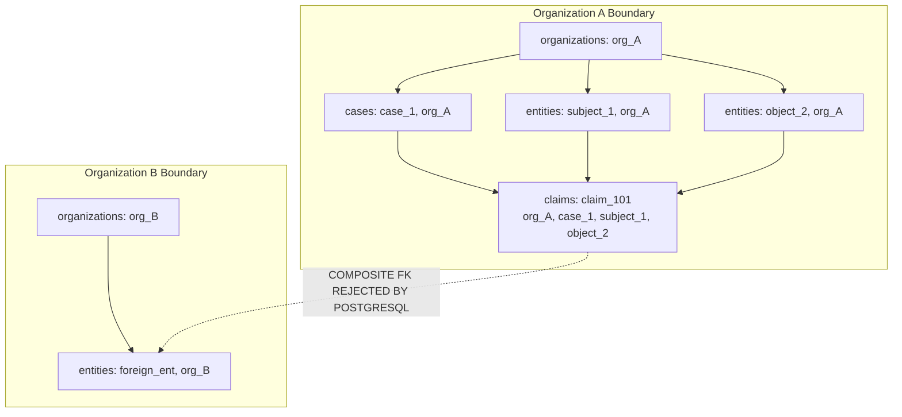
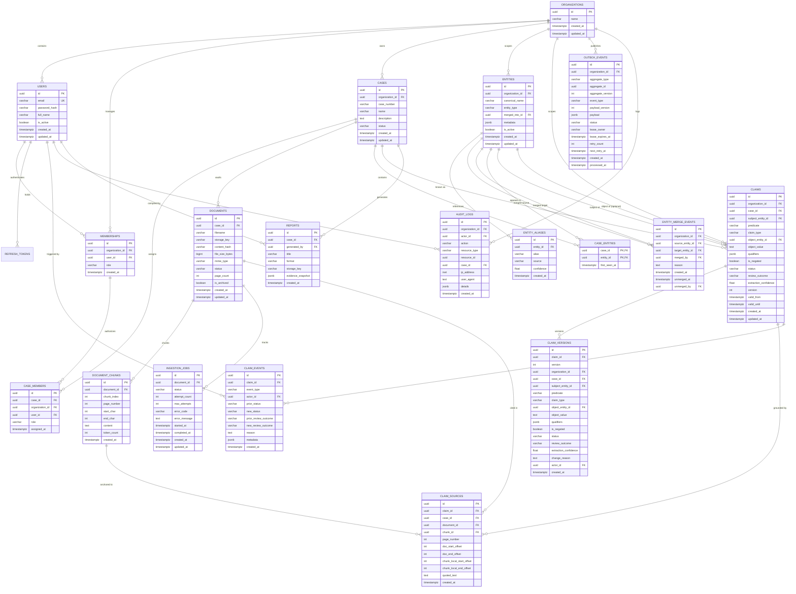

# RedThread Relational Database Design & Engine-Level Specification

> **Document Status**: `DESIGN`  
> **Authority**: Relational Model, Invariants, DDL, Normalization Proofs, and Integrity Constraints  
> **Target Engine**: PostgreSQL 16 (`uuid-ossp`, `pg_trgm`)  
> **Core Relational Invariant**: PostgreSQL is the single authoritative Source of Truth. Relational invariants, multi-tenant boundaries, and evidence provenance are guaranteed by the database engine via constraints, types, and composite foreign keys.

---

## 1. Critical Schema Invariant Corrections

### 1.1 Claim Target Exclusivity & Structured Qualifiers
In the initial draft, `chk_claim_target_validity` permitted both `object_entity_id` and `object_value` to be populated simultaneously. This created an ambiguous data model where a claim could simultaneously point to an entity and a literal string without clear semantics.

#### Corrected Mathematical Model:
RedThread strictly categorizes claims into two mutually exclusive types via `claim_type`:
1. **`ENTITY_TO_ENTITY`**: Asserts a directed relationship between two entities (`subject_entity_id` and `object_entity_id`). `object_value` must be `NULL`.
2. **`ENTITY_TO_LITERAL`**: Asserts an attribute or literal fact about the subject (`object_value` is populated). `object_entity_id` must be `NULL`.

Structured qualifiers (monetary amounts, currencies, unit measurements, dates, confidence intervals) are isolated in a typed `qualifiers` (`JSONB`) column:

```sql
CREATE TYPE claim_type AS ENUM ('ENTITY_TO_ENTITY', 'ENTITY_TO_LITERAL');

-- Enforced strictly via engine-level CHECK constraint:
CONSTRAINT chk_claim_target_exclusivity CHECK (
    (claim_type = 'ENTITY_TO_ENTITY' AND object_entity_id IS NOT NULL AND object_value IS NULL) OR
    (claim_type = 'ENTITY_TO_LITERAL' AND object_entity_id IS NULL AND object_value IS NOT NULL)
)
```

---

### 1.2 Organization-Safe Entity & Case References
In naive multi-tenant databases, a claim in Organization A could reference an entity belonging to Organization B if foreign keys only validate the surrogate primary key `id`. RedThread enforces cross-tenant safety at the relational engine level using **Composite Foreign Keys**:



Every case-scoped and entity-scoped table carries `organization_id` in its composite candidate keys:
- `cases`: `UNIQUE (organization_id, id)`
- `entities`: `UNIQUE (organization_id, id)`
- `claims`: `organization_id`, `case_id`, `subject_entity_id`, `object_entity_id`
  - `FOREIGN KEY (organization_id, case_id) REFERENCES cases(organization_id, id)`
  - `FOREIGN KEY (organization_id, subject_entity_id) REFERENCES entities(organization_id, id)`
  - `FOREIGN KEY (organization_id, object_entity_id) REFERENCES entities(organization_id, id)`

**Result**: Even if application validation is bypassed or raw SQL is executed, PostgreSQL physically rejects any attempt to connect a claim to an entity belonging to another organization.

---

### 1.3 Evidence Provenance & Coordinate Integrity
To guarantee that evidence citations cannot point to the wrong case, document, or non-existent chunk spans:
1. **Case-Scoped Grounding**: `claim_sources` validates `(case_id, claim_id) REFERENCES claims(case_id, id)` and `(case_id, document_id) REFERENCES documents(case_id, id)`.
2. **Document-Scoped Chunks**: `claim_sources` validates `(document_id, chunk_id) REFERENCES document_chunks(document_id, id)`. A chunk cannot be cited under a document it does not belong to.
3. **Explicit Offset Coordinate Systems**:
   - `doc_start_offset`, `doc_end_offset`: 0-indexed character offsets against the **entire normalized document text**.
   - `chunk_local_start_offset`, `chunk_local_end_offset`: 0-indexed character offsets relative to the start of the specific chunk.
   - `page_number`: 1-indexed physical page in original document (PDF).
   - Strict constraints enforce positive offsets and verified lengths:
     ```sql
     CONSTRAINT chk_doc_offsets_valid CHECK (doc_start_offset >= 0 AND doc_end_offset > doc_start_offset),
     CONSTRAINT chk_chunk_offsets_valid CHECK (
         chunk_local_start_offset IS NULL OR 
         (chunk_local_start_offset >= 0 AND chunk_local_end_offset > chunk_local_start_offset)
     )
     ```
4. **Coordinate Alignment Invariant & Validation**:
   When `chunk_id` is supplied, `doc_start_offset` and `doc_end_offset` must be completely contained within `[chunk.start_char, chunk.end_char]`, and chunk-local offsets must satisfy:
   $$\text{chunk\_local\_start\_offset} = \text{doc\_start\_offset} - \text{chunk.start\_char}$$
   $$\text{chunk\_local\_end\_offset} = \text{doc\_end\_offset} - \text{chunk.start\_char}$$
   Because cross-table relational comparisons cannot be expressed in standard SQL `CHECK` constraints, this mathematical invariant is enforced via trigger `trg_validate_claim_source_chunk_offsets`.

---

### 1.4 Immutable Claim Content Versioning (`claim_versions`)
The canonical `claims` table stores the **current operational state** of each claim for high-performance indexing and graph queries. To ensure non-repudiation and evidentiary history, every insert and mutation generates an immutable snapshot in `claim_versions`:

```sql
CREATE TABLE claim_versions (
    id UUID PRIMARY KEY DEFAULT uuid_generate_v4(),
    claim_id UUID NOT NULL REFERENCES claims(id) ON DELETE RESTRICT,
    version INT NOT NULL,
    organization_id UUID NOT NULL,
    case_id UUID NOT NULL,
    subject_entity_id UUID NOT NULL,
    predicate VARCHAR(64) NOT NULL,
    claim_type claim_type NOT NULL,
    object_entity_id UUID,
    object_value TEXT,
    qualifiers JSONB NOT NULL DEFAULT '{}'::jsonb,
    is_negated BOOLEAN NOT NULL DEFAULT FALSE,
    status claim_status NOT NULL,
    review_outcome review_outcome NOT NULL,
    extraction_confidence FLOAT NOT NULL,
    valid_from TIMESTAMPTZ,
    valid_until TIMESTAMPTZ,
    change_reason TEXT NOT NULL,
    actor_id UUID NOT NULL REFERENCES users(id) ON DELETE RESTRICT,
    created_at TIMESTAMPTZ NOT NULL DEFAULT NOW(),
    CONSTRAINT uq_claim_version UNIQUE (claim_id, version)
);
```

---

### 1.5 Reversible, Relational Entity Merge Architecture
Storing JSON snapshots of relationships to support unmerging is fragile: if Entity A merges into B, and claims are added or modified, restoring a JSON snapshot destroys intervening evidence.

#### The Pointer-Based Reversible Merge Design:
1. **Claims Retain Original Extraction Pointers**: In `claims`, `subject_entity_id` and `object_entity_id` continue to point permanently to the entity extracted from the source document.
2. **Canonical Entity Pointer**: In `entities`, `merged_into_id` (`UUID NULL REFERENCES entities(id)`) defines the merge hierarchy:
   - If `merged_into_id IS NULL`, the entity is canonical.
   - If `merged_into_id = B`, entity $A$ is subsumed into entity $B$.
3. **Merge Event Ledger (`entity_merge_events`)**: Records `source_entity_id`, `target_entity_id`, `merged_by`, `reason`, `created_at`, `unmerged_at`, `unmerged_by`.
4. **Transitive Canonical Resolution**:
   When entities are merged in sequence ($A \rightarrow B$ and later $B \rightarrow C$), canonical resolution must follow the pointer chain to the root node where `merged_into_id IS NULL`. While single-hop resolution can use `COALESCE(e.merged_into_id, e.id)`, robust multi-hop resolution uses a recursive CTE or deterministic function `fn_get_canonical_entity_id(UUID)`:
   ```sql
   CREATE OR REPLACE FUNCTION fn_get_canonical_entity_id(p_entity_id UUID)
   RETURNS UUID AS $$
   DECLARE
       v_current UUID := p_entity_id;
       v_next UUID;
       v_depth INT := 0;
   BEGIN
       LOOP
           SELECT merged_into_id INTO v_next FROM entities WHERE id = v_current;
           IF v_next IS NULL OR v_next = v_current THEN
               RETURN v_current;
           END IF;
           v_current := v_next;
           v_depth := v_depth + 1;
           IF v_depth > 20 THEN
               RAISE EXCEPTION 'Detected cycle or excessive depth in merge chain for entity %', p_entity_id;
           END IF;
       END LOOP;
   END;
   $$ LANGUAGE plpgsql STABLE;
   ```
5. **Cycle Prevention Trigger (`trg_prevent_entity_merge_cycles`)**:
   PostgreSQL `CHECK (merged_into_id <> id)` prevents immediate self-merges ($A \rightarrow A$), but cannot evaluate multi-hop cycles ($A \rightarrow B \rightarrow C \rightarrow A$). An explicit `BEFORE INSERT OR UPDATE OF merged_into_id` trigger traverses prospective ancestors and raises an exception if a cycle is introduced.
6. **Deterministic Multi-Hop Unmerge Policy**:
   - If $A \rightarrow B \rightarrow C$ and an investigator unmerges intermediate entity $B$ from $C$:
     ```sql
     UPDATE entities SET merged_into_id = NULL, updated_at = NOW() WHERE id = :entity_b_id;
     UPDATE entity_merge_events SET unmerged_at = NOW(), unmerged_by = :actor_id 
     WHERE source_entity_id = :entity_b_id AND unmerged_at IS NULL;
     ```
   - In accordance with hierarchical sub-network isolation, $B$ immediately becomes canonical again, and $A$ continues pointing to $B$ (which is now its canonical root). If $A$ was also mistakenly associated with $B$, an investigator executes an unmerge for $A$ independently.
   - Because claims still reference original entity UUIDs ($A$ or $B$), **zero claim rows are mutated**, and evidentiary provenance remains uncorrupted.

---

## 2. Referential Integrity & Deletion Policy Matrix

In a legal investigation platform, raw `CASCADE` deletes risk destroying evidentiary provenance. The deletion matrix enforces explicit integrity policies:

| Table | Hard Delete Policy | Soft Delete / Archival Policy | Evidentiary Justification |
| :--- | :--- | :--- | :--- |
| `organizations` | **RESTRICT** | Active flag / Billing deactivation | Cannot delete an organization while cases or audit records exist. |
| `users` | **RESTRICT** | `is_active = FALSE` | Users author claims, challenges, and audit entries; must never be purged. |
| `memberships` | **CASCADE** on User delete, **RESTRICT** if assigned | Soft-revocation via `role = 'VIEWER'` or membership removal | Historical membership changes preserved in `audit_logs`. |
| `cases` | **RESTRICT** | `status = 'ARCHIVED'` or `'CLOSED'` | Active and cold investigations must preserve immutable records. |
| `case_members` | **CASCADE** on Case delete | Explicit removal logged in `audit_logs` | Assigned investigators can be removed; history kept in audit log. |
| `documents` | **RESTRICT** if cited by `claim_sources` | `status = 'FAILED'` or `is_archived = TRUE` | A document that grounds an active or disputed claim cannot be deleted. |
| `document_chunks` | **CASCADE** with Document | Soft delete if document archived | Chunks are physical partitions of a document; deleted only if parent doc is unreferenced. |
| `ingestion_jobs` | **CASCADE** with Document | Retained in `DEAD_LETTER` | Ingestion retry and failure audit trail. |
| `entities` | **RESTRICT** if cited by claims | `is_active = FALSE` / `merged_into_id` | Entities grounding claims cannot be dropped. |
| `entity_aliases` | **CASCADE** with Entity | Confidence down-weighting | Aliases follow canonical entity lifecycle. |
| `entity_merges` | **RESTRICT** | Append-only event history | Historical merge trail is immutable. |
| `claims` | **RESTRICT** | `status = 'RETRACTED'` | **Claims are NEVER hard-deleted**. Retraction preserves evidence history. |
| `claim_sources` | **RESTRICT** if Claim active | Document provenance preservation | Grounding citations cannot be severed. |
| `claim_versions` | **RESTRICT** (Append-Only) | Immutable historical record | Audit trail cannot be mutated or dropped. |
| `claim_events` | **RESTRICT** (Append-Only) | Immutable historical record | Security requirement: write-once, read-many. |
| `outbox_events` | **PURGE** after 7 days | Deleted only when `status = 'PUBLISHED'` | Operational transient table; pruned after verified processing. |
| `audit_logs` | **RESTRICT** (Append-Only) | Immutable compliance log | Permanent retention required for regulatory compliance. |
| `reports` | **RESTRICT** | Frozen evidence snapshot | Court and regulatory dossiers cannot be mutated. |

### Privacy Deletion & GDPR Redaction Strategy:
If a court or regulatory mandate requires removing personal data (Right to be Forgotten):
1. The canonical entity's `canonical_name` is updated to `"[REDACTED-PERSON-UUID]"`.
2. Associated `quoted_text` in `claim_sources` is overwritten with `"[REDACTED EXCERPT PURSUANT TO COURT ORDER #...]"`.
3. The relationship structure (Claim edge) is preserved in `status = 'RETRACTED'`.
4. A mandatory entry is recorded in `audit_logs` documenting the legal justification and redaction actor.

---

## 3. Complete Mermaid Relational Entity-Relationship Diagram



---

## 4. Formal Normalization Analysis & Mathematical Proofs

### 4.1 Functional Dependency Analysis by Relation

#### 1. Relation: `users`
- **Candidate Keys**: $K_1 = \{\text{id}\}$, $K_2 = \{\text{email}\}$
- **Functional Dependencies**:
  - $F_1: \text{id} \rightarrow \text{email}, \text{password\_hash}, \text{full\_name}, \text{is\_active}, \text{created\_at}, \text{updated\_at}$
  - $F_2: \text{email} \rightarrow \text{id}, \text{password\_hash}, \text{full\_name}, \text{is\_active}, \text{created\_at}, \text{updated\_at}$
- **Analysis**: All determinants ($\text{id}, \text{email}$) are candidate keys. There are no partial or transitive dependencies.
- **Highest Proven Normal Form**: **BCNF / 4NF**.

#### 2. Relation: `memberships`
- **Candidate Keys**: $K_1 = \{\text{id}\}$, $K_2 = \{\text{organization\_id}, \text{user\_id}\}$
- **Functional Dependencies**:
  - $F_1: \text{id} \rightarrow \text{organization\_id}, \text{user\_id}, \text{role}, \text{created\_at}$
  - $F_2: \{\text{organization\_id}, \text{user\_id}\} \rightarrow \text{id}, \text{role}, \text{created\_at}$
- **Analysis**: Both determinants are candidate keys. Eliminates role update anomalies.
- **Highest Proven Normal Form**: **BCNF / 4NF**.

#### 3. Relation: `cases`
- **Candidate Keys**: $K_1 = \{\text{id}\}$, $K_2 = \{\text{organization\_id}, \text{case\_number}\}$
- **Functional Dependencies**:
  - $F_1: \text{id} \rightarrow \text{organization\_id}, \text{case\_number}, \text{name}, \text{description}, \text{status}, \text{created\_at}, \text{updated\_at}$
  - $F_2: \{\text{organization\_id}, \text{case\_number}\} \rightarrow \text{id}, \text{name}, \text{description}, \text{status}, \text{created\_at}, \text{updated\_at}$
- **Analysis**: Determinants are candidate keys. Guarantees scoped uniqueness.
- **Highest Proven Normal Form**: **BCNF / 4NF**.

#### 4. Relation: `documents`
- **Candidate Keys**: $K_1 = \{\text{id}\}$, $K_2 = \{\text{case\_id}, \text{content\_hash}\}$
- **Functional Dependencies**:
  - $F_1: \text{id} \rightarrow \text{case\_id}, \text{filename}, \text{storage\_key}, \text{content\_hash}, \text{file\_size\_bytes}, \text{mime\_type}, \text{status}, \text{page\_count}, \text{is\_archived}, \text{created\_at}, \text{updated\_at}$
  - $F_2: \{\text{case\_id}, \text{content\_hash}\} \rightarrow \text{id}, \text{filename}, \dots$
- **Analysis**: Prevents duplicate file ingestion within a case.
- **Highest Proven Normal Form**: **BCNF / 4NF**.

#### 5. Relation: `document_chunks`
- **Candidate Keys**: $K_1 = \{\text{id}\}$, $K_2 = \{\text{document\_id}, \text{chunk\_index}\}$
- **Functional Dependencies**:
  - $F_1: \text{id} \rightarrow \text{document\_id}, \text{chunk\_index}, \text{page\_number}, \text{start\_char}, \text{end\_char}, \text{content}, \text{token\_count}, \text{created\_at}$
  - $F_2: \{\text{document\_id}, \text{chunk\_index}\} \rightarrow \text{id}, \text{page\_number}, \dots$
- **Highest Proven Normal Form**: **BCNF / 4NF**.

#### 6. Relation: `entities`
- **Candidate Keys**: $K_1 = \{\text{id}\}$, $K_2 = \{\text{organization\_id}, \text{canonical\_name}, \text{entity\_type}\}$
- **Functional Dependencies**:
  - $F_1: \text{id} \rightarrow \text{organization\_id}, \text{canonical\_name}, \text{entity\_type}, \text{merged\_into\_id}, \text{metadata}, \text{is\_active}, \text{created\_at}, \text{updated\_at}$
  - $F_2: \{\text{organization\_id}, \text{canonical\_name}, \text{entity\_type}\} \rightarrow \text{id}, \text{merged\_into\_id}, \dots$
- **Highest Proven Normal Form**: **BCNF / 4NF**.

#### 7. Relation: `claims`
- **Candidate Keys**: $K_1 = \{\text{id}\}$
- **Functional Dependencies**:
  - $F_1: \text{id} \rightarrow \text{organization\_id}, \text{case\_id}, \text{subject\_entity\_id}, \text{predicate}, \text{claim\_type}, \text{object\_entity\_id}, \text{object\_value}, \text{qualifiers}, \text{is\_negated}, \text{status}, \text{review\_outcome}, \text{extraction\_confidence}, \text{version}, \text{valid\_from}, \text{valid\_until}, \text{created\_at}, \text{updated\_at}$
- **Analysis**: Every non-prime attribute depends directly on `{id}`. There are no transitive dependencies among non-prime attributes.
- **Highest Proven Normal Form**: **BCNF / 4NF**.

#### 8. Relation: `claim_sources`
- **Candidate Keys**: $K_1 = \{\text{id}\}$, $K_2 = \{\text{claim\_id}, \text{document\_id}, \text{doc\_start\_offset}, \text{doc\_end\_offset}\}$
- **Functional Dependencies**:
  - $F_1: \text{id} \rightarrow \text{claim\_id}, \text{case\_id}, \text{document\_id}, \text{chunk\_id}, \text{page\_number}, \text{doc\_start\_offset}, \text{doc\_end\_offset}, \text{chunk\_local\_start\_offset}, \text{chunk\_local\_end\_offset}, \text{quoted\_text}, \text{created\_at}$
  - $F_2: \{\text{claim\_id}, \text{document\_id}, \text{doc\_start\_offset}, \text{doc\_end\_offset}\} \rightarrow \text{id}, \text{case\_id}, \dots$
- **Highest Proven Normal Form**: **BCNF / 4NF**.

---

### 4.2 Normal Form Compliance Matrix

| Normal Form | Compliance Evaluation | Mathematical Invariant Enforced |
| :--- | :---: | :--- |
| **1NF (Atomic Attributes)** | **Satisfied** | Attributes contain atomic scalar values. Multivalued facts (`aliases`, `sources`, `qualifiers`) are modeled as child relations or strictly validated JSONB payloads. |
| **2NF (No Partial Dependencies)** | **Satisfied** | For all tables with composite candidate keys (`memberships`, `cases`, `documents`, `document_chunks`, `entities`, `case_entities`, `claim_sources`), every non-prime attribute depends on the **entire** candidate key. |
| **3NF (No Transitive Dependencies)** | **Satisfied** | Non-prime attributes depend solely on candidate keys. No non-prime attribute determines another non-prime attribute ($A \rightarrow B \rightarrow C$). |
| **BCNF (Boyce-Codd Normal Form)**| **Satisfied** | In every functional dependency $X \rightarrow Y$, the determinant $X$ is a superkey. Eliminates all functional dependency anomalies. |
| **4NF (No Multivalued Dependencies)**| **Satisfied** | Independent $1:N$ relationships (e.g. Case Members vs. Case Documents) are isolated in separate tables, preventing Cartesian product update anomalies. |
| **5NF (Join Dependencies)** | **Not Claimed Universally** | 5NF is only relevant when relations decompose into 3 or more cyclic projections ($*\{R_1, R_2, R_3\}$) without loss. RedThread’s schema relies on binary foreign-key decompositions (4NF/BCNF). Claiming universal 5NF compliance without cyclic join dependencies is mathematically disingenuous. |

---

### 4.3 Engineering Denormalizations: Drift Detection & Repair

| Denormalized Field | Parent Source | Why It Exists | Invariant Maintained | Drift Detection Query | Automated Repair Mechanism |
| :--- | :--- | :--- | :--- | :--- | :--- |
| `document_chunks.page_number` | PDF Page Geometry | Eliminates runtime coordinate recalculations during recall queries. | Must match PDF page containing `start_char`. | `SELECT c.id FROM document_chunks c WHERE c.page_number <> (SELECT page FROM ...)` | Reparsed from source PDF during document re-indexing. |
| `claims.extraction_confidence` | LLM Extraction Payload | Enables $O(1)$ edge filtering during BFS graph traversal without joining `claim_sources`. | Must equal max confidence of supporting `claim_sources`. | `SELECT c.id, c.extraction_confidence FROM claims c ...` | Reconciliation worker computes `UPDATE claims SET extraction_confidence = (SELECT MAX(confidence) FROM ...)` |
| `ingestion_jobs.attempt_count` | `ingestion_jobs` | Fast polling without counting child retry logs. | Must equal number of execution attempts. | `SELECT id FROM ingestion_jobs WHERE attempt_count < 0` | Celery task state machine increments counter atomically on retry. |

---

## 5. PostgreSQL 16 Complete DDL Specification

```sql
-- Enable cryptographic, text-matching, and UUID extensions
CREATE EXTENSION IF NOT EXISTS "uuid-ossp";
CREATE EXTENSION IF NOT EXISTS "pg_trgm";

-- ----------------------------------------------------------------------
-- 1. Identity, Organizations & Authentication
-- ----------------------------------------------------------------------
CREATE TABLE organizations (
    id UUID PRIMARY KEY DEFAULT uuid_generate_v4(),
    name VARCHAR(255) NOT NULL,
    created_at TIMESTAMPTZ NOT NULL DEFAULT NOW(),
    updated_at TIMESTAMPTZ NOT NULL DEFAULT NOW()
);

CREATE TABLE users (
    id UUID PRIMARY KEY DEFAULT uuid_generate_v4(),
    email VARCHAR(255) NOT NULL UNIQUE,
    password_hash VARCHAR(255) NOT NULL,
    full_name VARCHAR(255) NOT NULL,
    is_active BOOLEAN NOT NULL DEFAULT TRUE,
    created_at TIMESTAMPTZ NOT NULL DEFAULT NOW(),
    updated_at TIMESTAMPTZ NOT NULL DEFAULT NOW()
);
CREATE INDEX idx_users_email ON users(email);

CREATE TYPE org_role AS ENUM ('ORGANIZATION_ADMIN', 'INVESTIGATOR', 'REVIEWER', 'VIEWER');

CREATE TABLE memberships (
    id UUID PRIMARY KEY DEFAULT uuid_generate_v4(),
    organization_id UUID NOT NULL REFERENCES organizations(id) ON DELETE RESTRICT,
    user_id UUID NOT NULL REFERENCES users(id) ON DELETE RESTRICT,
    role org_role NOT NULL DEFAULT 'VIEWER',
    created_at TIMESTAMPTZ NOT NULL DEFAULT NOW(),
    CONSTRAINT uq_membership_org_user UNIQUE (organization_id, user_id)
);
CREATE INDEX idx_memberships_user ON memberships(user_id);
CREATE INDEX idx_memberships_org ON memberships(organization_id);

CREATE TABLE refresh_tokens (
    id UUID PRIMARY KEY DEFAULT uuid_generate_v4(),
    user_id UUID NOT NULL REFERENCES users(id) ON DELETE CASCADE,
    token_hash VARCHAR(64) NOT NULL UNIQUE,
    expires_at TIMESTAMPTZ NOT NULL,
    revoked_at TIMESTAMPTZ,
    created_at TIMESTAMPTZ NOT NULL DEFAULT NOW()
);
CREATE INDEX idx_refresh_tokens_hash ON refresh_tokens(token_hash);
CREATE INDEX idx_refresh_tokens_user ON refresh_tokens(user_id);

-- ----------------------------------------------------------------------
-- 2. Case Management Workspaces
-- ----------------------------------------------------------------------
CREATE TYPE case_status AS ENUM ('ACTIVE', 'ARCHIVED', 'CLOSED');

CREATE TABLE cases (
    id UUID PRIMARY KEY DEFAULT uuid_generate_v4(),
    organization_id UUID NOT NULL REFERENCES organizations(id) ON DELETE RESTRICT,
    case_number VARCHAR(64) NOT NULL,
    name VARCHAR(255) NOT NULL,
    description TEXT,
    status case_status NOT NULL DEFAULT 'ACTIVE',
    created_at TIMESTAMPTZ NOT NULL DEFAULT NOW(),
    updated_at TIMESTAMPTZ NOT NULL DEFAULT NOW(),
    CONSTRAINT uq_org_case_number UNIQUE (organization_id, case_number),
    CONSTRAINT uq_case_org UNIQUE (organization_id, id)
);
CREATE INDEX idx_cases_org_status ON cases(organization_id, status);

CREATE TABLE case_members (
    id UUID PRIMARY KEY DEFAULT uuid_generate_v4(),
    case_id UUID NOT NULL,
    organization_id UUID NOT NULL,
    user_id UUID NOT NULL,
    role org_role NOT NULL DEFAULT 'INVESTIGATOR',
    assigned_at TIMESTAMPTZ NOT NULL DEFAULT NOW(),
    CONSTRAINT uq_case_member UNIQUE (case_id, user_id),
    CONSTRAINT fk_case_member_case_org FOREIGN KEY (organization_id, case_id) 
        REFERENCES cases(organization_id, id) ON DELETE CASCADE,
    CONSTRAINT fk_case_member_org_user FOREIGN KEY (organization_id, user_id) 
        REFERENCES memberships(organization_id, user_id) ON DELETE CASCADE
);
CREATE INDEX idx_case_members_user ON case_members(user_id);
CREATE INDEX idx_case_members_case ON case_members(case_id);

-- ----------------------------------------------------------------------
-- 3. Document Management & Chunking
-- ----------------------------------------------------------------------
CREATE TYPE document_status AS ENUM ('UPLOADED', 'PROCESSING', 'INDEXED', 'FAILED');

CREATE TABLE documents (
    id UUID PRIMARY KEY DEFAULT uuid_generate_v4(),
    case_id UUID NOT NULL REFERENCES cases(id) ON DELETE RESTRICT,
    filename VARCHAR(255) NOT NULL,
    storage_key VARCHAR(512) NOT NULL,
    content_hash VARCHAR(64) NOT NULL,
    file_size_bytes BIGINT NOT NULL,
    mime_type VARCHAR(128) NOT NULL,
    status document_status NOT NULL DEFAULT 'UPLOADED',
    page_count INT,
    is_archived BOOLEAN NOT NULL DEFAULT FALSE,
    created_at TIMESTAMPTZ NOT NULL DEFAULT NOW(),
    updated_at TIMESTAMPTZ NOT NULL DEFAULT NOW(),
    CONSTRAINT uq_case_document_hash UNIQUE (case_id, content_hash),
    CONSTRAINT uq_doc_case UNIQUE (case_id, id),
    CONSTRAINT uq_doc_id UNIQUE (id)
);
CREATE INDEX idx_documents_case_status ON documents(case_id, status);
CREATE INDEX idx_documents_hash ON documents(content_hash);

CREATE TABLE document_chunks (
    id UUID PRIMARY KEY DEFAULT uuid_generate_v4(),
    document_id UUID NOT NULL REFERENCES documents(id) ON DELETE CASCADE,
    chunk_index INT NOT NULL,
    page_number INT NOT NULL,
    start_char INT NOT NULL,
    end_char INT NOT NULL,
    content TEXT NOT NULL,
    token_count INT NOT NULL,
    created_at TIMESTAMPTZ NOT NULL DEFAULT NOW(),
    CONSTRAINT uq_document_chunk_idx UNIQUE (document_id, chunk_index),
    CONSTRAINT uq_chunk_doc UNIQUE (document_id, id),
    CONSTRAINT chk_chunk_char_offsets CHECK (start_char >= 0 AND end_char > start_char)
);
CREATE INDEX idx_document_chunks_doc ON document_chunks(document_id);

CREATE TYPE job_status AS ENUM ('QUEUED', 'PROCESSING', 'COMPLETED', 'FAILED', 'RETRYING', 'DEAD_LETTER');

CREATE TABLE ingestion_jobs (
    id UUID PRIMARY KEY DEFAULT uuid_generate_v4(),
    document_id UUID NOT NULL REFERENCES documents(id) ON DELETE CASCADE,
    status job_status NOT NULL DEFAULT 'QUEUED',
    attempt_count INT NOT NULL DEFAULT 0,
    max_attempts INT NOT NULL DEFAULT 3,
    error_code VARCHAR(64),
    error_message TEXT,
    started_at TIMESTAMPTZ,
    completed_at TIMESTAMPTZ,
    created_at TIMESTAMPTZ NOT NULL DEFAULT NOW(),
    updated_at TIMESTAMPTZ NOT NULL DEFAULT NOW()
);
CREATE INDEX idx_ingestion_jobs_status ON ingestion_jobs(status);
CREATE INDEX idx_ingestion_jobs_doc ON ingestion_jobs(document_id);

-- ----------------------------------------------------------------------
-- 4. Knowledge Management, Entities & Reversible Merges
-- ----------------------------------------------------------------------
CREATE TYPE entity_type AS ENUM (
    'PERSON', 'ORGANIZATION', 'FINANCIAL_ACCOUNT', 'MONETARY_AMOUNT',
    'LOCATION', 'DOCUMENT_REF', 'DATE_TIME', 'TRANSACTION'
);

CREATE TABLE entities (
    id UUID PRIMARY KEY DEFAULT uuid_generate_v4(),
    organization_id UUID NOT NULL REFERENCES organizations(id) ON DELETE RESTRICT,
    canonical_name VARCHAR(255) NOT NULL,
    entity_type entity_type NOT NULL,
    merged_into_id UUID REFERENCES entities(id) ON DELETE RESTRICT,
    metadata JSONB NOT NULL DEFAULT '{}'::jsonb,
    is_active BOOLEAN NOT NULL DEFAULT TRUE,
    created_at TIMESTAMPTZ NOT NULL DEFAULT NOW(),
    updated_at TIMESTAMPTZ NOT NULL DEFAULT NOW(),
    CONSTRAINT uq_org_entity_name_type UNIQUE (organization_id, canonical_name, entity_type),
    CONSTRAINT uq_entity_org UNIQUE (organization_id, id),
    CONSTRAINT chk_prevent_self_merge_pointer CHECK (merged_into_id <> id)
);
CREATE INDEX idx_entities_canonical ON entities(organization_id, canonical_name);
CREATE INDEX idx_entities_trgm ON entities USING GIN (canonical_name gin_trgm_ops);
CREATE INDEX idx_entities_metadata ON entities USING GIN (metadata jsonb_path_ops);
CREATE INDEX idx_entities_merged ON entities(merged_into_id) WHERE merged_into_id IS NOT NULL;

CREATE TABLE entity_aliases (
    id UUID PRIMARY KEY DEFAULT uuid_generate_v4(),
    organization_id UUID NOT NULL,
    entity_id UUID NOT NULL,
    alias VARCHAR(255) NOT NULL,
    source VARCHAR(64) NOT NULL DEFAULT 'INGESTION',
    confidence FLOAT NOT NULL DEFAULT 1.0,
    created_at TIMESTAMPTZ NOT NULL DEFAULT NOW(),
    CONSTRAINT uq_entity_alias UNIQUE (entity_id, alias),
    CONSTRAINT fk_alias_entity_org FOREIGN KEY (organization_id, entity_id) 
        REFERENCES entities(organization_id, id) ON DELETE CASCADE
);
CREATE INDEX idx_entity_aliases_alias ON entity_aliases(alias);
CREATE INDEX idx_entity_aliases_trgm ON entity_aliases USING GIN (alias gin_trgm_ops);

CREATE TABLE entity_merge_events (
    id UUID PRIMARY KEY DEFAULT uuid_generate_v4(),
    organization_id UUID NOT NULL REFERENCES organizations(id) ON DELETE RESTRICT,
    source_entity_id UUID NOT NULL,
    target_entity_id UUID NOT NULL,
    merged_by UUID NOT NULL REFERENCES users(id) ON DELETE RESTRICT,
    reason TEXT NOT NULL,
    created_at TIMESTAMPTZ NOT NULL DEFAULT NOW(),
    unmerged_at TIMESTAMPTZ,
    unmerged_by UUID REFERENCES users(id) ON DELETE RESTRICT,
    CONSTRAINT chk_merge_distinct_entities CHECK (target_entity_id <> source_entity_id),
    CONSTRAINT fk_merge_source_org FOREIGN KEY (organization_id, source_entity_id) 
        REFERENCES entities(organization_id, id) ON DELETE RESTRICT,
    CONSTRAINT fk_merge_target_org FOREIGN KEY (organization_id, target_entity_id) 
        REFERENCES entities(organization_id, id) ON DELETE RESTRICT
);
CREATE INDEX idx_merge_events_source ON entity_merge_events(source_entity_id);
CREATE INDEX idx_merge_events_target ON entity_merge_events(target_entity_id);

-- Merge Cycle Prevention Trigger Function
CREATE OR REPLACE FUNCTION fn_check_entity_merge_cycle()
RETURNS TRIGGER AS $$
DECLARE
    v_curr UUID := NEW.merged_into_id;
    v_depth INT := 0;
BEGIN
    IF NEW.merged_into_id IS NULL THEN
        RETURN NEW;
    END IF;
    
    -- Disallow immediate self-merge
    IF NEW.merged_into_id = NEW.id THEN
        RAISE EXCEPTION 'Entity % cannot be merged into itself', NEW.id;
    END IF;

    -- Traverse up the merge chain to ensure NEW.id is not an ancestor of NEW.merged_into_id
    WHILE v_curr IS NOT NULL LOOP
        IF v_curr = NEW.id THEN
            RAISE EXCEPTION 'Merge cycle detected: entity % is already an ancestor of %', NEW.id, NEW.merged_into_id;
        END IF;
        
        v_depth := v_depth + 1;
        IF v_depth > 20 THEN
            RAISE EXCEPTION 'Merge chain depth exceeded limit (20) for entity %', NEW.id;
        END IF;
        
        SELECT merged_into_id INTO v_curr FROM entities WHERE id = v_curr;
    END LOOP;
    
    RETURN NEW;
END;
$$ LANGUAGE plpgsql;

CREATE TRIGGER trg_prevent_entity_merge_cycles
BEFORE INSERT OR UPDATE OF merged_into_id ON entities
FOR EACH ROW
EXECUTE FUNCTION fn_check_entity_merge_cycle();

-- Recursive Canonical Entity Resolution Function & View
CREATE OR REPLACE FUNCTION fn_get_canonical_entity_id(p_entity_id UUID)
RETURNS UUID AS $$
DECLARE
    v_current UUID := p_entity_id;
    v_next UUID;
    v_depth INT := 0;
BEGIN
    LOOP
        SELECT merged_into_id INTO v_next FROM entities WHERE id = v_current;
        IF v_next IS NULL OR v_next = v_current THEN
            RETURN v_current;
        END IF;
        v_current := v_next;
        v_depth := v_depth + 1;
        IF v_depth > 20 THEN
            RAISE EXCEPTION 'Merge chain depth exceeded limit (20) for entity %', p_entity_id;
        END IF;
    END LOOP;
END;
$$ LANGUAGE plpgsql STABLE;

CREATE OR REPLACE VIEW vw_canonical_entities AS
WITH RECURSIVE entity_chain AS (
    SELECT id AS original_id, id AS canonical_id, merged_into_id, 0 AS depth
    FROM entities
    UNION ALL
    SELECT ec.original_id, e.id AS canonical_id, e.merged_into_id, ec.depth + 1
    FROM entity_chain ec
    JOIN entities e ON ec.merged_into_id = e.id
    WHERE ec.merged_into_id IS NOT NULL AND ec.depth < 20
)
SELECT original_id, canonical_id
FROM entity_chain
WHERE merged_into_id IS NULL;

CREATE TABLE case_entities (
    case_id UUID NOT NULL REFERENCES cases(id) ON DELETE CASCADE,
    entity_id UUID NOT NULL REFERENCES entities(id) ON DELETE RESTRICT,
    first_seen_at TIMESTAMPTZ NOT NULL DEFAULT NOW(),
    PRIMARY KEY (case_id, entity_id)
);
CREATE INDEX idx_case_entities_entity ON case_entities(entity_id);

-- ----------------------------------------------------------------------
-- 5. Canonical Claims & Evidence Provenance
-- ----------------------------------------------------------------------
CREATE TYPE claim_type AS ENUM ('ENTITY_TO_ENTITY', 'ENTITY_TO_LITERAL');
CREATE TYPE claim_status AS ENUM ('ACTIVE', 'DISPUTED', 'RETRACTED');
CREATE TYPE review_outcome AS ENUM ('PENDING', 'UPHELD', 'REJECTED', 'INCONCLUSIVE');

CREATE TABLE claims (
    id UUID PRIMARY KEY DEFAULT uuid_generate_v4(),
    organization_id UUID NOT NULL,
    case_id UUID NOT NULL,
    subject_entity_id UUID NOT NULL,
    predicate VARCHAR(64) NOT NULL,
    claim_type claim_type NOT NULL,
    object_entity_id UUID,
    object_value TEXT,
    qualifiers JSONB NOT NULL DEFAULT '{}'::jsonb,
    is_negated BOOLEAN NOT NULL DEFAULT FALSE,
    status claim_status NOT NULL DEFAULT 'ACTIVE',
    review_outcome review_outcome NOT NULL DEFAULT 'PENDING',
    extraction_confidence FLOAT NOT NULL DEFAULT 0.0,
    version INT NOT NULL DEFAULT 1,
    valid_from TIMESTAMPTZ,
    valid_until TIMESTAMPTZ,
    created_at TIMESTAMPTZ NOT NULL DEFAULT NOW(),
    updated_at TIMESTAMPTZ NOT NULL DEFAULT NOW(),
    CONSTRAINT uq_claim_case UNIQUE (case_id, id),
    CONSTRAINT uq_claim_org UNIQUE (organization_id, id),
    CONSTRAINT fk_claim_case_org FOREIGN KEY (organization_id, case_id) 
        REFERENCES cases(organization_id, id) ON DELETE RESTRICT,
    CONSTRAINT fk_claim_subject_org FOREIGN KEY (organization_id, subject_entity_id) 
        REFERENCES entities(organization_id, id) ON DELETE RESTRICT,
    CONSTRAINT fk_claim_object_org FOREIGN KEY (organization_id, object_entity_id) 
        REFERENCES entities(organization_id, id) ON DELETE RESTRICT,
    CONSTRAINT chk_claim_confidence_range CHECK (extraction_confidence >= 0.0 AND extraction_confidence <= 1.0),
    CONSTRAINT chk_claim_target_exclusivity CHECK (
        (claim_type = 'ENTITY_TO_ENTITY' AND object_entity_id IS NOT NULL AND object_value IS NULL) OR
        (claim_type = 'ENTITY_TO_LITERAL' AND object_entity_id IS NULL AND object_value IS NOT NULL)
    )
);
CREATE INDEX idx_claims_case_status ON claims(case_id, status);
CREATE INDEX idx_claims_subject ON claims(subject_entity_id);
CREATE INDEX idx_claims_object ON claims(object_entity_id);
CREATE INDEX idx_claims_predicate ON claims(predicate);

-- Partial index for active graph traversal
CREATE INDEX idx_claims_active ON claims(case_id, subject_entity_id, object_entity_id) 
    WHERE status = 'ACTIVE' AND claim_type = 'ENTITY_TO_ENTITY';

CREATE TABLE claim_versions (
    id UUID PRIMARY KEY DEFAULT uuid_generate_v4(),
    claim_id UUID NOT NULL REFERENCES claims(id) ON DELETE RESTRICT,
    version INT NOT NULL,
    organization_id UUID NOT NULL,
    case_id UUID NOT NULL,
    subject_entity_id UUID NOT NULL,
    predicate VARCHAR(64) NOT NULL,
    claim_type claim_type NOT NULL,
    object_entity_id UUID,
    object_value TEXT,
    qualifiers JSONB NOT NULL DEFAULT '{}'::jsonb,
    is_negated BOOLEAN NOT NULL DEFAULT FALSE,
    status claim_status NOT NULL,
    review_outcome review_outcome NOT NULL,
    extraction_confidence FLOAT NOT NULL,
    valid_from TIMESTAMPTZ,
    valid_until TIMESTAMPTZ,
    change_reason TEXT NOT NULL,
    actor_id UUID NOT NULL REFERENCES users(id) ON DELETE RESTRICT,
    created_at TIMESTAMPTZ NOT NULL DEFAULT NOW(),
    CONSTRAINT uq_claim_version UNIQUE (claim_id, version)
);
CREATE INDEX idx_claim_versions_lookup ON claim_versions(claim_id, version DESC);

CREATE TABLE claim_sources (
    id UUID PRIMARY KEY DEFAULT uuid_generate_v4(),
    claim_id UUID NOT NULL,
    case_id UUID NOT NULL,
    document_id UUID NOT NULL,
    chunk_id UUID,
    page_number INT NOT NULL,
    doc_start_offset INT NOT NULL,
    doc_end_offset INT NOT NULL,
    chunk_local_start_offset INT,
    chunk_local_end_offset INT,
    quoted_text TEXT NOT NULL,
    created_at TIMESTAMPTZ NOT NULL DEFAULT NOW(),
    CONSTRAINT fk_claim_source_claim_case FOREIGN KEY (case_id, claim_id) 
        REFERENCES claims(case_id, id) ON DELETE RESTRICT,
    CONSTRAINT fk_claim_source_doc_case FOREIGN KEY (case_id, document_id) 
        REFERENCES documents(case_id, id) ON DELETE RESTRICT,
    CONSTRAINT fk_claim_source_chunk FOREIGN KEY (document_id, chunk_id) 
        REFERENCES document_chunks(document_id, id) ON DELETE RESTRICT,
    CONSTRAINT uq_claim_source_span UNIQUE (claim_id, document_id, doc_start_offset, doc_end_offset),
    CONSTRAINT chk_doc_offsets_valid CHECK (doc_start_offset >= 0 AND doc_end_offset > doc_start_offset),
    CONSTRAINT chk_chunk_offsets_valid CHECK (
        chunk_local_start_offset IS NULL OR 
        (chunk_local_start_offset >= 0 AND chunk_local_end_offset > chunk_local_start_offset)
    )
);
CREATE INDEX idx_claim_sources_claim ON claim_sources(claim_id);
CREATE INDEX idx_claim_sources_doc ON claim_sources(document_id);

-- Chunk Offset Coordinate Alignment Validation Trigger
CREATE OR REPLACE FUNCTION fn_validate_claim_source_chunk_offsets()
RETURNS TRIGGER AS $$
DECLARE
    v_chunk_start INT;
    v_chunk_end INT;
BEGIN
    IF NEW.chunk_id IS NOT NULL THEN
        SELECT start_char, end_char INTO v_chunk_start, v_chunk_end
        FROM document_chunks
        WHERE id = NEW.chunk_id;
        
        IF NOT FOUND THEN
            RAISE EXCEPTION 'Referenced chunk % does not exist', NEW.chunk_id;
        END IF;
        
        -- Validate document offset containment
        IF NEW.doc_start_offset < v_chunk_start OR NEW.doc_end_offset > v_chunk_end THEN
            RAISE EXCEPTION 'Claim citation offsets [%, %] exceed chunk boundaries [%, %]', 
                NEW.doc_start_offset, NEW.doc_end_offset, v_chunk_start, v_chunk_end;
        END IF;
        
        -- Validate chunk-local offsets alignment
        IF NEW.chunk_local_start_offset IS NOT NULL AND NEW.chunk_local_end_offset IS NOT NULL THEN
            IF NEW.chunk_local_start_offset <> (NEW.doc_start_offset - v_chunk_start) OR
               NEW.chunk_local_end_offset <> (NEW.doc_end_offset - v_chunk_start) THEN
                RAISE EXCEPTION 'Chunk-local offsets [%, %] do not match relative position [%, %] within chunk [%, %]',
                    NEW.chunk_local_start_offset, NEW.chunk_local_end_offset,
                    (NEW.doc_start_offset - v_chunk_start), (NEW.doc_end_offset - v_chunk_start),
                    v_chunk_start, v_chunk_end;
            END IF;
        END IF;
    END IF;
    
    RETURN NEW;
END;
$$ LANGUAGE plpgsql;

CREATE TRIGGER trg_validate_claim_source_chunk_offsets
BEFORE INSERT OR UPDATE ON claim_sources
FOR EACH ROW
EXECUTE FUNCTION fn_validate_claim_source_chunk_offsets();

CREATE TYPE claim_event_type AS ENUM (
    'CLAIM_CREATED',
    'CLAIM_CHALLENGED',
    'EVIDENCE_ATTACHED',
    'CLAIM_REVIEWED',
    'CLAIM_RETRACTED',
    'CLAIM_REINSTATED'
);

CREATE TABLE claim_events (
    id UUID PRIMARY KEY DEFAULT uuid_generate_v4(),
    claim_id UUID NOT NULL REFERENCES claims(id) ON DELETE RESTRICT,
    event_type claim_event_type NOT NULL,
    actor_id UUID NOT NULL REFERENCES users(id) ON DELETE RESTRICT,
    prior_status claim_status,
    new_status claim_status NOT NULL,
    prior_review_outcome review_outcome,
    new_review_outcome review_outcome NOT NULL,
    reason TEXT NOT NULL,
    metadata JSONB NOT NULL DEFAULT '{}'::jsonb,
    created_at TIMESTAMPTZ NOT NULL DEFAULT NOW()
);
CREATE INDEX idx_claim_events_claim ON claim_events(claim_id);
CREATE INDEX idx_claim_events_actor ON claim_events(actor_id);

-- ----------------------------------------------------------------------
-- 6. Outbox, Auditing & Reports
-- ----------------------------------------------------------------------
CREATE TYPE outbox_status AS ENUM ('PENDING', 'PUBLISHED', 'FAILED');

CREATE TABLE outbox_events (
    id UUID PRIMARY KEY DEFAULT uuid_generate_v4(),
    organization_id UUID NOT NULL REFERENCES organizations(id) ON DELETE RESTRICT,
    aggregate_type VARCHAR(64) NOT NULL,
    aggregate_id UUID NOT NULL,
    aggregate_version INT NOT NULL DEFAULT 1,
    event_type VARCHAR(64) NOT NULL,
    payload_version INT NOT NULL DEFAULT 1,
    payload JSONB NOT NULL,
    status outbox_status NOT NULL DEFAULT 'PENDING',
    lease_owner VARCHAR(64),
    lease_expires_at TIMESTAMPTZ,
    retry_count INT NOT NULL DEFAULT 0,
    next_retry_at TIMESTAMPTZ NOT NULL DEFAULT NOW(),
    created_at TIMESTAMPTZ NOT NULL DEFAULT NOW(),
    processed_at TIMESTAMPTZ
);
CREATE INDEX idx_outbox_pending_dispatch ON outbox_events(status, next_retry_at, created_at) 
    WHERE status = 'PENDING';

CREATE TABLE audit_logs (
    id UUID PRIMARY KEY DEFAULT uuid_generate_v4(),
    organization_id UUID NOT NULL REFERENCES organizations(id) ON DELETE RESTRICT,
    actor_id UUID REFERENCES users(id) ON DELETE SET NULL,
    action VARCHAR(64) NOT NULL,
    resource_type VARCHAR(64) NOT NULL,
    resource_id UUID NOT NULL,
    case_id UUID REFERENCES cases(id) ON DELETE SET NULL,
    ip_address INET,
    user_agent TEXT,
    details JSONB NOT NULL DEFAULT '{}'::jsonb,
    created_at TIMESTAMPTZ NOT NULL DEFAULT NOW()
);
CREATE INDEX idx_audit_logs_org_created ON audit_logs(organization_id, created_at DESC);
CREATE INDEX idx_audit_logs_case ON audit_logs(case_id);

CREATE TABLE reports (
    id UUID PRIMARY KEY DEFAULT uuid_generate_v4(),
    case_id UUID NOT NULL REFERENCES cases(id) ON DELETE RESTRICT,
    generated_by UUID NOT NULL REFERENCES users(id) ON DELETE RESTRICT,
    title VARCHAR(255) NOT NULL,
    format VARCHAR(16) NOT NULL,
    storage_key VARCHAR(512) NOT NULL,
    evidence_snapshot JSONB NOT NULL,
    created_at TIMESTAMPTZ NOT NULL DEFAULT NOW()
);
CREATE INDEX idx_reports_case ON reports(case_id);
```

---

## 6. Related Documents
- [Database Transactions Specification](database-transactions.md)
- [Database Security & RLS](database-security.md)
- [Database Performance & Indexing](database-performance.md)
- [Database Operations & Recovery](database-operations.md)
- [Data Consistency Specification](data-consistency.md)
