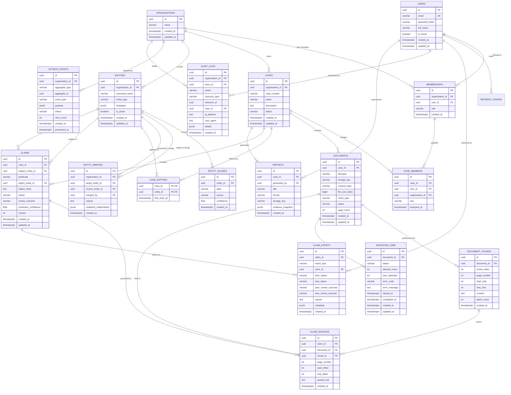

# RedThread Relational Database Design & Conceptual Architecture

> **Document Status**: `DESIGN`  
> **Role**: Primary Database Architecture Specification  
> **Target Engine**: PostgreSQL 16  
> **Relational Invariant**: PostgreSQL is the sole authoritative Source of Truth. Redis, Cognee, and Object Storage are derived, ephemeral, or specialized transport/index layers.

---

## 1. Stage 1: Existing Repository Database Audit

### 1.1 Current State Analysis
A thorough inspection of the repository reveals that the existing prototype lacks any relational database persistence layer:
1. **Zero Database Infrastructure**: No PostgreSQL connection, no SQLAlchemy ORM models, no Alembic migration scripts exist in the repository.
2. **Ephemeral In-Memory State**: 
   - `backend/main.py` stores document texts in a global dictionary: `DATASET_TEXTS: dict[str, str] = {}`.
   - Edge confidence scores are stored in a global dictionary: `EDGE_CONFIDENCE: dict[str, float] = {}`.
   - On server restart, all documents, confidence states, and case associations are permanently lost.
3. **Implicit Storage in Cognee**: 
   - Cognee's internal DuckDB/Kùzu/SQLite stores are used directly as an ad-hoc database.
   - Cognee provides no multi-tenant isolation, no foreign-key integrity, no relational role-based access controls, and no ACID transaction boundaries.
4. **Destructive Updates**: 
   - Contradiction handling is simulated by calling `cognee.forget(dataset=target)`, which physically purges datasets rather than recording an audited dispute event.

### 1.2 Identified Architectural Deficiencies & Proposed Corrections

| Existing Flaw | Architectural Risk | Proposed PostgreSQL Correction |
| :--- | :--- | :--- |
| **In-Memory Global Dicts** | Total data loss on process restart; impossible to scale horizontally across multiple worker nodes. | Durable PostgreSQL 16 tables with WAL archiving and connection pooling. |
| **No Tenant/Case Boundaries** | Severe cross-tenant data leakage; IDOR vulnerabilities; violations of legal discovery standards. | Strict multi-tenancy model with composite foreign keys enforcing organization boundaries and PostgreSQL Row-Level Security (RLS). |
| **No Audit History** | Unverifiable claim changes; inability to establish evidentiary provenance in legal investigations. | Append-only `claim_events` and `audit_logs` tables tracking actor UUID, timestamp, prior state, new state, and reason. |
| **Dual Storage Competition** | Cognee and application state competing for truth; synchronization divergence under network failure. | Clear division: PostgreSQL is the **sole source of truth**; Cognee is an eventually consistent, derived graph accelerator. |
| **Redundant Relationship Storage** | Duplicating facts between `claims` and a separate `relationships` table risks split-brain inconsistency. | **Claims as Canonical Assertions**: A single `claims` table models entity-to-entity edges and entity-to-literal assertions. |

---

## 2. Stage 2: Conceptual Database Design

### 2.1 Entity Inventory & Domain Boundaries

The RedThread domain model consists of 18 distinct entities organized across 6 functional subdomains:

```
1. Identity & Tenancy Subdomain
   ├── Organizations (Tenant boundary)
   ├── Users (Global identity)
   ├── Memberships (Tenant-User junction + Org Role)
   └── RefreshTokens (Cryptographic session persistence)

2. Case Management Subdomain
   ├── Cases (Logical investigation workspace within an Org)
   └── CaseMembers (Case-level assignment + Case Role)

3. Document & Ingestion Subdomain
   ├── Documents (Case-scoped file metadata & deduplication hash)
   ├── DocumentChunks (Segmented text spans with character offsets & token counts)
   └── IngestionJobs (Asynchronous processing lifecycle state machine)

4. Knowledge Subdomain
   ├── Entities (Canonical real-world entities scoped to an Org)
   ├── EntityAliases (Observed name variants linked to a canonical entity)
   ├── CaseEntities (Junction associating entities with cases where they appear)
   └── EntityMerges (Auditable, reversible entity merge history)

5. Claims & Evidence Subdomain
   ├── Claims (Canonical assertions connecting subject, predicate, and object/value)
   ├── ClaimSources (Granular grounding linking claims to document chunks & offsets)
   └── ClaimEvents (Immutable event ledger tracking disputes, reviews, and retractions)

6. Background Processing & Auditing Subdomain
   ├── OutboxEvents (Transactional outbox for reliable event dispatch to Celery/Redis)
   ├── AuditLogs (Immutable security and operational event trail)
   └── Reports (Frozen evidentiary dossiers exported in PDF/JSON/CSV)
```

---

### 2.2 Cardinality & Participation Constraints

| Relationship | Cardinality | Participation | Structural Justification |
| :--- | :---: | :---: | :--- |
| **Organization to Case** | $1 : N$ | Mandatory (Case) | Every Case must belong to exactly one Organization. An Organization may have zero or more Cases. |
| **Organization to User** | $M : N$ | Optional (Both) | Users can participate in multiple Organizations via the `memberships` junction table. |
| **Case to User** | $M : N$ | Optional (User), Mandatory (Case) | Investigators are assigned to Cases via `case_members`. Every case must have at least one creator/owner. |
| **Case to Document** | $1 : N$ | Mandatory (Document) | A Document belongs strictly to one Case. A Case may contain zero or more Documents. |
| **Document to DocumentChunk**| $1 : N$ | Mandatory (Chunk) | Chunks represent contiguous, overlapping text segments of a single Document. |
| **Document to IngestionJob** | $1 : N$ | Mandatory (Job) | Tracks processing attempts; allows re-ingestion and retries while preserving job history. |
| **Organization to Entity** | $1 : N$ | Mandatory (Entity) | Entities are scoped to an Organization, enabling cross-case intelligence without cross-tenant leakage. |
| **Entity to EntityAlias** | $1 : N$ | Mandatory (Alias) | A canonical entity can have many aliases (acronyms, misspellings, pseudonyms). |
| **Case to Entity** | $M : N$ | Optional (Both) | Tracked explicitly via `case_entities` to bound graph queries and calculate case-level metrics. |
| **Entity to EntityMerge** | $1 : N$ | Optional | Models reversible merges where multiple source entities are subsumed into a target entity. |
| **Case to Claim** | $1 : N$ | Mandatory (Claim) | Claims are created in the context of an investigation case. |
| **Entity to Claim (Subject)** | $1 : N$ | Mandatory (Claim) | Every Claim must have a defined subject Entity. |
| **Entity to Claim (Object)** | $1 : N$ | Optional (Claim) | Claims connecting two entities reference `object_entity_id`. Literal claims leave this `NULL` and set `object_value`. |
| **Claim to ClaimSource** | $1 : N$ | Mandatory (Claim) | Evidence-First invariant: Every claim must be grounded in at least one document source offset. |
| **Claim to ClaimEvent** | $1 : N$ | Mandatory (Claim) | Every claim mutation (creation, dispute, review, retraction) generates an immutable event row. |
| **Organization to OutboxEvent**| $1 : N$ | Mandatory (Event) | Outbox events are scoped to organizations for guaranteed reliable task dispatch. |

---

## 3. Complete Mermaid Entity-Relationship Diagram



---

## 4. Functional Dependency & Normalization Analysis

### 4.1 Functional Dependencies by Table

#### Table: `users`
- Candidate Key: `{id}`, `{email}`
- Functional Dependencies:
  - $\text{id} \rightarrow \text{email}, \text{password\_hash}, \text{full\_name}, \text{is\_active}, \text{created\_at}, \text{updated\_at}$
  - $\text{email} \rightarrow \text{id}, \text{password\_hash}, \text{full\_name}, \text{is\_active}, \text{created\_at}, \text{updated\_at}$
- Normal Form: **BCNF**. Every determinant is a candidate key.

#### Table: `memberships`
- Candidate Key: `{id}`, `{organization_id, user_id}`
- Functional Dependencies:
  - $\text{id} \rightarrow \text{organization\_id}, \text{user\_id}, \text{role}, \text{created\_at}$
  - $\{\text{organization\_id}, \text{user\_id}\} \rightarrow \text{id}, \text{role}, \text{created\_at}$
- Normal Form: **BCNF**. All determinants are candidate keys. Eliminates update anomalies when modifying an organizational role.

#### Table: `cases`
- Candidate Key: `{id}`, `{organization_id, case_number}`
- Functional Dependencies:
  - $\text{id} \rightarrow \text{organization\_id}, \text{case\_number}, \text{name}, \text{description}, \text{status}, \text{created\_at}, \text{updated\_at}$
  - $\{\text{organization\_id}, \text{case\_number}\} \rightarrow \text{id}, \text{name}, \text{description}, \text{status}, \text{created\_at}, \text{updated\_at}$
- Normal Form: **BCNF**. Prevents case number collision while ensuring scoped uniqueness.

#### Table: `documents`
- Candidate Key: `{id}`, `{case_id, content_hash}`
- Functional Dependencies:
  - $\text{id} \rightarrow \text{case\_id}, \text{filename}, \text{storage\_key}, \text{content\_hash}, \text{file\_size\_bytes}, \text{mime\_type}, \text{status}, \text{page\_count}, \text{created\_at}, \text{updated\_at}$
  - $\{\text{case\_id}, \text{content\_hash}\} \rightarrow \text{id}, \text{filename}, \text{storage\_key}, \dots$
- Normal Form: **BCNF**. Enforces document deduplication within a case at the schema level.

#### Table: `document_chunks`
- Candidate Key: `{id}`, `{document_id, chunk_index}`
- Functional Dependencies:
  - $\text{id} \rightarrow \text{document\_id}, \text{chunk\_index}, \text{page\_number}, \text{start\_char}, \text{end\_char}, \text{content}, \text{token\_count}, \text{created\_at}$
  - $\{\text{document\_id}, \text{chunk\_index}\} \rightarrow \text{id}, \text{page\_number}, \text{start\_char}, \text{end\_char}, \text{content}, \text{token\_count}, \text{created\_at}$
- Normal Form: **BCNF**. Chunks are uniquely identified either by surrogate UUID or composite document sequence.

#### Table: `entities`
- Candidate Key: `{id}`, `{organization_id, canonical_name, entity_type}`
- Functional Dependencies:
  - $\text{id} \rightarrow \text{organization\_id}, \text{canonical\_name}, \text{entity\_type}, \text{metadata}, \text{is\_active}, \text{created\_at}, \text{updated\_at}$
  - $\{\text{organization\_id}, \text{canonical\_name}, \text{entity\_type}\} \rightarrow \text{id}, \text{metadata}, \text{is\_active}, \text{created\_at}, \text{updated\_at}$
- Normal Form: **BCNF**. Guarantees that within an organization, a canonical name of a given entity type refers to exactly one entity record.

#### Table: `claims`
- Candidate Key: `{id}`
- Functional Dependencies:
  - $\text{id} \rightarrow \text{case\_id}, \text{subject\_entity\_id}, \text{predicate}, \text{object\_entity\_id}, \text{object\_value}, \text{status}, \text{review\_outcome}, \text{extraction\_confidence}, \text{version}, \text{created\_at}, \text{updated\_at}$
- Normal Form: **BCNF**. Every attribute depends directly on the claim primary key.

#### Table: `claim_sources`
- Candidate Key: `{id}`, `{claim_id, document_id, start_offset, end_offset}`
- Functional Dependencies:
  - $\text{id} \rightarrow \text{claim\_id}, \text{document\_id}, \text{chunk\_id}, \text{page\_number}, \text{start\_offset}, \text{end\_offset}, \text{quoted\_text}, \text{created\_at}$
  - $\{\text{claim\_id}, \text{document\_id}, \text{start\_offset}, \text{end\_offset}\} \rightarrow \text{id}, \text{chunk\_id}, \text{page\_number}, \text{quoted\_text}, \text{created\_at}$
- Normal Form: **BCNF**. Eliminates duplicate evidence attribution spans.

---

### 4.2 Normal Form Compliance & Evaluation (1NF through 5NF)

| Normal Form | Compliance Assessment | Proof / Invariant Enforced |
| :--- | :---: | :--- |
| **1NF (Atomic Attributes)** | **Satisfied** | All column attributes contain atomic values. Arrays and comma-separated lists are strictly prohibited for relationships. The only non-scalar field is `metadata` (`JSONB`), which is reserved exclusively for arbitrary unstructured entity metadata (e.g., raw vendor payload attributes) and is never used to model relational foreign keys. |
| **2NF (No Partial Dependencies)** | **Satisfied** | For all tables with composite candidate keys (`memberships`, `cases`, `documents`, `document_chunks`, `entities`, `case_entities`, `claim_sources`), every non-prime attribute depends on the **entire** composite key, not a proper subset. |
| **3NF (No Transitive Dependencies)** | **Satisfied** | There are no transitive dependencies ($X \rightarrow Y \rightarrow Z$) among non-key attributes. For example, `claims` stores `case_id`, `subject_entity_id`, and `predicate`, but does NOT duplicate the organization ID or entity canonical name; those are resolved strictly via relational joins. |
| **BCNF (Boyce-Codd Normal Form)**| **Satisfied** | For every non-trivial functional dependency $X \rightarrow Y$, the determinant $X$ is a superkey. There are no overlapping candidate keys with non-trivial dependencies on non-superkeys. |
| **4NF (No Multivalued Dependencies)**| **Satisfied** | Multivalued dependencies ($X \twoheadrightarrow Y$) are properly decomposed into independent junction tables. For instance, a Case has multiple assigned users and multiple uploaded documents; these independent $1:N$ relationships are modeled as distinct tables (`case_members` and `documents`), preventing MVD Cartesian anomalies. |
| **5NF (Join Dependencies)** | **Satisfied** | The decomposed tables cannot be further decomposed into smaller projection tables without losing information or integrity constraints. |

---

### 4.3 Anomalies Prevented

1. **Insertion Anomalies Prevented**:
   - In a non-normalized design where claims stored document text, you could not record an extracted entity or an investigator challenge without having a document attached. With normalized `entities`, `claims`, and `claim_sources`, entities and claims exist independently with granular source grounding.
2. **Update Anomalies Prevented**:
   - If an entity canonical name or alias were duplicated across hundreds of claims, renaming an entity would require updating thousands of rows. In RedThread, updating `entities.canonical_name` automatically updates all associated claims and graph views instantaneously.
3. **Deletion Anomalies Prevented**:
   - If a document is deleted or archived, normalized `claim_sources` allows deleting or soft-deleting document binaries while preserving the historical fact that Claim $C$ was once asserted in Document $D$ with its historical review audit trail intact.

---

### 4.4 Intentional Pragmatic Denormalizations

The schema introduces three strictly controlled denormalizations to optimize high-frequency hot paths:

1. **`document_chunks.page_number`**:
   - *Reason*: While the page number could theoretically be recalculated on the fly from character offsets against raw document layouts, storing `page_number` directly on the chunk eliminates expensive runtime geometric recalculations during retrieval.
2. **`claims.extraction_confidence`**:
   - *Reason*: Extracted directly by the LLM during ingestion and stored on the canonical claim row to enable fast $O(1)$ edge filtering during graph traversal without joining `claim_sources`.
3. **`ingestion_jobs.attempt_count` & `status`**:
   - *Reason*: Maintained on the parent job record to avoid executing `SELECT COUNT(*)` queries across individual worker log entries on every status polling poll.

---

## 5. Domain Invariants & Mathematical Constraint Model

### 5.1 Multi-Tenant Cross-Contamination Prevention
A critical security flaw in naive multi-tenant systems is associating a resource in Organization A with a user or entity in Organization B (IDOR). RedThread prevents this at the database engine level using **Composite Foreign Keys**:

#### Invariant 1: Case Membership Must Belong to Case Organization
```sql
-- In cases:
ALTER TABLE cases ADD CONSTRAINT uq_case_org UNIQUE (id, organization_id);

-- In memberships:
ALTER TABLE memberships ADD CONSTRAINT uq_membership_org_user UNIQUE (organization_id, user_id);

-- In case_members:
-- This composite foreign key guarantees that a user CANNOT be added to a case
-- unless they possess a verified membership in the EXACT SAME organization that owns the case!
ALTER TABLE case_members 
    ADD CONSTRAINT fk_case_member_org_user 
    FOREIGN KEY (organization_id, user_id) 
    REFERENCES memberships(organization_id, user_id) ON DELETE CASCADE;

ALTER TABLE case_members 
    ADD CONSTRAINT fk_case_member_case_org 
    FOREIGN KEY (case_id, organization_id) 
    REFERENCES cases(id, organization_id) ON DELETE CASCADE;
```

#### Invariant 2: Claim Sources Must Belong to the Same Case as the Claim
```sql
-- In documents:
ALTER TABLE documents ADD CONSTRAINT uq_doc_case UNIQUE (id, case_id);

-- In claims:
ALTER TABLE claims ADD CONSTRAINT uq_claim_case UNIQUE (id, case_id);

-- In claim_sources:
-- A claim source must belong to the exact same case as the parent claim!
ALTER TABLE claim_sources ADD COLUMN case_id UUID NOT NULL;

ALTER TABLE claim_sources 
    ADD CONSTRAINT fk_claim_source_claim_case 
    FOREIGN KEY (claim_id, case_id) 
    REFERENCES claims(id, case_id) ON DELETE CASCADE;

ALTER TABLE claim_sources 
    ADD CONSTRAINT fk_claim_source_doc_case 
    FOREIGN KEY (document_id, case_id) 
    REFERENCES documents(id, case_id) ON DELETE CASCADE;
```

---

### 5.2 Claim XOR Target Constraints
A claim connects a `subject_entity_id` to either:
1. Another entity (`object_entity_id IS NOT NULL AND object_value IS NULL`)
2. A literal value (`object_entity_id IS NULL AND object_value IS NOT NULL`)
3. Both in special annotated contexts (e.g. attributed monetary value)

```sql
ALTER TABLE claims ADD CONSTRAINT chk_claim_target_validity CHECK (
    (object_entity_id IS NOT NULL AND object_value IS NULL) OR
    (object_entity_id IS NULL AND object_value IS NOT NULL) OR
    (object_entity_id IS NOT NULL AND object_value IS NOT NULL)
);
```

### 5.3 Extraction Confidence Bound
```sql
ALTER TABLE claims ADD CONSTRAINT chk_claim_confidence_range CHECK (
    extraction_confidence >= 0.0 AND extraction_confidence <= 1.0
);
```

### 5.4 Self-Merge Prevention
```sql
ALTER TABLE entity_merges ADD CONSTRAINT chk_prevent_self_merge CHECK (
    target_entity_id <> source_entity_id
);
```

---

## 6. Comprehensive PostgreSQL 16 DDL

```sql
-- Enable cryptographic and UUID extensions
CREATE EXTENSION IF NOT EXISTS "uuid-ossp";
CREATE EXTENSION IF NOT EXISTS "pg_trgm";

-- ----------------------------------------------------------------------
-- 1. Identity & Tenancy
-- ----------------------------------------------------------------------
CREATE TABLE organizations (
    id UUID PRIMARY KEY DEFAULT uuid_generate_v4(),
    name VARCHAR(255) NOT NULL,
    created_at TIMESTAMPTZ NOT NULL DEFAULT NOW(),
    updated_at TIMESTAMPTZ NOT NULL DEFAULT NOW()
);

CREATE TABLE users (
    id UUID PRIMARY KEY DEFAULT uuid_generate_v4(),
    email VARCHAR(255) NOT NULL UNIQUE,
    password_hash VARCHAR(255) NOT NULL,
    full_name VARCHAR(255) NOT NULL,
    is_active BOOLEAN NOT NULL DEFAULT TRUE,
    created_at TIMESTAMPTZ NOT NULL DEFAULT NOW(),
    updated_at TIMESTAMPTZ NOT NULL DEFAULT NOW()
);
CREATE INDEX idx_users_email ON users(email);

CREATE TYPE org_role AS ENUM ('ORGANIZATION_ADMIN', 'INVESTIGATOR', 'REVIEWER', 'VIEWER');

CREATE TABLE memberships (
    id UUID PRIMARY KEY DEFAULT uuid_generate_v4(),
    organization_id UUID NOT NULL REFERENCES organizations(id) ON DELETE CASCADE,
    user_id UUID NOT NULL REFERENCES users(id) ON DELETE CASCADE,
    role org_role NOT NULL DEFAULT 'VIEWER',
    created_at TIMESTAMPTZ NOT NULL DEFAULT NOW(),
    CONSTRAINT uq_membership_org_user UNIQUE (organization_id, user_id)
);
CREATE INDEX idx_memberships_user ON memberships(user_id);
CREATE INDEX idx_memberships_org ON memberships(organization_id);

CREATE TABLE refresh_tokens (
    id UUID PRIMARY KEY DEFAULT uuid_generate_v4(),
    user_id UUID NOT NULL REFERENCES users(id) ON DELETE CASCADE,
    token_hash VARCHAR(64) NOT NULL UNIQUE, -- SHA-256 hash
    expires_at TIMESTAMPTZ NOT NULL,
    revoked_at TIMESTAMPTZ,
    created_at TIMESTAMPTZ NOT NULL DEFAULT NOW()
);
CREATE INDEX idx_refresh_tokens_hash ON refresh_tokens(token_hash);
CREATE INDEX idx_refresh_tokens_user ON refresh_tokens(user_id);

-- ----------------------------------------------------------------------
-- 2. Case Workspaces
-- ----------------------------------------------------------------------
CREATE TYPE case_status AS ENUM ('ACTIVE', 'ARCHIVED', 'CLOSED');

CREATE TABLE cases (
    id UUID PRIMARY KEY DEFAULT uuid_generate_v4(),
    organization_id UUID NOT NULL REFERENCES organizations(id) ON DELETE CASCADE,
    case_number VARCHAR(64) NOT NULL,
    name VARCHAR(255) NOT NULL,
    description TEXT,
    status case_status NOT NULL DEFAULT 'ACTIVE',
    created_at TIMESTAMPTZ NOT NULL DEFAULT NOW(),
    updated_at TIMESTAMPTZ NOT NULL DEFAULT NOW(),
    CONSTRAINT uq_org_case_number UNIQUE (organization_id, case_number),
    CONSTRAINT uq_case_org UNIQUE (id, organization_id)
);
CREATE INDEX idx_cases_org_status ON cases(organization_id, status);

CREATE TABLE case_members (
    id UUID PRIMARY KEY DEFAULT uuid_generate_v4(),
    case_id UUID NOT NULL,
    organization_id UUID NOT NULL,
    user_id UUID NOT NULL,
    role org_role NOT NULL DEFAULT 'INVESTIGATOR',
    assigned_at TIMESTAMPTZ NOT NULL DEFAULT NOW(),
    CONSTRAINT uq_case_member UNIQUE (case_id, user_id),
    CONSTRAINT fk_case_member_case_org FOREIGN KEY (case_id, organization_id) 
        REFERENCES cases(id, organization_id) ON DELETE CASCADE,
    CONSTRAINT fk_case_member_org_user FOREIGN KEY (organization_id, user_id) 
        REFERENCES memberships(organization_id, user_id) ON DELETE CASCADE
);
CREATE INDEX idx_case_members_user ON case_members(user_id);
CREATE INDEX idx_case_members_case ON case_members(case_id);

-- ----------------------------------------------------------------------
-- 3. Document Management & Ingestion
-- ----------------------------------------------------------------------
CREATE TYPE document_status AS ENUM ('UPLOADED', 'PROCESSING', 'INDEXED', 'FAILED');

CREATE TABLE documents (
    id UUID PRIMARY KEY DEFAULT uuid_generate_v4(),
    case_id UUID NOT NULL REFERENCES cases(id) ON DELETE CASCADE,
    filename VARCHAR(255) NOT NULL,
    storage_key VARCHAR(512) NOT NULL,
    content_hash VARCHAR(64) NOT NULL, -- SHA-256
    file_size_bytes BIGINT NOT NULL,
    mime_type VARCHAR(128) NOT NULL,
    status document_status NOT NULL DEFAULT 'UPLOADED',
    page_count INT,
    created_at TIMESTAMPTZ NOT NULL DEFAULT NOW(),
    updated_at TIMESTAMPTZ NOT NULL DEFAULT NOW(),
    CONSTRAINT uq_case_document_hash UNIQUE (case_id, content_hash),
    CONSTRAINT uq_doc_case UNIQUE (id, case_id)
);
CREATE INDEX idx_documents_case_status ON documents(case_id, status);
CREATE INDEX idx_documents_hash ON documents(content_hash);

CREATE TABLE document_chunks (
    id UUID PRIMARY KEY DEFAULT uuid_generate_v4(),
    document_id UUID NOT NULL REFERENCES documents(id) ON DELETE CASCADE,
    chunk_index INT NOT NULL,
    page_number INT NOT NULL,
    start_char INT NOT NULL,
    end_char INT NOT NULL,
    content TEXT NOT NULL,
    token_count INT NOT NULL,
    created_at TIMESTAMPTZ NOT NULL DEFAULT NOW(),
    CONSTRAINT uq_document_chunk_idx UNIQUE (document_id, chunk_index)
);
CREATE INDEX idx_document_chunks_doc ON document_chunks(document_id);

CREATE TYPE job_status AS ENUM ('QUEUED', 'PROCESSING', 'COMPLETED', 'FAILED', 'RETRYING', 'DEAD_LETTER');

CREATE TABLE ingestion_jobs (
    id UUID PRIMARY KEY DEFAULT uuid_generate_v4(),
    document_id UUID NOT NULL REFERENCES documents(id) ON DELETE CASCADE,
    status job_status NOT NULL DEFAULT 'QUEUED',
    attempt_count INT NOT NULL DEFAULT 0,
    max_attempts INT NOT NULL DEFAULT 3,
    error_code VARCHAR(64),
    error_message TEXT,
    started_at TIMESTAMPTZ,
    completed_at TIMESTAMPTZ,
    created_at TIMESTAMPTZ NOT NULL DEFAULT NOW(),
    updated_at TIMESTAMPTZ NOT NULL DEFAULT NOW()
);
CREATE INDEX idx_ingestion_jobs_status ON ingestion_jobs(status);
CREATE INDEX idx_ingestion_jobs_doc ON ingestion_jobs(document_id);

-- ----------------------------------------------------------------------
-- 4. Knowledge Management & Entities
-- ----------------------------------------------------------------------
CREATE TYPE entity_type AS ENUM (
    'PERSON', 'ORGANIZATION', 'FINANCIAL_ACCOUNT', 'MONETARY_AMOUNT',
    'LOCATION', 'DOCUMENT_REF', 'DATE_TIME', 'TRANSACTION'
);

CREATE TABLE entities (
    id UUID PRIMARY KEY DEFAULT uuid_generate_v4(),
    organization_id UUID NOT NULL REFERENCES organizations(id) ON DELETE CASCADE,
    canonical_name VARCHAR(255) NOT NULL,
    entity_type entity_type NOT NULL,
    metadata JSONB NOT NULL DEFAULT '{}'::jsonb,
    is_active BOOLEAN NOT NULL DEFAULT TRUE,
    created_at TIMESTAMPTZ NOT NULL DEFAULT NOW(),
    updated_at TIMESTAMPTZ NOT NULL DEFAULT NOW(),
    CONSTRAINT uq_org_entity_name_type UNIQUE (organization_id, canonical_name, entity_type)
);
CREATE INDEX idx_entities_canonical ON entities(organization_id, canonical_name);
CREATE INDEX idx_entities_trgm ON entities USING GIN (canonical_name gin_trgm_ops);
CREATE INDEX idx_entities_metadata ON entities USING GIN (metadata);

CREATE TABLE entity_aliases (
    id UUID PRIMARY KEY DEFAULT uuid_generate_v4(),
    entity_id UUID NOT NULL REFERENCES entities(id) ON DELETE CASCADE,
    alias VARCHAR(255) NOT NULL,
    source VARCHAR(64) NOT NULL DEFAULT 'INGESTION',
    confidence FLOAT NOT NULL DEFAULT 1.0,
    created_at TIMESTAMPTZ NOT NULL DEFAULT NOW(),
    CONSTRAINT uq_entity_alias UNIQUE (entity_id, alias)
);
CREATE INDEX idx_entity_aliases_alias ON entity_aliases(alias);
CREATE INDEX idx_entity_aliases_trgm ON entity_aliases USING GIN (alias gin_trgm_ops);

CREATE TABLE entity_merges (
    id UUID PRIMARY KEY DEFAULT uuid_generate_v4(),
    organization_id UUID NOT NULL REFERENCES organizations(id) ON DELETE CASCADE,
    target_entity_id UUID NOT NULL REFERENCES entities(id) ON DELETE RESTRICT,
    source_entity_id UUID NOT NULL REFERENCES entities(id) ON DELETE RESTRICT,
    merged_by UUID NOT NULL REFERENCES users(id) ON DELETE RESTRICT,
    reason TEXT NOT NULL,
    snapshot_relationships JSONB NOT NULL,
    created_at TIMESTAMPTZ NOT NULL DEFAULT NOW(),
    CONSTRAINT chk_prevent_self_merge CHECK (target_entity_id <> source_entity_id)
);
CREATE INDEX idx_entity_merges_org ON entity_merges(organization_id);
CREATE INDEX idx_entity_merges_target ON entity_merges(target_entity_id);

CREATE TABLE case_entities (
    case_id UUID NOT NULL REFERENCES cases(id) ON DELETE CASCADE,
    entity_id UUID NOT NULL REFERENCES entities(id) ON DELETE CASCADE,
    first_seen_at TIMESTAMPTZ NOT NULL DEFAULT NOW(),
    PRIMARY KEY (case_id, entity_id)
);
CREATE INDEX idx_case_entities_entity ON case_entities(entity_id);

-- ----------------------------------------------------------------------
-- 5. Claims & Granular Provenance
-- ----------------------------------------------------------------------
CREATE TYPE claim_status AS ENUM ('ACTIVE', 'DISPUTED', 'RETRACTED');
CREATE TYPE review_outcome AS ENUM ('PENDING', 'UPHELD', 'REJECTED', 'INCONCLUSIVE');

CREATE TABLE claims (
    id UUID PRIMARY KEY DEFAULT uuid_generate_v4(),
    case_id UUID NOT NULL REFERENCES cases(id) ON DELETE CASCADE,
    subject_entity_id UUID NOT NULL REFERENCES entities(id) ON DELETE RESTRICT,
    predicate VARCHAR(64) NOT NULL,
    object_entity_id UUID REFERENCES entities(id) ON DELETE RESTRICT,
    object_value TEXT,
    status claim_status NOT NULL DEFAULT 'ACTIVE',
    review_outcome review_outcome NOT NULL DEFAULT 'PENDING',
    extraction_confidence FLOAT NOT NULL DEFAULT 0.0,
    version INT NOT NULL DEFAULT 1,
    created_at TIMESTAMPTZ NOT NULL DEFAULT NOW(),
    updated_at TIMESTAMPTZ NOT NULL DEFAULT NOW(),
    CONSTRAINT uq_claim_case UNIQUE (id, case_id),
    CONSTRAINT chk_claim_confidence_range CHECK (extraction_confidence >= 0.0 AND extraction_confidence <= 1.0),
    CONSTRAINT chk_claim_target_validity CHECK (
        (object_entity_id IS NOT NULL AND object_value IS NULL) OR
        (object_entity_id IS NULL AND object_value IS NOT NULL) OR
        (object_entity_id IS NOT NULL AND object_value IS NOT NULL)
    )
);
CREATE INDEX idx_claims_case_status ON claims(case_id, status);
CREATE INDEX idx_claims_subject ON claims(subject_entity_id);
CREATE INDEX idx_claims_object ON claims(object_entity_id);
CREATE INDEX idx_claims_predicate ON claims(predicate);

-- Partial index for active claims in graph retrieval
CREATE INDEX idx_claims_active ON claims(case_id, subject_entity_id, object_entity_id) 
    WHERE status = 'ACTIVE';

CREATE TABLE claim_sources (
    id UUID PRIMARY KEY DEFAULT uuid_generate_v4(),
    claim_id UUID NOT NULL,
    document_id UUID NOT NULL,
    case_id UUID NOT NULL,
    chunk_id UUID REFERENCES document_chunks(id) ON DELETE SET NULL,
    page_number INT NOT NULL,
    start_offset INT NOT NULL,
    end_offset INT NOT NULL,
    quoted_text TEXT NOT NULL,
    created_at TIMESTAMPTZ NOT NULL DEFAULT NOW(),
    CONSTRAINT fk_claim_source_claim_case FOREIGN KEY (claim_id, case_id) 
        REFERENCES claims(id, case_id) ON DELETE CASCADE,
    CONSTRAINT fk_claim_source_doc_case FOREIGN KEY (document_id, case_id) 
        REFERENCES documents(id, case_id) ON DELETE CASCADE,
    CONSTRAINT uq_claim_source_span UNIQUE (claim_id, document_id, start_offset, end_offset)
);
CREATE INDEX idx_claim_sources_claim ON claim_sources(claim_id);
CREATE INDEX idx_claim_sources_doc ON claim_sources(document_id);

CREATE TYPE claim_event_type AS ENUM (
    'CLAIM_CREATED',
    'CLAIM_CHALLENGED',
    'EVIDENCE_ATTACHED',
    'CLAIM_REVIEWED',
    'CLAIM_RETRACTED',
    'CLAIM_REINSTATED'
);

CREATE TABLE claim_events (
    id UUID PRIMARY KEY DEFAULT uuid_generate_v4(),
    claim_id UUID NOT NULL REFERENCES claims(id) ON DELETE CASCADE,
    event_type claim_event_type NOT NULL,
    actor_id UUID NOT NULL REFERENCES users(id) ON DELETE RESTRICT,
    prior_status claim_status,
    new_status claim_status NOT NULL,
    prior_review_outcome review_outcome,
    new_review_outcome review_outcome NOT NULL,
    reason TEXT NOT NULL,
    metadata JSONB NOT NULL DEFAULT '{}'::jsonb,
    created_at TIMESTAMPTZ NOT NULL DEFAULT NOW()
);
CREATE INDEX idx_claim_events_claim ON claim_events(claim_id);
CREATE INDEX idx_claim_events_actor ON claim_events(actor_id);

-- ----------------------------------------------------------------------
-- 6. Outbox, Auditing & Reports
-- ----------------------------------------------------------------------
CREATE TYPE outbox_status AS ENUM ('PENDING', 'PUBLISHED', 'FAILED');

CREATE TABLE outbox_events (
    id UUID PRIMARY KEY DEFAULT uuid_generate_v4(),
    organization_id UUID NOT NULL REFERENCES organizations(id) ON DELETE CASCADE,
    aggregate_type VARCHAR(64) NOT NULL,
    aggregate_id UUID NOT NULL,
    event_type VARCHAR(64) NOT NULL,
    payload JSONB NOT NULL,
    status outbox_status NOT NULL DEFAULT 'PENDING',
    retry_count INT NOT NULL DEFAULT 0,
    created_at TIMESTAMPTZ NOT NULL DEFAULT NOW(),
    processed_at TIMESTAMPTZ
);
CREATE INDEX idx_outbox_pending ON outbox_events(created_at) WHERE status = 'PENDING';

CREATE TABLE audit_logs (
    id UUID PRIMARY KEY DEFAULT uuid_generate_v4(),
    organization_id UUID NOT NULL REFERENCES organizations(id) ON DELETE CASCADE,
    actor_id UUID REFERENCES users(id) ON DELETE SET NULL,
    action VARCHAR(64) NOT NULL,
    resource_type VARCHAR(64) NOT NULL,
    resource_id UUID NOT NULL,
    case_id UUID REFERENCES cases(id) ON DELETE CASCADE,
    ip_address INET,
    user_agent TEXT,
    details JSONB NOT NULL DEFAULT '{}'::jsonb,
    created_at TIMESTAMPTZ NOT NULL DEFAULT NOW()
);
CREATE INDEX idx_audit_logs_org_created ON audit_logs(organization_id, created_at DESC);
CREATE INDEX idx_audit_logs_case ON audit_logs(case_id);

CREATE TABLE reports (
    id UUID PRIMARY KEY DEFAULT uuid_generate_v4(),
    case_id UUID NOT NULL REFERENCES cases(id) ON DELETE CASCADE,
    generated_by UUID NOT NULL REFERENCES users(id) ON DELETE RESTRICT,
    title VARCHAR(255) NOT NULL,
    format VARCHAR(16) NOT NULL, -- 'PDF', 'JSON', 'CSV'
    storage_key VARCHAR(512) NOT NULL,
    evidence_snapshot JSONB NOT NULL,
    created_at TIMESTAMPTZ NOT NULL DEFAULT NOW()
);
CREATE INDEX idx_reports_case ON reports(case_id);
```

---

## 7. Related Documents
- [Database Transactions Specification](database-transactions.md)
- [Database Security & RLS](database-security.md)
- [Database Performance & Indexing](database-performance.md)
- [Database Operations & Runbooks](database-operations.md)
- [Data Consistency Specification](data-consistency.md)
