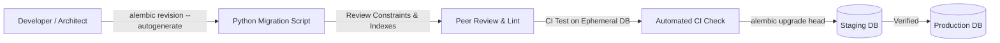

# RedThread Database Operations, Migrations & Disaster Recovery

> **Document Status**: `DESIGN`  
> **Role**: Operational Runbooks, Schema Evolution, Backup/Restore, and Maintenance  
> **Target Engine**: PostgreSQL 16  
> **Core Principle**: Zero-downtime migrations via expand-and-contract. Backups are untrusted until a test restoration succeeds.

---

## 1. Schema Migrations with Alembic

All database modifications in RedThread are governed exclusively by **Alembic versioned migrations**. Raw manual DDL execution in production is strictly prohibited.



### 1.1 Non-Disruptive Migration Rules (Expand-and-Contract)

1. **Adding Non-Null Columns Safely**:
   - *Bad Practice*: `ALTER TABLE claims ADD COLUMN score FLOAT NOT NULL;` (Locks table, fails if existing rows exist).
   - *Production Pattern (3-step)*:
     1. Add column as nullable: `ALTER TABLE claims ADD COLUMN score FLOAT;`
     2. Backfill existing rows via batch script: `UPDATE claims SET score = 1.0 WHERE score IS NULL;`
     3. Add constraint: `ALTER TABLE claims ALTER COLUMN score SET NOT NULL;`
2. **Concurrent Index Creation**:
   - Large production tables must never be locked during index creation:
     ```python
     def upgrade() -> None:
         op.execute("COMMIT")  # Exit active transaction block
         op.execute("CREATE INDEX CONCURRENTLY idx_claims_active ON claims(case_id, subject_entity_id) WHERE status = 'ACTIVE'")
     ```
3. **Mandatory Downgrade Support**:
   - Every migration script must implement a deterministic, tested `downgrade()` function to support automated rollbacks during deployment failures.

---

## 2. Backup, Recovery & Durability Architecture

### 2.1 Recovery Objectives (RPO & RTO)
- **Recovery Point Objective (RPO)**: $< 5\text{ minutes}$  
  (Maximum permissible data loss in a catastrophic disaster; achieved via continuous Write-Ahead Log (WAL) archiving).
- **Recovery Time Objective (RTO)**: $< 30\text{ minutes}$  
  (Time to restore full service from a cold infrastructure failure).

---

### 2.2 Backup Strategy Matrix

| Backup Type | Frequency | Tool / Strategy | Storage Destination | Retention |
| :--- | :--- | :--- | :--- | :--- |
| **Continuous WAL Archiving** | Real-time (streamed on segment close) | PostgreSQL `archive_command` / `WAL-G` | S3-Compatible Cloud Vault (`/wal/`) | 14 Days |
| **Full Base Backup** | Daily at 02:00 UTC | `pg_basebackup` / Managed Snapshot | S3-Compatible Cloud Vault (`/backups/`) | 30 Days |
| **Logical Schema Dump** | Pre-deployment | `pg_dump -Fc --schema-only` | Git release artifact / Local S3 | 90 Days |

---

### 2.3 Point-in-Time Recovery (PITR) Runbook

When a critical data corruption or mistaken truncation occurs:
1. **Identify Target Timestamp**: Determine exact timestamp $T_{\text{target}}$ prior to the corrupting event from `audit_logs`.
2. **Provision Target PostgreSQL Instance**: Launch fresh server with identical hardware and engine version.
3. **Restore Most Recent Base Backup**:
   ```bash
   wal-g backup-fetch /var/lib/postgresql/data latest
   ```
4. **Configure `recovery.signal`**:
   ```ini
   # In /var/lib/postgresql/data/postgresql.conf
   restore_command = 'wal-g wal-fetch "%f" "%p"'
   recovery_target_time = '2026-11-18 01:45:00 UTC'
   recovery_target_action = 'promote'
   ```
5. **Start PostgreSQL**: The engine replays WAL logs up to the exact millisecond before the corruption and promotes itself to primary.

---

## 3. Routine Maintenance & Vacuuming

### 3.1 Autovacuum Tuning for High-Churn Tables
Tables like `outbox_events` and `ingestion_jobs` experience hundreds of inserts, updates, and deletes per minute, generating dead tuples rapidly. Default PostgreSQL autovacuum settings are too conservative:

```sql
-- Tune autovacuum for outbox_events to prevent table bloat
ALTER TABLE outbox_events SET (
    autovacuum_vacuum_scale_factor = 0.05,  -- Trigger vacuum when 5% of rows are dead
    autovacuum_vacuum_cost_limit = 1000,
    autovacuum_vacuum_cost_delay = 2
);
```

### 3.2 Outbox Retention & Cleanup Daemon
A background cron job runs nightly to delete successfully processed outbox events older than 7 days, maintaining table size $< 100,000$ rows:
```sql
DELETE FROM outbox_events 
WHERE status = 'PUBLISHED' 
  AND processed_at < NOW() - INTERVAL '7 days';
```

---

## 4. Related Documents
- [Database Design Specification](database-design.md)
- [Database Performance & Indexing](database-performance.md)
- [Deployment & Operations](deployment-and-operations.md)
