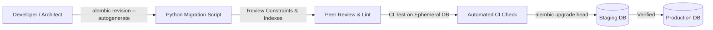

# RedThread Database Operations, Migrations & Disaster Recovery Specification

> **Document Status**: `DESIGN`  
> **Role**: Operational Runbooks, Alembic Autocommit Migrations, Backup/Restore Testing, and Retention Cleanup  
> **Target Engine**: PostgreSQL 16  
> **Core Principle**: Zero-downtime migrations via expand-and-contract. Backups are unverified assumptions until automated restore drills prove recoverability.

---

## 1. Schema Migrations with Alembic

All database modifications in RedThread are governed exclusively by **Alembic versioned migrations**. Manual DDL execution in production is strictly prohibited.



### 1.1 Proper Concurrent Index Migrations in Alembic
In PostgreSQL, `CREATE INDEX CONCURRENTLY` cannot run inside an active transaction block. Attempting raw `op.execute("COMMIT")` inside an Alembic migration breaks Alembic's transaction manager.

The proper, supported pattern is to use **`autocommit_block()`**:

```python
"""Add concurrent index on active claims

Revision ID: 002_add_active_claims_idx
Revises: 001_initial_schema
Create Date: 2026-11-18
"""
from alembic import op

# revision identifiers, used by Alembic.
revision = '002_add_active_claims_idx'
down_revision = '001_initial_schema'
branch_labels = None
depends_on = None

def upgrade() -> None:
    # Use Alembic autocommit block to run DDL outside an ambient transaction
    with op.get_context().autocommit_block():
        op.create_index(
            'idx_claims_active',
            'claims',
            ['case_id', 'subject_entity_id', 'object_entity_id'],
            postgresql_where=sa.text("status = 'ACTIVE' AND claim_type = 'ENTITY_TO_ENTITY'"),
            postgresql_concurrently=True
        )

def downgrade() -> None:
    with op.get_context().autocommit_block():
        op.drop_index(
            'idx_claims_active',
            table_name='claims',
            postgresql_concurrently=True
        )
```

---

### 1.2 Non-Disruptive Migration Rules (Expand-and-Contract)

1. **Adding Non-Null Columns Safely**:
   - Step 1 (Expand): Add column as nullable.
   - Step 2 (Backfill): Populate values via batch background updates.
   - Step 3 (Contract): Apply `ALTER TABLE ... ALTER COLUMN ... SET NOT NULL;`.
2. **When Destructive Downgrade is Unsafe**:
   - If a migration drops a column or table (contract phase), running `alembic downgrade` after data has been modified in production will cause permanent data loss. Destructive operations are marked with a `# DESTRUCTIVE DOWNGRADE WARNING` in Alembic scripts and require a mandatory full snapshot before execution.

---

## 2. Backup, Recovery & Durability Architecture

### 2.1 Recovery Objectives (RPO & RTO Targets)
> [!NOTE]
> The following RPO and RTO values represent **architectural engineering targets** assuming configured cloud object storage and automated WAL archiving infrastructure:

- **Target Recovery Point Objective (RPO)**: $< 15\text{ minutes}$  
  (Maximum permissible data loss in a catastrophic disaster; achieved via continuous Write-Ahead Log archiving).
- **Target Recovery Time Objective (RTO)**: $< 60\text{ minutes}$  
  (Time required to provision replacement compute, restore the latest daily base backup, and replay WAL segments).

---

### 2.2 Backup Strategy Matrix

| Backup Type | Frequency | Tool / Strategy | Destination | Retention Policy |
| :--- | :--- | :--- | :--- | :--- |
| **Continuous WAL Archiving** | Real-time (streamed on segment close) | PostgreSQL `archive_command` / `WAL-G` | S3-Compatible Cloud Vault (`/wal/`) | 14 Days |
| **Full Base Backup** | Daily at 02:00 UTC | `pg_basebackup` / Managed Snapshot | S3-Compatible Cloud Vault (`/backups/`) | 30 Days |
| **Logical Schema Dump** | Pre-deployment | `pg_dump -Fc --schema-only` | Versioned Git release artifact | 90 Days |

---

### 2.3 Automated Backup Verification & Restore Testing Drills
Backups that have not been restored are merely theoretical assumptions. RedThread institutes an automated weekly restore drill:
1. An ephemeral container is launched in CI/CD.
2. The latest production base backup is fetched from S3.
3. WAL segments are replayed up to the current timestamp.
4. An automated test query verifies table row counts, composite foreign key integrity, and RLS policies.
5. The drill logs a success report or raises an automated alert to on-call engineering.

---

## 3. Routine Maintenance & Vacuuming

### 3.1 Autovacuum Tuning for High-Churn Outbox Tables
The `outbox_events` table experiences continuous inserts and updates, generating dead tuples rapidly. To avoid table bloat and index degradation, aggressive autovacuum thresholds are applied:

```sql
ALTER TABLE outbox_events SET (
    autovacuum_vacuum_scale_factor = 0.05,  -- Trigger vacuum when 5% of rows are dead
    autovacuum_vacuum_cost_limit = 1000,
    autovacuum_vacuum_cost_delay = 2
);
```

### 3.2 Safe Outbox Retention & Cleanup Daemon
To guarantee that active tasks are never prematurely deleted, cleanup scripts delete records **strictly when both conditions are satisfied**:
1. `status = 'PUBLISHED'`
2. `processed_at < NOW() - INTERVAL '7 days'`

Unprocessed (`PENDING`, `PROCESSING`) or failed events are **never deleted by the retention cleaner**:

```sql
DELETE FROM outbox_events 
WHERE status = 'PUBLISHED' 
  AND processed_at IS NOT NULL 
  AND processed_at < NOW() - INTERVAL '7 days';
```

---

## 4. Related Documents
- [Database Design Specification](database-design.md)
- [Database Performance & Indexing](database-performance.md)
- [Deployment & Operations](deployment-and-operations.md)
