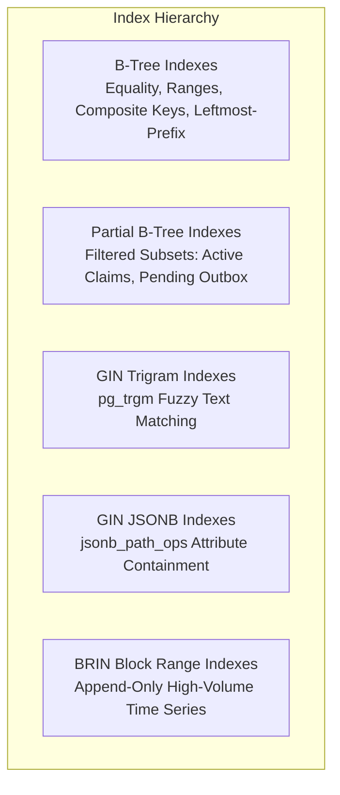

# RedThread Database Performance, Indexing & Connection Management Specification

> **Document Status**: `DESIGN`  
> **Role**: Query Optimization, Indexing Engineering, and Connection Pool Sizing  
> **Target Engine**: PostgreSQL 16  
> **Core Principle**: Indexes must be justified by concrete query patterns and selectivity analysis. Memory sizing must account for per-operator allocations rather than global server limits.

---

## 1. Indexing Strategy & Index Type Analysis

RedThread applies five distinct PostgreSQL indexing types based on access pattern selectivity and write overhead:



### 1.1 Complete Index Inventory & Query Mapping

| Index Name | Table | Type & Column Definition | Exact Query Pattern Supported | Selectivity | Write Overhead | Justification |
| :--- | :--- | :--- | :--- | :--- | :--- | :--- |
| `idx_claims_active` | `claims` | **Partial B-Tree**:<br/>`(case_id, subject_entity_id, object_entity_id) WHERE status = 'ACTIVE' AND claim_type = 'ENTITY_TO_ENTITY'` | `WHERE case_id = :cid AND subject_entity_id = :sid AND status = 'ACTIVE'` | **Very High** ($< 5\%$ of table size as disputes/retractions accumulate) | Low (only written when active claims inserted/transitioned) | BFS graph traversal only expands active relationship edges. Omitting retracted claims keeps the working set entirely in shared buffers. |
| `idx_outbox_pending_dispatch` | `outbox_events` | **Partial B-Tree**:<br/>`(status, next_retry_at, created_at) WHERE status = 'PENDING'` | `WHERE status = 'PENDING' AND next_retry_at <= NOW() ORDER BY aggregate_id, aggregate_version` | **Extremely High** ($< 0.1\%$ of total outbox volume) | Low (written on insert, removed from partial tree on publish) | Outbox polling scans a tiny index slice ($< 100$ rows) instead of performing expensive sequential scans across millions of processed rows. |
| `idx_entities_trgm` | `entities` | **GIN Trigram**:<br/>`canonical_name gin_trgm_ops` | `WHERE canonical_name % :search_string` (similarity candidate generation) | **High** across entity search space | High (multi-key inverted index updates on insert) | Accelerates fuzzy name candidate retrieval in entity resolution without requiring sequential table scans. |
| `idx_entity_aliases_trgm` | `entity_aliases` | **GIN Trigram**:<br/>`alias gin_trgm_ops` | `WHERE alias % :search_alias` | **High** | High on alias insert | Enables sub-10ms lookup across thousands of acronyms, corporate variants, and misspellings. |
| `idx_entities_metadata` | `entities` | **GIN JSONB**:<br/>`metadata jsonb_path_ops` | `WHERE metadata @> '{"tax_id": "..."}'` | High on structured attribute filters | Moderate | `jsonb_path_ops` hashes entire path-value pairs, generating a 50% smaller index footprint than default `jsonb_ops`. |
| `idx_documents_case_status` | `documents` | **Composite B-Tree**:<br/>`(case_id, status)` | `WHERE case_id = :cid AND status = 'INDEXED'` | High | Low | Leftmost prefix supports filtering documents by case while skipping failed uploads. |
| `idx_claim_sources_claim` | `claim_sources` | **B-Tree**:<br/>`(claim_id)` | Foreign key joins: `FROM claims c JOIN claim_sources s ON s.claim_id = c.id` | High | Moderate | Prevents full table scan on `claim_sources` whenever citations are retrieved for AI recall. |
| `idx_claim_versions_lookup` | `claim_versions` | **Composite B-Tree**:<br/>`(claim_id, version DESC)` | `WHERE claim_id = :cid ORDER BY version DESC` | High | Low (append-only) | Instantly retrieves historical claim audit snapshots in reverse chronological order. |
| `idx_audit_logs_org_created` | `audit_logs` | **BRIN** / **B-Tree**:<br/>`(organization_id, created_at DESC)` | `WHERE organization_id = :oid AND created_at >= :start_date ORDER BY created_at DESC` | High | Low | Large append-only compliance ledger; indexes temporal range queries efficiently. |

---

## 2. Example Query Plans (Analytical EXPLAIN Models)

> [!NOTE]
> The following execution plans are **analytical models** illustrating expected query planner behavior under representative data volumes. Actual execution times depend on hardware, buffer cache warming, and table statistics (`ANALYZE`).

### 2.1 Model 1: Active Graph Neighbor Traversal
```sql
EXPLAIN (BUFFERS, COSTS)
SELECT c.id, c.subject_entity_id, c.predicate, c.object_entity_id, c.extraction_confidence
FROM claims c
WHERE c.case_id = 'c1f2e3d4-5678-90ab-cdef-1234567890ab'
  AND c.subject_entity_id = 'e3b0c442-98fc-1c14-9af0-2a3b9566963f'
  AND c.status = 'ACTIVE'
  AND c.claim_type = 'ENTITY_TO_ENTITY';
```
**Expected Plan Shape**:
```
Index Scan using idx_claims_active on claims c
  Index Cond: ((case_id = 'c1f2e3d4-...'::uuid) AND (subject_entity_id = 'e3b0c442-...'::uuid))
  Cost: 0.28..8.30 Rows: 4 Width: 88
```
- *Explanation*: The query planner uses the partial index `idx_claims_active`, bypassing the entire bulk of retracted or disputed claims and fetching matching active edges via an index scan.

### 2.2 Model 2: Outbox Worker Dispatch (`SKIP LOCKED`)
```sql
EXPLAIN (BUFFERS, COSTS)
SELECT id, aggregate_id, payload 
FROM outbox_events
WHERE status = 'PENDING' AND next_retry_at <= NOW()
ORDER BY aggregate_id, aggregate_version ASC, created_at ASC
LIMIT 50
FOR UPDATE SKIP LOCKED;
```
**Expected Plan Shape**:
```
Limit (Cost: 0.15..12.45 Rows: 50 Width: 320)
  -> LockRows (Cost: 0.15..24.60 Rows: 100 Width: 320)
       -> Index Scan using idx_outbox_pending_dispatch on outbox_events
            Index Cond: (status = 'PENDING'::outbox_status AND next_retry_at <= now())
```
- *Explanation*: Indexes directly on the partial index condition, avoiding locks on in-flight rows processed by concurrent workers via `SKIP LOCKED`.

---

## 3. Connection Pool Budgeting & Memory Calculations

### 3.1 The `work_mem` Per-Operation Principle
A critical database engineering truth: **`work_mem` is allocated per sort, hash join, or aggregation operator per query**, not as a fixed memory block per connection. A complex recall query with two sorts and a hash join can allocate $3 \times \text{work\_mem}$ simultaneously.

Setting `work_mem` too high (e.g. 64 MB with 100 connections) risks catastrophic Linux Out-Of-Memory (OOM) killer terminations:
$$\text{Worst-Case RAM} = \text{shared\_buffers} + (N_{\text{connections}} \times \text{Max Operators} \times \text{work\_mem})$$
$$4\text{ GB} + (100 \times 4 \times 64\text{ MB}) = 4\text{ GB} + 25.6\text{ GB} = 29.6\text{ GB} \quad (\text{OOM Failure on 16GB RAM!})$$

#### Correct Sizing for 16 GB Production Node:
- `shared_buffers = 4GB` (25% of RAM)
- `work_mem = 8MB` (Sized to handle in-memory sorting of graph candidate pools $< 10,000$ rows while keeping peak memory bounded)
- `maintenance_work_mem = 512MB` (Dedicated to Alembic index builds and `VACUUM`)
- `max_connections = 100`
- Safe peak RAM usage:
  $$4\text{ GB} + (80\text{ Active Conns} \times 2\text{ Operators} \times 8\text{ MB}) = 4\text{ GB} + 1.28\text{ GB} = 5.28\text{ GB} \quad (\text{Extremely Safe})$$

---

### 3.2 Total Connection Pool Sizing Across Services

To avoid exhausting PostgreSQL connection slots, connections are dimensioned strictly across all processes:

| Process Deployment | Instances ($N$) | Pool Size ($P$) | Max Overflow ($O$) | Max Peak Connections |
| :--- | :---: | :---: | :---: | :---: |
| **FastAPI Web Service** | 4 Uvicorn workers | 10 | 5 | $4 \times 15 = 60$ |
| **Celery Ingestion Worker** | 4 Worker processes | 2 | 1 | $4 \times 3 = 12$ |
| **Outbox Relay Daemon** | 1 Process | 3 | 2 | $1 \times 5 = 5$ |
| **Hourly Reconciliation Daemon** | 1 Process | 2 | 1 | $1 \times 3 = 3$ |
| **Alembic Migrations** | 1 CI/CD Job | 2 | 0 | 2 |
| **DBA / Superuser Buffer** | Reserved | 5 | 0 | 5 |
| **Total Connections Reserved** | | | | **87 Connections** |

PostgreSQL server `max_connections` is set to **100**, leaving a 13-connection safety buffer.

---

## 4. Related Documents
- [Database Design Specification](database-design.md)
- [Database Operations & Recovery](database-operations.md)
- [Performance Targets & SLAs](benchmarks/performance-targets.md)
