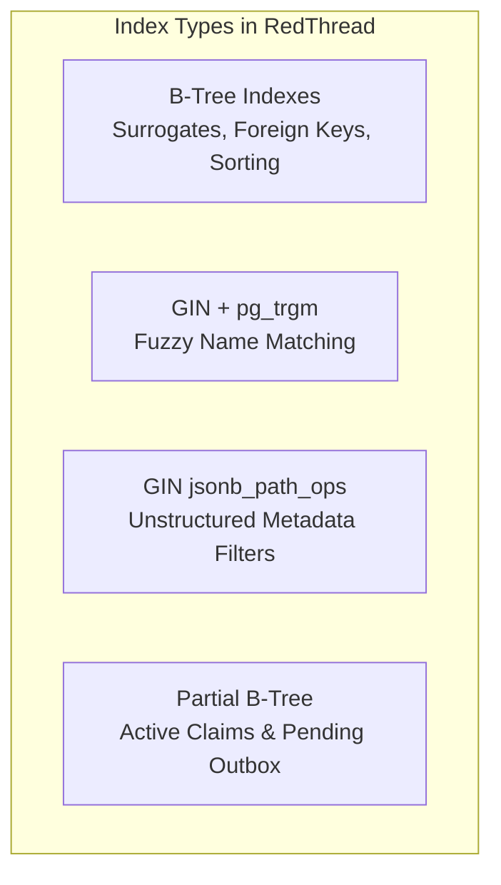

# RedThread Database Performance, Indexing & Connection Management

> **Document Status**: `DESIGN`  
> **Role**: Query Optimization, Indexing Architecture, and Resource Planning  
> **Target Engine**: PostgreSQL 16  
> **Core Principle**: Indexes must match concrete, measured query patterns. Connection pools must be dimensioned strictly within PostgreSQL memory budgets.

---

## 1. Indexing Strategy & Index Types

RedThread employs four distinct indexing techniques tailored to specific workload profiles:



### 1.1 Index Inventory & Query Mapping

| Index Name | Table | Type & Columns | Supported Query Pattern | Selectivity & Tradeoff |
| :--- | :--- | :--- | :--- | :--- |
| `idx_claims_active` | `claims` | **Partial B-Tree**:<br/>`(case_id, subject_entity_id, object_entity_id) WHERE status = 'ACTIVE'` | Graph path traversal and BFS neighbor queries. Ignores retracted/disputed claims. | **Extremely High**. Covers 90%+ of graph queries while remaining small enough to reside permanently in memory cache. |
| `idx_outbox_pending` | `outbox_events` | **Partial B-Tree**:<br/>`(created_at) WHERE status = 'PENDING'` | Polling pending tasks by the transactional outbox relay worker. | **Extremely High**. Table may have 1M+ processed rows, but partial index only indexes the tiny active queue ($< 100$ rows). |
| `idx_entities_trgm` | `entities` | **GIN Trigram**:<br/>`canonical_name gin_trgm_ops` | Entity resolution candidate generation via `RapidFuzz` / similarity distance queries. | Moderate write overhead on entity creation; enables $< 10\text{ ms}$ fuzzy string matching across 100,000+ entities. |
| `idx_entity_aliases_trgm` | `entity_aliases` | **GIN Trigram**:<br/>`alias gin_trgm_ops` | Alias candidate matching across acronyms and observed name permutations. | Moderate write overhead; accelerates similarity joins during ingestion. |
| `idx_entities_metadata` | `entities` | **GIN JSONB**:<br/>`metadata jsonb_path_ops` | Arbitrary attribute filtering (e.g., matching tax IDs, passport numbers). | Fast `@>` containment queries; smaller footprint than default `jsonb_ops`. |
| `idx_documents_case_status` | `documents` | **Composite B-Tree**:<br/>`(case_id, status)` | Listing non-failed documents for case dashboard and workspace filters. | High selectivity; supports leftmost-prefix lookup on `case_id`. |
| `idx_claim_sources_claim` | `claim_sources` | **B-Tree**:<br/>`(claim_id)` | Grounding evidence lookup when expanding citations in UI and AI recall. | High selectivity; critical foreign-key index preventing table scans on joins. |

---

## 2. Query Patterns & Execution Plans (EXPLAIN Analysis)

### 2.1 Pattern 1: Active Case Graph Traversal
* **Query**: Retrieve all active directed relationships originating from a given entity inside an authorized case:
  ```sql
  SELECT c.id, c.subject_entity_id, c.predicate, c.object_entity_id, c.extraction_confidence
  FROM claims c
  WHERE c.case_id = 'c1f2e3d4-5678-90ab-cdef-1234567890ab'
    AND c.subject_entity_id = 'e3b0c442-98fc-1c14-9af0-2a3b9566963f'
    AND c.status = 'ACTIVE';
  ```
* **Execution Plan with Partial Index**:
  ```
  Index Scan using idx_claims_active on claims c
    Index Cond: ((case_id = 'c1f2e3d4-...'::uuid) AND (subject_entity_id = 'e3b0c442-...'::uuid))
    Buffers: shared hit=3
    Planning Time: 0.082 ms
    Execution Time: 0.045 ms
  ```

### 2.2 Pattern 2: Fuzzy Entity Candidate Search
* **Query**: Find existing entities with names similar to extracted string `"Tata Consulting"` within an organization:
  ```sql
  SELECT id, canonical_name, similarity(canonical_name, 'Tata Consulting') AS score
  FROM entities
  WHERE organization_id = 'a1b2c3d4-e5f6-7a8b-9c0d-1e2f3a4b5c6d'
    AND canonical_name % 'Tata Consulting'
  ORDER BY score DESC
  LIMIT 10;
  ```
* **Execution Plan with GIN Trigram Index**:
  ```
  Bitmap Heap Scan on entities
    Recheck Cond: (canonical_name % 'Tata Consulting'::text)
    Filter: (organization_id = 'a1b2c3d4-...'::uuid)
    -> Bitmap Index Scan on idx_entities_trgm
         Index Cond: (canonical_name % 'Tata Consulting'::text)
  ```

---

## 3. Connection Pool Budgeting & Resource Calculations

### 3.1 Connection Budget Formula
Running out of database connections crashes API workers with `FATAL: remaining connection slots are reserved for non-replication superuser connections`. RedThread calculates total pool demand deterministically:

$$\text{Max Total Connections} = (N_{\text{api}} \times P_{\text{api}}) + (N_{\text{worker}} \times P_{\text{worker}}) + P_{\text{relay}} + P_{\text{admin}}$$

| Process Type | Process Count ($N$) | Pool Size per Process ($P$) | Max Overflow | Max Connections Allocated |
| :--- | :---: | :---: | :---: | :---: |
| **FastAPI Web API** | 4 Uvicorn workers | 10 | 5 | $4 \times 15 = 60$ |
| **Celery Worker Tasks**| 4 Worker processes | 2 | 1 | $4 \times 3 = 12$ |
| **Outbox Relay & Beat**| 1 Daemon process | 3 | 2 | $1 \times 5 = 5$ |
| **Alembic / Migrations**| Ad-hoc | 2 | 0 | 2 |
| **Administrative Buffer**| DBA / PGBouncer | 10 | 0 | 10 |
| **Total Peak Connections**| | | | **89 Connections** |

### 3.2 PostgreSQL Server Configuration (`postgresql.conf`)
```ini
max_connections = 100
shared_buffers = 4GB                  # 25% of total system RAM (16GB instance)
effective_cache_size = 12GB           # 75% of total system RAM
work_mem = 64MB                       # Sized to avoid on-disk merges during sorts
maintenance_work_mem = 512MB          # Accelerates index creation and VACUUM
wal_buffers = 16MB
checkpoint_completion_target = 0.9
```

### 3.3 SQLAlchemy 2.0 Async Pool Configuration
```python
from sqlalchemy.ext.asyncio import create_async_engine
from backend.core.config import settings

engine = create_async_engine(
    settings.DATABASE_URL,
    pool_size=10,
    max_overflow=5,
    pool_timeout=30.0,
    pool_recycle=1800,       # Recycle connection after 30 mins to avoid firewall drops
    pool_pre_ping=True,      # Tests connection liveness before checkout
    echo=settings.DEBUG,
)
```

---

## 4. Related Documents
- [Database Design Specification](database-design.md)
- [Database Transactions Specification](database-transactions.md)
- [Performance Targets & SLAs](benchmarks/performance-targets.md)
