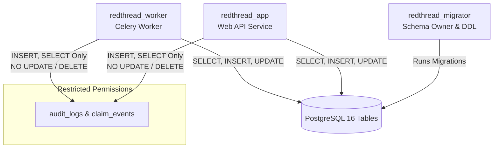

# RedThread Database Security, Roles & Row-Level Security (RLS)

> **Document Status**: `DESIGN`  
> **Role**: Database Security, IAM, and Tenant Isolation Architecture  
> **Target Engine**: PostgreSQL 16  
> **Core Principle**: Multi-layered defense in depth. Database-enforced Row-Level Security (RLS) and least-privilege roles reinforce application-tier authorization.

---

## 1. PostgreSQL Database Roles & Least Privilege

RedThread strictly prohibits running application services under database superuser or table-owner roles:



### 1.1 Role Definitions & Privileges

```sql
-- 1. Migration Role (Used strictly by Alembic in CI/CD)
CREATE ROLE redthread_migrator WITH LOGIN PASSWORD 'strong_migrator_password';
GRANT ALL PRIVILEGES ON DATABASE redthread_db TO redthread_migrator;
GRANT ALL PRIVILEGES ON SCHEMA public TO redthread_migrator;

-- 2. Application API Role (Used by FastAPI backend)
CREATE ROLE redthread_app WITH LOGIN PASSWORD 'strong_app_password';
GRANT CONNECT ON DATABASE redthread_db TO redthread_app;
GRANT USAGE ON SCHEMA public TO redthread_app;

-- Grant standard DML on tables
GRANT SELECT, INSERT, UPDATE ON ALL TABLES IN SCHEMA public TO redthread_app;
-- Revoke DELETE on core evidence and audit ledgers
REVOKE DELETE, UPDATE ON TABLE audit_logs, claim_events, entity_merges FROM redthread_app;
REVOKE TRUNCATE, DROP ON ALL TABLES IN SCHEMA public FROM redthread_app;

-- 3. Worker Role (Used by Celery workers)
CREATE ROLE redthread_worker WITH LOGIN PASSWORD 'strong_worker_password';
GRANT CONNECT ON DATABASE redthread_db TO redthread_worker;
GRANT USAGE ON SCHEMA public TO redthread_worker;
GRANT SELECT, INSERT, UPDATE ON ALL TABLES IN SCHEMA public TO redthread_worker;
REVOKE DELETE, UPDATE ON TABLE audit_logs, claim_events, entity_merges FROM redthread_worker;
```

---

## 2. Row-Level Security (RLS) Policy Architecture

To protect against application bugs, memory corruption, or IDOR query construction, PostgreSQL Row-Level Security provides an independent engine-level isolation barrier.

### 2.1 The `FORCE ROW LEVEL SECURITY` Mandate
Standard PostgreSQL RLS does not apply to table owners unless explicitly forced. RedThread enables `FORCE ROW LEVEL SECURITY` on all tenant tables:

```sql
ALTER TABLE cases ENABLE ROW LEVEL SECURITY;
ALTER TABLE cases FORCE ROW LEVEL SECURITY;

ALTER TABLE documents ENABLE ROW LEVEL SECURITY;
ALTER TABLE documents FORCE ROW LEVEL SECURITY;

ALTER TABLE claims ENABLE ROW LEVEL SECURITY;
ALTER TABLE claims FORCE ROW LEVEL SECURITY;

ALTER TABLE entities ENABLE ROW LEVEL SECURITY;
ALTER TABLE entities FORCE ROW LEVEL SECURITY;

ALTER TABLE outbox_events ENABLE ROW LEVEL SECURITY;
ALTER TABLE outbox_events FORCE ROW LEVEL SECURITY;
```

---

## 3. Session-Local Context & Connection Pool Safety

### 3.1 The Pooled Context Leakage Risk
When using connection pooling (e.g., SQLAlchemy `QueuePool`), physical connections are recycled across distinct HTTP requests. If an organization ID is set globally on a connection (`SET app.current_org_id = '...'`), an uncaught exception could return the connection to the pool with stale tenant context, leaking data to the next user.

### 3.2 The `SET LOCAL` Solution
RedThread exclusively uses transaction-scoped configuration settings via `SET LOCAL`:

```sql
-- Executed inside BEGIN ... COMMIT
SET LOCAL app.current_org_id = 'e3b0c442-98fc-1c14-9af0-2a3b9566963f';
SET LOCAL app.current_user_id = 'a1b2c3d4-e5f6-7a8b-9c0d-1e2f3a4b5c6d';
```

`SET LOCAL` binds variables **strictly to the current transaction block**. As soon as the transaction calls `COMMIT` or `ROLLBACK`, the setting is automatically cleared by the PostgreSQL engine.

---

## 4. Complete RLS Policies

```sql
-- ----------------------------------------------------------------------
-- Policy 1: Cases Table
-- ----------------------------------------------------------------------
CREATE POLICY rls_cases_isolation ON cases
    FOR ALL
    USING (
        organization_id = NULLIF(current_setting('app.current_org_id', true), '')::UUID
    )
    WITH CHECK (
        organization_id = NULLIF(current_setting('app.current_org_id', true), '')::UUID
    );

-- ----------------------------------------------------------------------
-- Policy 2: Documents Table
-- ----------------------------------------------------------------------
CREATE POLICY rls_documents_isolation ON documents
    FOR ALL
    USING (
        case_id IN (
            SELECT id FROM cases 
            WHERE organization_id = NULLIF(current_setting('app.current_org_id', true), '')::UUID
        )
    )
    WITH CHECK (
        case_id IN (
            SELECT id FROM cases 
            WHERE organization_id = NULLIF(current_setting('app.current_org_id', true), '')::UUID
        )
    );

-- ----------------------------------------------------------------------
-- Policy 3: Entities Table
-- ----------------------------------------------------------------------
CREATE POLICY rls_entities_isolation ON entities
    FOR ALL
    USING (
        organization_id = NULLIF(current_setting('app.current_org_id', true), '')::UUID
    )
    WITH CHECK (
        organization_id = NULLIF(current_setting('app.current_org_id', true), '')::UUID
    );

-- ----------------------------------------------------------------------
-- Policy 4: Claims Table
-- ----------------------------------------------------------------------
CREATE POLICY rls_claims_isolation ON claims
    FOR ALL
    USING (
        case_id IN (
            SELECT id FROM cases 
            WHERE organization_id = NULLIF(current_setting('app.current_org_id', true), '')::UUID
        )
    )
    WITH CHECK (
        case_id IN (
            SELECT id FROM cases 
            WHERE organization_id = NULLIF(current_setting('app.current_org_id', true), '')::UUID
        )
    );

-- ----------------------------------------------------------------------
-- Policy 5: Outbox Events Table
-- ----------------------------------------------------------------------
CREATE POLICY rls_outbox_isolation ON outbox_events
    FOR ALL
    USING (
        organization_id = NULLIF(current_setting('app.current_org_id', true), '')::UUID
    );
```

---

## 5. Security Integration in SQLAlchemy 2.0

RedThread's database session dependency automatically injects tenant context upon opening an async session:

```python
from sqlalchemy.ext.asyncio import AsyncSession
from sqlalchemy import text
from uuid import UUID

async def get_tenant_db(
    org_id: UUID, 
    user_id: UUID, 
    session_factory
) -> AsyncSession:
    async with session_factory() as session:
        async with session.begin():
            await session.execute(
                text("SET LOCAL app.current_org_id = :org_id"),
                {"org_id": str(org_id)}
            )
            await session.execute(
                text("SET LOCAL app.current_user_id = :user_id"),
                {"user_id": str(user_id)}
            )
            yield session
```

---

## 6. Related Documents
- [Database Design Specification](database-design.md)
- [Database Transactions Specification](database-transactions.md)
- [Threat Model](threat-model.md)
