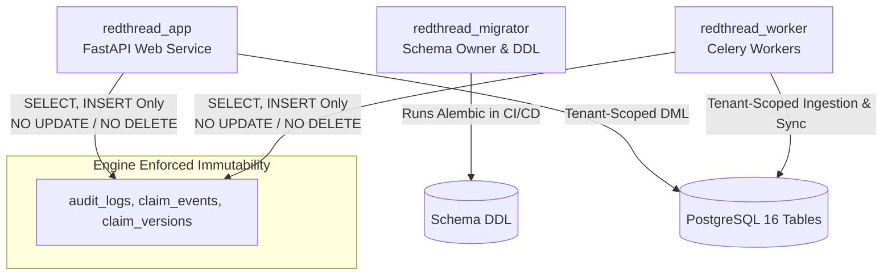

# RedThread Database Security, Roles & Complete Row-Level Security (RLS) Specification

> **Document Status**: `DESIGN`  
> **Role**: Database Security, IAM, Role Permissions, and Complete RLS Policy Inventory  
> **Target Engine**: PostgreSQL 16  
> **Core Principle**: Engine-enforced defense in depth. Even if application middleware, ORM queries, or API boundaries are compromised, PostgreSQL physically blocks unauthorized cross-tenant reads and writes.

---

## 1. PostgreSQL Database Roles & Least-Privilege Separation

RedThread operates under three distinct, non-superuser PostgreSQL database roles:



### 1.1 Role Privileges & Command Permissions

```sql
-- 1. Migration Role (Used strictly by Alembic migrations)
CREATE ROLE redthread_migrator WITH LOGIN PASSWORD 'migrator_secure_password';
GRANT ALL PRIVILEGES ON DATABASE redthread_db TO redthread_migrator;
GRANT ALL PRIVILEGES ON SCHEMA public TO redthread_migrator;

-- 2. Application API Role (Used by FastAPI web processes)
CREATE ROLE redthread_app WITH LOGIN PASSWORD 'app_secure_password';
GRANT CONNECT ON DATABASE redthread_db TO redthread_app;
GRANT USAGE ON SCHEMA public TO redthread_app;
GRANT SELECT, INSERT, UPDATE ON ALL TABLES IN SCHEMA public TO redthread_app;

-- Revoke hard deletion on all evidence, audit, and tenancy tables
REVOKE DELETE, UPDATE ON TABLE audit_logs, claim_events, claim_versions, entity_merge_events FROM redthread_app;
REVOKE TRUNCATE, DROP, ALTER ON ALL TABLES IN SCHEMA public TO redthread_app;

-- 3. Asynchronous Worker Role (Used by Celery workers)
CREATE ROLE redthread_worker WITH LOGIN PASSWORD 'worker_secure_password';
GRANT CONNECT ON DATABASE redthread_db TO redthread_worker;
GRANT USAGE ON SCHEMA public TO redthread_worker;
GRANT SELECT, INSERT, UPDATE ON ALL TABLES IN SCHEMA public TO redthread_worker;
REVOKE DELETE, UPDATE ON TABLE audit_logs, claim_events, claim_versions, entity_merge_events FROM redthread_worker;
```

---

## 2. The `FORCE ROW LEVEL SECURITY` Mandate

In standard PostgreSQL, table owners and superusers bypass RLS by default. In RedThread:
1. The application connections (`redthread_app` and `redthread_worker`) do **NOT** own the tables (`redthread_migrator` owns them).
2. Every tenant-scoped table is configured with **`FORCE ROW LEVEL SECURITY`**, guaranteeing that even if a table owner connection is accidentally used, RLS policies are strictly executed:

```sql
ALTER TABLE organizations ENABLE ROW LEVEL SECURITY;
ALTER TABLE organizations FORCE ROW LEVEL SECURITY;

ALTER TABLE memberships ENABLE ROW LEVEL SECURITY;
ALTER TABLE memberships FORCE ROW LEVEL SECURITY;

ALTER TABLE cases ENABLE ROW LEVEL SECURITY;
ALTER TABLE cases FORCE ROW LEVEL SECURITY;

ALTER TABLE case_members ENABLE ROW LEVEL SECURITY;
ALTER TABLE case_members FORCE ROW LEVEL SECURITY;

ALTER TABLE documents ENABLE ROW LEVEL SECURITY;
ALTER TABLE documents FORCE ROW LEVEL SECURITY;

ALTER TABLE document_chunks ENABLE ROW LEVEL SECURITY;
ALTER TABLE document_chunks FORCE ROW LEVEL SECURITY;

ALTER TABLE ingestion_jobs ENABLE ROW LEVEL SECURITY;
ALTER TABLE ingestion_jobs FORCE ROW LEVEL SECURITY;

ALTER TABLE entities ENABLE ROW LEVEL SECURITY;
ALTER TABLE entities FORCE ROW LEVEL SECURITY;

ALTER TABLE entity_aliases ENABLE ROW LEVEL SECURITY;
ALTER TABLE entity_aliases FORCE ROW LEVEL SECURITY;

ALTER TABLE entity_merge_events ENABLE ROW LEVEL SECURITY;
ALTER TABLE entity_merge_events FORCE ROW LEVEL SECURITY;

ALTER TABLE case_entities ENABLE ROW LEVEL SECURITY;
ALTER TABLE case_entities FORCE ROW LEVEL SECURITY;

ALTER TABLE claims ENABLE ROW LEVEL SECURITY;
ALTER TABLE claims FORCE ROW LEVEL SECURITY;

ALTER TABLE claim_versions ENABLE ROW LEVEL SECURITY;
ALTER TABLE claim_versions FORCE ROW LEVEL SECURITY;

ALTER TABLE claim_sources ENABLE ROW LEVEL SECURITY;
ALTER TABLE claim_sources FORCE ROW LEVEL SECURITY;

ALTER TABLE claim_events ENABLE ROW LEVEL SECURITY;
ALTER TABLE claim_events FORCE ROW LEVEL SECURITY;

ALTER TABLE outbox_events ENABLE ROW LEVEL SECURITY;
ALTER TABLE outbox_events FORCE ROW LEVEL SECURITY;

ALTER TABLE audit_logs ENABLE ROW LEVEL SECURITY;
ALTER TABLE audit_logs FORCE ROW LEVEL SECURITY;

ALTER TABLE reports ENABLE ROW LEVEL SECURITY;
ALTER TABLE reports FORCE ROW LEVEL SECURITY;
```

---

## 3. Session-Local Context & Connection Pool Safety

### 3.1 The Connection Contamination Threat
In pooled environments (SQLAlchemy `QueuePool`), physical TCP sockets are re-used across requests. If a web request sets `SET app.current_org_id = '...'` at the session level, an uncaught error could leave that variable active, causing the next query on that pooled connection to see the previous tenant's data.

### 3.2 The `SET LOCAL` Invariant
All context settings are executed with **`SET LOCAL` inside an explicit transaction block**:
```sql
BEGIN;
  SET LOCAL app.current_org_id = 'a1b2c3d4-e5f6-7a8b-9c0d-1e2f3a4b5c6d';
  SET LOCAL app.current_user_id = 'u1b2c3d4-e5f6-7a8b-9c0d-1e2f3a4b5c6d';
  SET LOCAL app.is_worker = 'false';
  -- All SQL queries run here
COMMIT; -- Context is automatically erased on COMMIT or ROLLBACK
```

### 3.3 Security Definer Context Verification Helpers
To prevent trusting arbitrary frontend input, PostgreSQL validates that the current user actually holds an active membership in `app.current_org_id`:

```sql
CREATE SCHEMA IF NOT EXISTS app;

-- Returns true if the user has an active membership in the current organization context
CREATE OR REPLACE FUNCTION app.is_authenticated_org_member()
RETURNS BOOLEAN AS $$
DECLARE
    v_org_id UUID;
    v_user_id UUID;
    v_is_worker BOOLEAN;
BEGIN
    v_is_worker := COALESCE(NULLIF(current_setting('app.is_worker', true), '')::BOOLEAN, false);
    IF v_is_worker THEN
        RETURN TRUE;
    END IF;

    v_org_id := NULLIF(current_setting('app.current_org_id', true), '')::UUID;
    v_user_id := NULLIF(current_setting('app.current_user_id', true), '')::UUID;

    IF v_org_id IS NULL OR v_user_id IS NULL THEN
        RETURN FALSE;
    END IF;

    RETURN EXISTS (
        SELECT 1 FROM public.memberships m 
        JOIN public.users u ON u.id = m.user_id
        WHERE m.organization_id = v_org_id 
          AND m.user_id = v_user_id
          AND u.is_active = TRUE
    );
END;
$$ LANGUAGE plpgsql SECURITY DEFINER STABLE;

-- Returns true if user has permission to access a specific case
CREATE OR REPLACE FUNCTION app.has_case_access(p_case_id UUID, p_min_role org_role DEFAULT 'VIEWER')
RETURNS BOOLEAN AS $$
DECLARE
    v_org_id UUID;
    v_user_id UUID;
    v_user_role org_role;
    v_is_worker BOOLEAN;
BEGIN
    v_is_worker := COALESCE(NULLIF(current_setting('app.is_worker', true), '')::BOOLEAN, false);
    IF v_is_worker THEN
        RETURN TRUE;
    END IF;

    v_org_id := NULLIF(current_setting('app.current_org_id', true), '')::UUID;
    v_user_id := NULLIF(current_setting('app.current_user_id', true), '')::UUID;

    IF v_org_id IS NULL OR v_user_id IS NULL OR p_case_id IS NULL THEN
        RETURN FALSE;
    END IF;

    -- Org Admins have universal read/write access to all cases within their organization
    SELECT role INTO v_user_role FROM public.memberships 
    WHERE organization_id = v_org_id AND user_id = v_user_id;

    IF v_user_role = 'ORGANIZATION_ADMIN' THEN
        RETURN TRUE;
    END IF;

    -- Otherwise, user must have an explicit assignment in case_members
    RETURN EXISTS (
        SELECT 1 FROM public.case_members cm
        WHERE cm.case_id = p_case_id 
          AND cm.user_id = v_user_id
          AND cm.organization_id = v_org_id
    );
END;
$$ LANGUAGE plpgsql SECURITY DEFINER STABLE;
```

---

## 4. Complete RLS Policy Inventory for All 18 Tables

### 1. `organizations`
- **SELECT**: Accessible if user is a member of the organization.
  ```sql
  CREATE POLICY rls_org_select ON organizations FOR SELECT
  USING (id = NULLIF(current_setting('app.current_org_id', true), '')::UUID AND app.is_authenticated_org_member());
  ```
- **UPDATE**: Only by `ORGANIZATION_ADMIN`.
  ```sql
  CREATE POLICY rls_org_update ON organizations FOR UPDATE
  USING (id = NULLIF(current_setting('app.current_org_id', true), '')::UUID AND EXISTS (
      SELECT 1 FROM memberships WHERE organization_id = id AND user_id = NULLIF(current_setting('app.current_user_id', true), '')::UUID AND role = 'ORGANIZATION_ADMIN'
  ));
  ```
- **INSERT / DELETE**: Prohibited via application role (handled via onboarding migration).

### 2. `memberships`
- **SELECT**: Accessible to all members of the organization.
  ```sql
  CREATE POLICY rls_mem_select ON memberships FOR SELECT
  USING (organization_id = NULLIF(current_setting('app.current_org_id', true), '')::UUID AND app.is_authenticated_org_member());
  ```
- **INSERT / UPDATE / DELETE**: Permitted only to `ORGANIZATION_ADMIN`.
  ```sql
  CREATE POLICY rls_mem_admin ON memberships FOR ALL
  USING (organization_id = NULLIF(current_setting('app.current_org_id', true), '')::UUID AND EXISTS (
      SELECT 1 FROM memberships WHERE organization_id = memberships.organization_id AND user_id = NULLIF(current_setting('app.current_user_id', true), '')::UUID AND role = 'ORGANIZATION_ADMIN'
  ))
  WITH CHECK (organization_id = NULLIF(current_setting('app.current_org_id', true), '')::UUID);
  ```

### 3. `cases`
- **SELECT**: Permitted if user has case access.
  ```sql
  CREATE POLICY rls_cases_select ON cases FOR SELECT
  USING (organization_id = NULLIF(current_setting('app.current_org_id', true), '')::UUID AND app.has_case_access(id));
  ```
- **INSERT**: Permitted to `ORGANIZATION_ADMIN` and `INVESTIGATOR`.
  ```sql
  CREATE POLICY rls_cases_insert ON cases FOR INSERT
  WITH CHECK (
      organization_id = NULLIF(current_setting('app.current_org_id', true), '')::UUID AND
      EXISTS (
          SELECT 1 FROM memberships 
          WHERE organization_id = cases.organization_id 
            AND user_id = NULLIF(current_setting('app.current_user_id', true), '')::UUID 
            AND role IN ('ORGANIZATION_ADMIN', 'INVESTIGATOR')
      )
  );
  ```
- **UPDATE**: Permitted to `ORGANIZATION_ADMIN` or assigned `INVESTIGATOR`.
  ```sql
  CREATE POLICY rls_cases_update ON cases FOR UPDATE
  USING (organization_id = NULLIF(current_setting('app.current_org_id', true), '')::UUID AND app.has_case_access(id, 'INVESTIGATOR'));
  ```

### 4. `case_members`
- **SELECT**: Permitted if user has access to the parent case.
  ```sql
  CREATE POLICY rls_cm_select ON case_members FOR SELECT
  USING (organization_id = NULLIF(current_setting('app.current_org_id', true), '')::UUID AND app.has_case_access(case_id));
  ```
- **INSERT / UPDATE / DELETE**: Permitted only to `ORGANIZATION_ADMIN` or case creators.
  ```sql
  CREATE POLICY rls_cm_manage ON case_members FOR ALL
  USING (organization_id = NULLIF(current_setting('app.current_org_id', true), '')::UUID AND app.has_case_access(case_id, 'INVESTIGATOR'))
  WITH CHECK (organization_id = NULLIF(current_setting('app.current_org_id', true), '')::UUID);
  ```

### 5. `documents`
- **SELECT**: Permitted if user has case access.
  ```sql
  CREATE POLICY rls_doc_select ON documents FOR SELECT
  USING (app.has_case_access(case_id));
  ```
- **INSERT**: Permitted to `INVESTIGATOR` or `ORGANIZATION_ADMIN`.
  ```sql
  CREATE POLICY rls_doc_insert ON documents FOR INSERT
  WITH CHECK (app.has_case_access(case_id, 'INVESTIGATOR'));
  ```
- **UPDATE**: Permitted to update status/metadata if assigned to case.
  ```sql
  CREATE POLICY rls_doc_update ON documents FOR UPDATE
  USING (app.has_case_access(case_id, 'INVESTIGATOR'));
  ```

### 6. `document_chunks`
- **SELECT**: Permitted if user has access to the parent document's case.
  ```sql
  CREATE POLICY rls_chunks_select ON document_chunks FOR SELECT
  USING (EXISTS (SELECT 1 FROM documents d WHERE d.id = document_chunks.document_id AND app.has_case_access(d.case_id)));
  ```
- **INSERT / UPDATE / DELETE**: Permitted to worker processes and investigators.
  ```sql
  CREATE POLICY rls_chunks_write ON document_chunks FOR ALL
  USING (EXISTS (SELECT 1 FROM documents d WHERE d.id = document_chunks.document_id AND app.has_case_access(d.case_id, 'INVESTIGATOR')));
  ```

### 7. `ingestion_jobs`
- **SELECT / UPDATE / INSERT**: Permitted if user has case access to document.
  ```sql
  CREATE POLICY rls_jobs_policy ON ingestion_jobs FOR ALL
  USING (EXISTS (SELECT 1 FROM documents d WHERE d.id = ingestion_jobs.document_id AND app.has_case_access(d.case_id)));
  ```

### 8. `entities`
- **SELECT**: Permitted to all members of the organization.
  ```sql
  CREATE POLICY rls_entities_select ON entities FOR SELECT
  USING (organization_id = NULLIF(current_setting('app.current_org_id', true), '')::UUID AND app.is_authenticated_org_member());
  ```
- **INSERT / UPDATE**: Permitted to `INVESTIGATOR` or `ORGANIZATION_ADMIN`.
  ```sql
  CREATE POLICY rls_entities_write ON entities FOR ALL
  USING (organization_id = NULLIF(current_setting('app.current_org_id', true), '')::UUID AND app.is_authenticated_org_member())
  WITH CHECK (organization_id = NULLIF(current_setting('app.current_org_id', true), '')::UUID);
  ```

### 9. `entity_aliases`
- **SELECT**: Permitted to organization members.
  ```sql
  CREATE POLICY rls_aliases_select ON entity_aliases FOR SELECT
  USING (organization_id = NULLIF(current_setting('app.current_org_id', true), '')::UUID AND app.is_authenticated_org_member());
  ```
- **INSERT / UPDATE**: Permitted to organization investigators.
  ```sql
  CREATE POLICY rls_aliases_write ON entity_aliases FOR ALL
  USING (organization_id = NULLIF(current_setting('app.current_org_id', true), '')::UUID AND app.is_authenticated_org_member())
  WITH CHECK (organization_id = NULLIF(current_setting('app.current_org_id', true), '')::UUID);
  ```

### 10. `entity_merge_events`
- **SELECT**: Permitted to organization members.
  ```sql
  CREATE POLICY rls_merges_select ON entity_merge_events FOR SELECT
  USING (organization_id = NULLIF(current_setting('app.current_org_id', true), '')::UUID AND app.is_authenticated_org_member());
  ```
- **INSERT / UPDATE**: Permitted to investigators and organization admins.
  ```sql
  CREATE POLICY rls_merges_write ON entity_merge_events FOR ALL
  USING (
      organization_id = NULLIF(current_setting('app.current_org_id', true), '')::UUID AND 
      EXISTS (
          SELECT 1 FROM memberships 
          WHERE organization_id = entity_merge_events.organization_id 
            AND user_id = NULLIF(current_setting('app.current_user_id', true), '')::UUID 
            AND role IN ('ORGANIZATION_ADMIN', 'INVESTIGATOR')
      )
  )
  WITH CHECK (
      organization_id = NULLIF(current_setting('app.current_org_id', true), '')::UUID AND 
      EXISTS (
          SELECT 1 FROM memberships 
          WHERE organization_id = entity_merge_events.organization_id 
            AND user_id = NULLIF(current_setting('app.current_user_id', true), '')::UUID 
            AND role IN ('ORGANIZATION_ADMIN', 'INVESTIGATOR')
      )
  );
  ```

### 11. `case_entities`
- **SELECT / INSERT / DELETE**: Scoped strictly by case access.
  ```sql
  CREATE POLICY rls_case_entities_policy ON case_entities FOR ALL
  USING (app.has_case_access(case_id));
  ```

### 12. `claims`
- **SELECT**: Permitted if user has access to the parent case.
  ```sql
  CREATE POLICY rls_claims_select ON claims FOR SELECT
  USING (organization_id = NULLIF(current_setting('app.current_org_id', true), '')::UUID AND app.has_case_access(case_id));
  ```
- **INSERT**: Permitted to `INVESTIGATOR` or `ORGANIZATION_ADMIN`.
  ```sql
  CREATE POLICY rls_claims_insert ON claims FOR INSERT
  WITH CHECK (
      organization_id = NULLIF(current_setting('app.current_org_id', true), '')::UUID AND 
      app.has_case_access(case_id, 'INVESTIGATOR')
  );
  ```
- **UPDATE**: Permitted for challenges and reviews by authorized roles (`REVIEWER`, `INVESTIGATOR`).
  ```sql
  CREATE POLICY rls_claims_update ON claims FOR UPDATE
  USING (
      organization_id = NULLIF(current_setting('app.current_org_id', true), '')::UUID AND 
      app.has_case_access(case_id, 'REVIEWER')
  );
  ```

### 13. `claim_versions`
- **SELECT**: Accessible if user has access to the parent case.
  ```sql
  CREATE POLICY rls_claim_versions_select ON claim_versions FOR SELECT
  USING (organization_id = NULLIF(current_setting('app.current_org_id', true), '')::UUID AND app.has_case_access(case_id));
  ```
- **INSERT**: Permitted to system workers and authorized investigators.
  ```sql
  CREATE POLICY rls_claim_versions_insert ON claim_versions FOR INSERT
  WITH CHECK (
      organization_id = NULLIF(current_setting('app.current_org_id', true), '')::UUID AND
      app.has_case_access(case_id, 'INVESTIGATOR')
  );
  ```

### 14. `claim_sources`
- **SELECT**: Accessible if user has access to the cited case.
  ```sql
  CREATE POLICY rls_sources_select ON claim_sources FOR SELECT
  USING (app.has_case_access(case_id));
  ```
- **INSERT**: Permitted to investigators.
  ```sql
  CREATE POLICY rls_sources_insert ON claim_sources FOR INSERT
  WITH CHECK (app.has_case_access(case_id, 'INVESTIGATOR'));
  ```

### 15. `claim_events`
- **SELECT**: Accessible if user has access to the underlying claim's case.
  ```sql
  CREATE POLICY rls_events_select ON claim_events FOR SELECT
  USING (EXISTS (SELECT 1 FROM claims c WHERE c.id = claim_events.claim_id AND app.has_case_access(c.case_id)));
  ```
- **INSERT**: Permitted to reviewers and investigators.
  ```sql
  CREATE POLICY rls_events_insert ON claim_events FOR INSERT
  WITH CHECK (EXISTS (SELECT 1 FROM claims c WHERE c.id = claim_events.claim_id AND app.has_case_access(c.case_id, 'REVIEWER')));
  ```

### 16. `outbox_events`
- **ALL**: Scoped strictly to the active organization.
  ```sql
  CREATE POLICY rls_outbox_policy ON outbox_events FOR ALL
  USING (organization_id = NULLIF(current_setting('app.current_org_id', true), '')::UUID)
  WITH CHECK (organization_id = NULLIF(current_setting('app.current_org_id', true), '')::UUID);
  ```

### 17. `audit_logs`
- **SELECT**: Permitted only to `ORGANIZATION_ADMIN`.
  ```sql
  CREATE POLICY rls_audit_select ON audit_logs FOR SELECT
  USING (
      organization_id = NULLIF(current_setting('app.current_org_id', true), '')::UUID AND
      EXISTS (
          SELECT 1 FROM memberships 
          WHERE organization_id = audit_logs.organization_id 
            AND user_id = NULLIF(current_setting('app.current_user_id', true), '')::UUID 
            AND role = 'ORGANIZATION_ADMIN'
      )
  );
  ```
- **INSERT**: Permitted to application services logging operational actions.
  ```sql
  CREATE POLICY rls_audit_insert ON audit_logs FOR INSERT
  WITH CHECK (organization_id = NULLIF(current_setting('app.current_org_id', true), '')::UUID);
  ```

### 18. `reports`
- **SELECT / INSERT**: Scoped strictly to users with case access.
  ```sql
  CREATE POLICY rls_reports_policy ON reports FOR ALL
  USING (app.has_case_access(case_id))
  WITH CHECK (app.has_case_access(case_id, 'INVESTIGATOR'));
  ```

---

## 5. Adversarial Testing Scenarios & Proofs

| Attack Scenario | Simulated Action | PostgreSQL Engine Defense | Expected Result |
| :--- | :--- | :--- | :--- |
| **Missing Tenant Context** | Attacker queries `SELECT * FROM cases;` without setting `app.current_org_id`. | `NULLIF('', '')::UUID` yields `NULL`. `app.has_case_access()` evaluates to `FALSE`. | Returns **0 rows**. |
| **Cross-Tenant IDOR Read** | User in Org A specifies `WHERE id = 'case_b_uuid'` belonging to Org B. | RLS evaluates `organization_id = org_A`. Case B row fails condition. | Returns **0 rows** (Non-disclosing 404). |
| **Cross-Tenant Claim Write** | User in Org A attempts to insert claim referencing `case_b_uuid`. | `WITH CHECK` evaluates `has_case_access(case_b_uuid)`. Access denied. | Transaction aborts: `new row violates row-level security policy for table "claims"`. |
| **Case Privilege Bypass** | User with `VIEWER` role executes `POST /claims/{id}/challenge`. | RLS evaluates `has_case_access(case_id, 'REVIEWER')`. Evaluates to `FALSE`. | Transaction aborts: RLS violation. |
| **Pooled Context Leak** | Worker finishes request; pooled socket returned without reset. | `SET LOCAL` is transaction-scoped. Sockets reset context automatically on `COMMIT`/`ROLLBACK`. | Stale tenant context **cannot leak** to subsequent transactions. |

---

## 6. Related Documents
- [Database Design Specification](database-design.md)
- [Database Transactions Specification](database-transactions.md)
- [Threat Model](threat-model.md)
