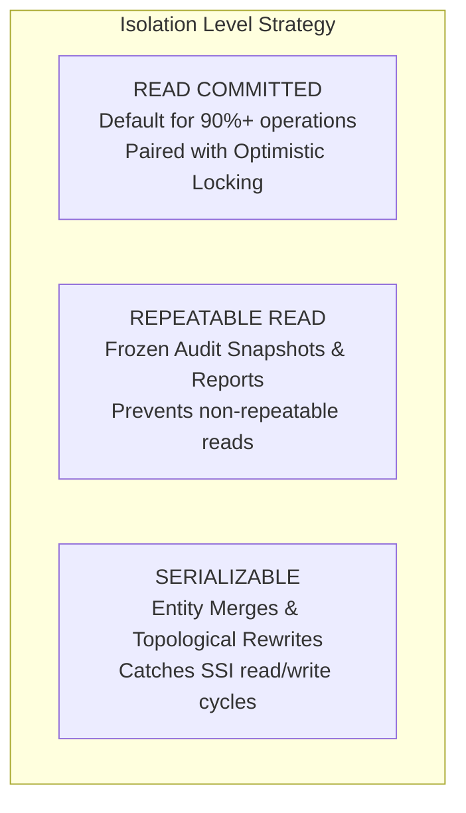

# RedThread Database Transactions, Concurrency Control & Isolation Specification

> **Document Status**: `DESIGN`  
> **Role**: Transaction Processing, Isolation Levels, Lock Orders, and Concurrency Matrix  
> **Target Engine**: PostgreSQL 16  
> **Core Principle**: Strict ACID boundaries enforce domain state transitions. Transactions are kept as short as possible; external HTTP calls (S3, Gemini, Cognee) are strictly barred from holding active database transactions.

---

## 1. Concurrency Control & Isolation Level Selection

PostgreSQL implements Multi-Version Concurrency Control (MVCC). Rather than using heavy table locks, RedThread selects isolation levels deliberately based on concurrency trade-offs:



### 1.1 Isolation Level Justifications

| Isolation Level | When Used | Failure Mode Handled | Why Stricter Level is Unnecessary |
| :--- | :--- | :--- | :--- |
| **`READ COMMITTED`** | Ingestion persistence, document registration, claim challenges, reviews, retractions, memberships. | Lost updates prevented via atomic SQL updates (`UPDATE ... SET status = ... WHERE version = ...`). | Fast, zero serialization conflicts, lowest CPU/lock overhead. |
| **`REPEATABLE READ`** | Generating frozen evidence reports (`reports` table). | Prevents non-repeatable reads and phantoms while compiling evidence dossiers across multiple tables. | Snapshot is frozen at transaction start; no concurrent modification anomalies. |
| **`SERIALIZABLE`** | Complex multi-entity merges and transitive unmerges. | Detects concurrent conflicting merges ($A \rightarrow B$ concurrently with $B \rightarrow C$) via SIREAD locks. | Standard row locking cannot detect predicate dependencies across multiple hops. |

---

## 2. Complete Transaction Specifications for All 12 Operations

### 2.1 Operation 1: Organization & Admin User Onboarding
- **Goal**: Atomically provision an organization, admin user, membership, and initial audit log.
- **Isolation Level**: `READ COMMITTED`
- **Lock Acquisition Order**: `organizations` $\rightarrow$ `users` $\rightarrow$ `memberships` $\rightarrow$ `audit_logs`
- **SQL Execution**:
  ```sql
  BEGIN;
    INSERT INTO organizations (id, name) 
    VALUES (:org_id, :org_name);

    INSERT INTO users (id, email, password_hash, full_name, is_active) 
    VALUES (:user_id, :email, :password_hash, :full_name, TRUE);

    INSERT INTO memberships (id, organization_id, user_id, role) 
    VALUES (:membership_id, :org_id, :user_id, 'ORGANIZATION_ADMIN');

    INSERT INTO audit_logs (id, organization_id, actor_id, action, resource_type, resource_id, details) 
    VALUES (uuid_generate_v4(), :org_id, :user_id, 'ORGANIZATION_INITIALIZED', 'ORGANIZATION', :org_id, 
            json_build_object('name', :org_name, 'admin_email', :email));
  COMMIT;
  ```
- **Rollback Behavior**: If email already exists (`uq_users_email`), transaction rolls back cleanly; no orphaned organization is created.

---

### 2.2 Operation 2: Case Creation & Workspace Initialization
- **Goal**: Provision an investigation workspace and assign the creator as lead investigator.
- **Isolation Level**: `READ COMMITTED`
- **Lock Acquisition Order**: `cases` $\rightarrow$ `case_members` $\rightarrow$ `audit_logs`
- **SQL Execution**:
  ```sql
  BEGIN;
    SET LOCAL app.current_org_id = :org_id;
    SET LOCAL app.current_user_id = :user_id;

    INSERT INTO cases (id, organization_id, case_number, name, description, status) 
    VALUES (:case_id, :org_id, :case_number, :name, :description, 'ACTIVE');

    INSERT INTO case_members (id, case_id, organization_id, user_id, role) 
    VALUES (uuid_generate_v4(), :case_id, :org_id, :user_id, 'INVESTIGATOR');

    INSERT INTO audit_logs (id, organization_id, actor_id, action, resource_type, resource_id, case_id) 
    VALUES (uuid_generate_v4(), :org_id, :user_id, 'CASE_CREATED', 'CASE', :case_id, :case_id);
  COMMIT;
  ```
- **Error Handling**: `uq_org_case_number` collision raises `409 Conflict`.

---

### 2.3 Operation 3: Document Upload Registration (Zero-Hold S3 Separation)
- **Goal**: Register uploaded document and enqueue background ingestion task.
- **Critical Rule**: **The database transaction must NOT be open while uploading bytes to S3**. File bytes are streamed to S3 **first**; only upon S3 success does the database transaction execute.
- **Isolation Level**: `READ COMMITTED`
- **SQL Execution**:
  ```sql
  BEGIN;
    SET LOCAL app.current_org_id = :org_id;
    SET LOCAL app.current_user_id = :user_id;

    INSERT INTO documents (id, case_id, filename, storage_key, content_hash, file_size_bytes, mime_type, status) 
    VALUES (:doc_id, :case_id, :filename, :s3_key, :hash, :size, :mime, 'UPLOADED');

    INSERT INTO ingestion_jobs (id, document_id, status, attempt_count, max_attempts) 
    VALUES (:job_id, :doc_id, 'QUEUED', 0, 3);

    -- Transactional Outbox Event for Celery/Redis dispatch
    INSERT INTO outbox_events (id, organization_id, aggregate_type, aggregate_id, aggregate_version, event_type, payload) 
    VALUES (uuid_generate_v4(), :org_id, 'DOCUMENT', :doc_id, 1, 'DOCUMENT_INGESTION_REQUESTED', 
            json_build_object('job_id', :job_id, 'document_id', :doc_id, 'case_id', :case_id, 'storage_key', :s3_key));
  COMMIT;
  ```

---

### 2.4 Operation 4: Document Deduplication Handling
- **Goal**: Prevent duplicate processing if an identical file is uploaded twice to the same case.
- **Isolation Level**: `READ COMMITTED`
- **SQL Execution**:
  ```sql
  INSERT INTO documents (id, case_id, filename, storage_key, content_hash, file_size_bytes, mime_type, status) 
  VALUES (:doc_id, :case_id, :filename, :s3_key, :hash, :size, :mime, 'UPLOADED')
  ON CONFLICT (case_id, content_hash) DO NOTHING
  RETURNING id;
  ```
- **Behavior**: If returning `NULL`, the application fetches the existing document ID and skips redundant Celery ingestion tasks.

---

### 2.5 Operation 5: Ingestion Completion & Evidence Batch Persistence
- **Goal**: Commit chunks, entities, claims, claim sources, and initial version snapshots in a single atomic transaction.
- **Isolation Level**: `READ COMMITTED`
- **Lock Acquisition Order**: `ingestion_jobs` $\rightarrow$ `document_chunks` $\rightarrow$ `entities` $\rightarrow$ `case_entities` $\rightarrow$ `claims` $\rightarrow$ `claim_versions` $\rightarrow$ `claim_sources` $\rightarrow$ `claim_events` $\rightarrow$ `documents`
- **SQL Execution**:
  ```sql
  BEGIN;
    SET LOCAL app.is_worker = 'true';

    -- 1. Insert Chunks
    INSERT INTO document_chunks (id, document_id, chunk_index, page_number, start_char, end_char, content, token_count)
    VALUES (:chunk_id, :doc_id, :chunk_idx, :page, :start, :end, :content, :tokens);

    -- 2. Upsert Entities
    INSERT INTO entities (id, organization_id, canonical_name, entity_type) 
    VALUES (:ent_id, :org_id, :name, :type)
    ON CONFLICT (organization_id, canonical_name, entity_type) 
    DO UPDATE SET updated_at = NOW() RETURNING id;

    INSERT INTO case_entities (case_id, entity_id) VALUES (:case_id, :resolved_ent_id) ON CONFLICT DO NOTHING;

    -- 3. Insert Canonical Claim
    INSERT INTO claims (id, organization_id, case_id, subject_entity_id, predicate, claim_type, object_entity_id, object_value, qualifiers, extraction_confidence, version, status, review_outcome) 
    VALUES (:claim_id, :org_id, :case_id, :subj_id, :predicate, :claim_type, :obj_ent_id, :obj_val, :qualifiers, :confidence, 1, 'ACTIVE', 'PENDING');

    -- 4. Insert Initial Version Snapshot
    INSERT INTO claim_versions (id, claim_id, version, organization_id, case_id, subject_entity_id, predicate, claim_type, object_entity_id, object_value, qualifiers, is_negated, status, review_outcome, extraction_confidence, change_reason, actor_id) 
    VALUES (uuid_generate_v4(), :claim_id, 1, :org_id, :case_id, :subj_id, :predicate, :claim_type, :obj_ent_id, :obj_val, :qualifiers, FALSE, 'ACTIVE', 'PENDING', :confidence, 'Initial extraction from document', :worker_user_id);

    -- 5. Insert Evidence Provenance
    INSERT INTO claim_sources (id, claim_id, case_id, document_id, chunk_id, page_number, doc_start_offset, doc_end_offset, chunk_local_start_offset, chunk_local_end_offset, quoted_text) 
    VALUES (uuid_generate_v4(), :claim_id, :case_id, :doc_id, :chunk_id, :page, :doc_start, :doc_end, :local_start, :local_end, :quote);

    -- 6. Insert Creation Event
    INSERT INTO claim_events (id, claim_id, event_type, actor_id, prior_status, new_status, prior_review_outcome, new_review_outcome, reason) 
    VALUES (uuid_generate_v4(), :claim_id, 'CLAIM_CREATED', :worker_user_id, NULL, 'ACTIVE', NULL, 'PENDING', 'Ingestion worker structured extraction');

    -- 7. Transition Job State
    UPDATE ingestion_jobs SET status = 'COMPLETED', completed_at = NOW() WHERE id = :job_id;
    UPDATE documents SET status = 'INDEXED' WHERE id = :doc_id;
  COMMIT;
  ```

---

### 2.6 Operation 6: Entity Merging (Deadlock-Free Deterministic Ordering)
- **Goal**: Merge entity $A$ into entity $B$ without mutating underlying claim entity references.
- **Isolation Level**: `SERIALIZABLE`
- **Lock Acquisition Order**: Deterministic ascending UUID order on `entities`.
- **SQL Execution**:
  ```sql
  BEGIN TRANSACTION ISOLATION LEVEL SERIALIZABLE;
    SET LOCAL app.current_org_id = :org_id;
    SET LOCAL app.current_user_id = :user_id;

    -- Deadlock prevention: sort UUIDs before acquiring exclusive row lock
    SELECT id FROM entities 
    WHERE id IN (:source_id, :target_id) 
    ORDER BY id ASC 
    FOR UPDATE;

    -- Record merge event
    INSERT INTO entity_merge_events (id, organization_id, source_entity_id, target_entity_id, merged_by, reason) 
    VALUES (:merge_id, :org_id, :source_id, :target_id, :user_id, :reason);

    -- Set pointer on subsumed entity
    UPDATE entities 
    SET merged_into_id = :target_id, is_active = FALSE, updated_at = NOW() 
    WHERE id = :source_id;

    -- Repoint aliases
    UPDATE entity_aliases 
    SET entity_id = :target_id 
    WHERE entity_id = :source_id;

    INSERT INTO audit_logs (id, organization_id, actor_id, action, resource_type, resource_id, details) 
    VALUES (uuid_generate_v4(), :org_id, :user_id, 'ENTITY_MERGED', 'ENTITY', :target_id, 
            json_build_object('source_entity_id', :source_id, 'reason', :reason));
  COMMIT;
  ```
- **Serialization Failure Handling**: If PostgreSQL raises error code `40001` (`serialization_failure`), the application catches the exception, sleeps for randomized jitter ($10\text{--}50\text{ ms}$), and retries up to 3 times.

---

### 2.7 Operation 7: Entity Unmerging
- **Goal**: Revert a merge and restore independent entity status.
- **Isolation Level**: `SERIALIZABLE`
- **SQL Execution**:
  ```sql
  BEGIN TRANSACTION ISOLATION LEVEL SERIALIZABLE;
    SET LOCAL app.current_org_id = :org_id;
    SET LOCAL app.current_user_id = :user_id;

    SELECT id FROM entities 
    WHERE id IN (:source_id, :target_id) 
    ORDER BY id ASC FOR UPDATE;

    -- Restore entity canonical pointer
    UPDATE entities 
    SET merged_into_id = NULL, is_active = TRUE, updated_at = NOW() 
    WHERE id = :source_id;

    -- Close merge event
    UPDATE entity_merge_events 
    SET unmerged_at = NOW(), unmerged_by = :user_id 
    WHERE source_entity_id = :source_id AND unmerged_at IS NULL;

    -- Repoint original aliases back to source entity
    UPDATE entity_aliases 
    SET entity_id = :source_id 
    WHERE id IN (
        SELECT id FROM entity_aliases WHERE entity_id = :target_id AND source = 'INGESTION_SOURCE_' || :source_id::text
    );

    INSERT INTO audit_logs (id, organization_id, actor_id, action, resource_type, resource_id, details) 
    VALUES (uuid_generate_v4(), :org_id, :user_id, 'ENTITY_UNMERGED', 'ENTITY', :source_id, 
            json_build_object('target_entity_id', :target_id));
  COMMIT;
  ```

---

### 2.8 Operation 8: Claim Challenge (Dispute Workflow)
- **Goal**: Mark a claim as `DISPUTED` with optimistic version concurrency.
- **Isolation Level**: `READ COMMITTED`
- **SQL Execution**:
  ```sql
  BEGIN;
    SET LOCAL app.current_org_id = :org_id;
    SET LOCAL app.current_user_id = :user_id;

    -- Optimistic update: must match expected_version
    UPDATE claims 
    SET status = 'DISPUTED', version = version + 1, updated_at = NOW() 
    WHERE id = :claim_id AND version = :expected_version;

    -- Verify rowcount == 1 in application code; if 0, raise 409 Conflict

    INSERT INTO claim_versions (id, claim_id, version, organization_id, case_id, subject_entity_id, predicate, claim_type, object_entity_id, object_value, qualifiers, is_negated, status, review_outcome, extraction_confidence, change_reason, actor_id) 
    SELECT uuid_generate_v4(), id, version, organization_id, case_id, subject_entity_id, predicate, claim_type, object_entity_id, object_value, qualifiers, is_negated, status, review_outcome, extraction_confidence, :reason, :user_id 
    FROM claims WHERE id = :claim_id;

    INSERT INTO claim_events (id, claim_id, event_type, actor_id, prior_status, new_status, prior_review_outcome, new_review_outcome, reason, metadata) 
    VALUES (uuid_generate_v4(), :claim_id, 'CLAIM_CHALLENGED', :user_id, 'ACTIVE', 'DISPUTED', 'PENDING', 'PENDING', :reason, :metadata);

    INSERT INTO audit_logs (id, organization_id, actor_id, action, resource_type, resource_id, case_id) 
    VALUES (uuid_generate_v4(), :org_id, :user_id, 'CLAIM_CHALLENGED', 'CLAIM', :claim_id, :case_id);
  COMMIT;
  ```

---

### 2.9 Operation 9: Claim Review Decision
- **Goal**: Formally review a disputed claim, assigning a review outcome (`UPHELD` or `REJECTED`).
- **Isolation Level**: `READ COMMITTED` (with OCC)
- **SQL Execution**:
  ```sql
  BEGIN;
    SET LOCAL app.current_org_id = :org_id;
    SET LOCAL app.current_user_id = :user_id;

    UPDATE claims 
    SET review_outcome = :new_outcome, 
        status = CASE WHEN :new_outcome = 'REJECTED' THEN 'RETRACTED'::claim_status ELSE 'ACTIVE'::claim_status END, 
        version = version + 1, 
        updated_at = NOW() 
    WHERE id = :claim_id AND version = :expected_version;

    INSERT INTO claim_versions (...) SELECT ... FROM claims WHERE id = :claim_id;

    INSERT INTO claim_events (id, claim_id, event_type, actor_id, prior_status, new_status, prior_review_outcome, new_review_outcome, reason) 
    VALUES (uuid_generate_v4(), :claim_id, 'CLAIM_REVIEWED', :user_id, :prior_status, :new_status, :prior_outcome, :new_outcome, :notes);
  COMMIT;
  ```

---

### 2.10 Operation 10: Claim Retraction
- **Goal**: Withdraw a claim from default graph queries while preserving audit trail.
- **Isolation Level**: `READ COMMITTED` (with OCC)
- **SQL Execution**:
  ```sql
  BEGIN;
    SET LOCAL app.current_org_id = :org_id;
    SET LOCAL app.current_user_id = :user_id;

    UPDATE claims 
    SET status = 'RETRACTED', review_outcome = 'REJECTED', version = version + 1, updated_at = NOW() 
    WHERE id = :claim_id AND version = :expected_version;

    INSERT INTO claim_versions (...) SELECT ... FROM claims WHERE id = :claim_id;

    INSERT INTO claim_events (id, claim_id, event_type, actor_id, prior_status, new_status, prior_review_outcome, new_review_outcome, reason) 
    VALUES (uuid_generate_v4(), :claim_id, 'CLAIM_RETRACTED', :user_id, :prior_status, 'RETRACTED', :prior_outcome, 'REJECTED', :reason);
  COMMIT;
  ```

---

### 2.11 Operation 11: Claim Reinstatement
- **Goal**: Restore a retracted claim after counter-evidence is debunked.
- **Isolation Level**: `READ COMMITTED` (with OCC)
- **SQL Execution**:
  ```sql
  BEGIN;
    SET LOCAL app.current_org_id = :org_id;
    SET LOCAL app.current_user_id = :user_id;

    UPDATE claims 
    SET status = 'ACTIVE', review_outcome = 'UPHELD', version = version + 1, updated_at = NOW() 
    WHERE id = :claim_id AND version = :expected_version;

    INSERT INTO claim_versions (...) SELECT ... FROM claims WHERE id = :claim_id;

    INSERT INTO claim_events (id, claim_id, event_type, actor_id, prior_status, new_status, prior_review_outcome, new_review_outcome, reason) 
    VALUES (uuid_generate_v4(), :claim_id, 'CLAIM_REINSTATED', :user_id, 'RETRACTED', 'ACTIVE', 'REJECTED', 'UPHELD', :reason);
  COMMIT;
  ```

---

### 2.12 Operation 12: Organization Membership Role Modification
- **Goal**: Promote or demote an investigator role with audit trail.
- **Isolation Level**: `READ COMMITTED`
- **SQL Execution**:
  ```sql
  BEGIN;
    SET LOCAL app.current_org_id = :org_id;
    SET LOCAL app.current_user_id = :admin_user_id;

    UPDATE memberships 
    SET role = :new_role 
    WHERE organization_id = :org_id AND user_id = :target_user_id;

    INSERT INTO audit_logs (id, organization_id, actor_id, action, resource_type, resource_id, details) 
    VALUES (uuid_generate_v4(), :org_id, :admin_user_id, 'MEMBERSHIP_ROLE_UPDATED', 'MEMBERSHIP', :target_user_id, 
            json_build_object('new_role', :new_role));
  COMMIT;
  ```

---

## 3. Concurrency Scenario Matrix

| Concurrency Scenario | Potential Anomaly | Database Enforcement Mechanism | Recovery Behavior |
| :--- | :--- | :--- | :--- |
| **Concurrent Document Ingestion** | Duplicate chunk/entity creation. | Redis distributed lock + `UPDATE ingestion_jobs ... WHERE status = 'QUEUED'`. | Second worker sees 0 affected rows and halts cleanly. |
| **Circular Entity Merging** | Deadlock between two workers merging $A \rightarrow B$ and $B \rightarrow A$. | Mandatory lock ordering by ascending UUID: `SELECT ... ORDER BY id ASC FOR UPDATE`. | Deadlock mathematically prevented. |
| **Simultaneous Claim Review** | Lost update between two reviewers. | Optimistic Concurrency Control via `version` column. | First reviewer commits; second reviewer receives `409 Conflict` and reloads. |
| **Simultaneous Duplicate Upload** | Duplicate documents stored. | Engine-level unique constraint `uq_case_document_hash`. | Second upload returns existing document ID. |
| **SSI Conflict on Multi-Entity Merge** | Read-write anti-dependency cycle across multiple merge paths. | `SERIALIZABLE` isolation level with SIREAD locks. | Transaction aborts with code `40001`; application retries after jitter. |

---

## 4. Related Documents
- [Database Design Specification](database-design.md)
- [Database Security & RLS](database-security.md)
- [Data Consistency Specification](data-consistency.md)
