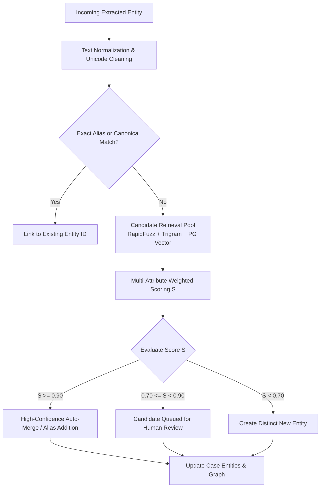

# RedThread Entity Resolution System

## 1. The Challenge in Investigative Analysis

In investigative workflows, documents originate from varied sources (emails, police reports, bank ledgers, offshore leaks) and reference identical entities using disparate naming conventions:
- **Corporate Entities**: *"Tata Consultancy Services"*, *"TCS"*, *"Tata Consultancy Services Limited"*, *"T.C.S."*
- **Individuals**: *"Rahul Sharma"*, *"Rahul S. Sharma"*, *"R. Sharma"*, *"Sharma, Rahul"*
- **Accounts & Aliases**: *"Account #9910-A"*, *"AX91"*, *"009910A"*

Blindly merging similar names corrupts investigation paths (e.g., falsely linking two different people named "John Smith"). Conversely, failing to resolve aliases leaves crucial multi-hop trails fragmented across silos.

---

## 2. The Multi-Stage Resolution Pipeline



---

## 3. Weighted Scoring Formula

Candidate matching evaluates four distinct signals to compute composite similarity score $S$:

$$S = 0.35N + 0.25A + 0.25C + 0.15T$$

| Component | Symbol | Metric & Technique | Description |
| :--- | :---: | :--- | :--- |
| **Name Similarity** | $N$ | `RapidFuzz.fuzz.token_sort_ratio` / Jaro-Winkler | Measures character and token permutation similarity, handling inverted first/last names. |
| **Attribute Similarity** | $A$ | Jaccard similarity over structured attributes | Matches registration numbers, email domains, phone numbers, Tax IDs, or passport numbers. |
| **Context Similarity** | $C$ | Cosine similarity of passage embeddings | Measures whether the surrounding textual context (co-occurring entities, topics) matches. |
| **Type Compatibility** | $T$ | Deterministic type matrix | Returns $1.0$ if types are compatible (e.g. `PERSON` with `PERSON`), $0.0$ if mismatched (e.g. `PERSON` with `ORGANIZATION`). |

### Calibration & Decision Thresholds

| Composite Score ($S$) | Action | System Behavior |
| :--- | :--- | :--- |
| **$S \ge 0.90$** | **High-Confidence Candidate** | Automatically links the observed name as an alias in `entity_aliases` pointing to the canonical `entity_id`. |
| **$0.70 \le S < 0.90$** | **Manual Review Queue** | Generates a pending review task for investigators in the UI. Evidence remains attributed to the unmerged entity until confirmed. |
| **$S < 0.70$** | **Keep Distinct** | Persists as an independent entity in PostgreSQL and Cognee. |

---

## 4. Entity Merge and Unmerge Operations

### 4.1 Why Unmerging is Mandatory
In financial and criminal investigations, an investigator might initially believe "John Smith" at Company A is the same "John Smith" at Company B and merge them. If new evidence proves they are distinct individuals, an irreversible merge corrupts hundreds of claims and graph edges.

### 4.2 Data Model for Reversible Merges
RedThread implements an audit-backed pointer architecture:
```sql
CREATE TABLE entity_merges (
    id UUID PRIMARY KEY DEFAULT gen_random_uuid(),
    organization_id UUID NOT NULL REFERENCES organizations(id),
    target_entity_id UUID NOT NULL REFERENCES entities(id), -- Canonical entity retained
    source_entity_id UUID NOT NULL REFERENCES entities(id), -- Entity subsumed
    merged_by UUID NOT NULL REFERENCES users(id),
    reason TEXT NOT NULL,
    snapshot_relationships JSONB NOT NULL, -- Preserved relationships prior to merge
    created_at TIMESTAMPTZ NOT NULL DEFAULT NOW()
);
```

### 4.3 Unmerge Execution
When an unmerge is triggered:
1. The `source_entity_id` is restored to active status in `entities`.
2. Aliases and claims that originated from source documents referencing the subsumed entity are repointed back to `source_entity_id`.
3. Graph edges in Cognee are detached from the target entity and reattached to the source entity.
4. An entry is recorded in `audit_logs` detailing the unmerge action.
