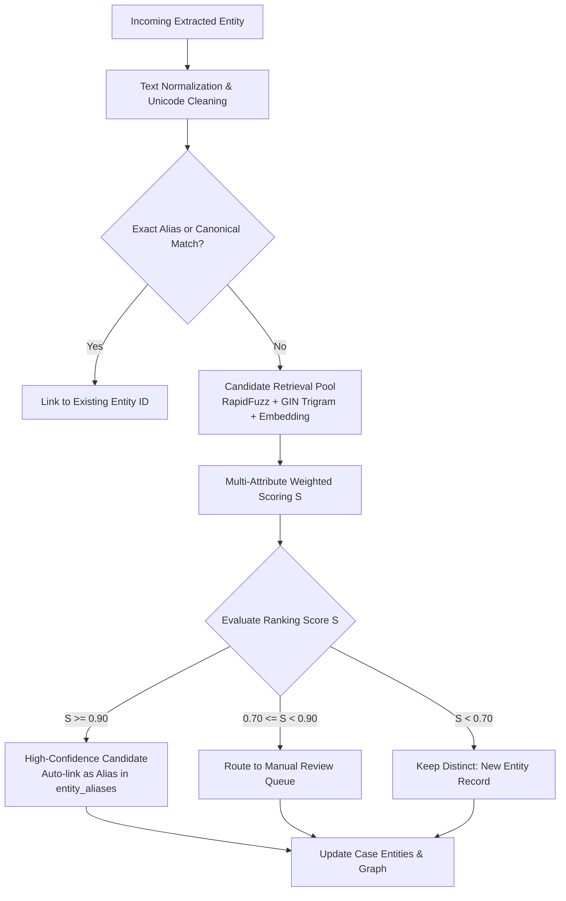

# RedThread Entity Resolution System Specification

> **Document Status**: `DESIGN`  
> **Core Pipeline**: Multi-attribute ranking, candidate generation, manual review queues, and pointer-based reversible merge history.

---

## 1. The Challenge in Investigative Analysis

In investigative workflows, documents originate from varied sources (emails, police reports, bank ledgers, offshore corporate registries) and reference identical entities using disparate naming conventions:
- **Corporate Entities**: *"Tata Consultancy Services"*, *"TCS"*, *"Tata Consultancy Services Limited"*, *"T.C.S."*
- **Individuals**: *"Rahul Sharma"*, *"Rahul S. Sharma"*, *"R. Sharma"*, *"Sharma, Rahul"*
- **Accounts & Aliases**: *"Account #9910-A"*, *"AX91"*, *"009910A"*

Blindly merging similar names corrupts investigation paths (e.g., falsely linking two different people named "John Smith"). Conversely, failing to resolve aliases leaves crucial multi-hop trails fragmented across silos.

---

## 2. Multi-Stage Resolution Pipeline



---

## 3. Weighted Scoring Formula & Interpretation

Candidate matching evaluates four distinct signals to compute composite similarity score $S$:

$$S = 0.35N + 0.25A + 0.25C + 0.15T$$

| Component | Symbol | Metric & Technique | Description |
| :--- | :---: | :--- | :--- |
| **Name Similarity** | $N$ | `RapidFuzz.fuzz.token_sort_ratio` / Jaro-Winkler | Measures character and token permutation similarity, handling inverted first/last names. |
| **Attribute Similarity** | $A$ | Jaccard similarity over structured attributes | Matches registration numbers, email domains, phone numbers, Tax IDs, or passport numbers. |
| **Context Similarity** | $C$ | Cosine similarity of passage embeddings | Measures whether the surrounding textual context (co-occurring entities, topics) matches. |
| **Type Compatibility** | $T$ | Deterministic type matrix | Returns $1.0$ if types are compatible (e.g. `PERSON` with `PERSON`), $0.0$ if mismatched (e.g. `PERSON` with `ORGANIZATION`). |

> [!WARNING]
> **Ranking Score vs. Calibrated Probability**: $S$ is a **heuristic ranking score**, not a statistically calibrated probability. Entities are never blindly combined without verifying type compatibility ($T = 1.0$), and scores in the ambiguous range ($0.70 \le S < 0.90$) are routed strictly to the investigator manual review queue.

### Decision Thresholds

| Composite Score ($S$) | Action | System Behavior |
| :--- | :--- | :--- |
| **$S \ge 0.90$** | **High-Confidence Candidate** | Links the observed name as an alias in `entity_aliases` pointing to the canonical `entity_id`. |
| **$0.70 \le S < 0.90$** | **Manual Review Queue** | Generates a pending review task for investigators in the UI. Evidence remains attributed to the unmerged entity until confirmed. |
| **$S < 0.70$** | **Keep Distinct** | Persists as an independent entity in PostgreSQL and Cognee. |

---

## 4. Reversible Merges & Unmerge Workflow (Pointer-Based Design)

### 4.1 Why Pointer-Based Merging is Mandatory
In financial and criminal investigations, an investigator might initially believe "John Smith" at Company A is the same "John Smith" at Company B and merge them. If subsequent forensic evidence proves they are distinct individuals, an irreversible merge or a crude JSON snapshot corrupts claims and edges.

### 4.2 Relational Model & Schema
1. **Source Claims Remain Untouched**: Claims continue to point directly to the entity UUID extracted from the document (`subject_entity_id = A`).
2. **Canonical Pointer on Entity**: `entities.merged_into_id` (`UUID NULL REFERENCES entities(id)`).
3. **Audit Ledger**:
```sql
CREATE TABLE entity_merge_events (
    id UUID PRIMARY KEY DEFAULT uuid_generate_v4(),
    organization_id UUID NOT NULL REFERENCES organizations(id) ON DELETE RESTRICT,
    source_entity_id UUID NOT NULL,
    target_entity_id UUID NOT NULL,
    merged_by UUID NOT NULL REFERENCES users(id) ON DELETE RESTRICT,
    reason TEXT NOT NULL,
    created_at TIMESTAMPTZ NOT NULL DEFAULT NOW(),
    unmerged_at TIMESTAMPTZ,
    unmerged_by UUID REFERENCES users(id) ON DELETE RESTRICT,
    CONSTRAINT chk_merge_distinct_entities CHECK (target_entity_id <> source_entity_id),
    CONSTRAINT fk_merge_source_org FOREIGN KEY (organization_id, source_entity_id) 
        REFERENCES entities(organization_id, id) ON DELETE RESTRICT,
    CONSTRAINT fk_merge_target_org FOREIGN KEY (organization_id, target_entity_id) 
        REFERENCES entities(organization_id, id) ON DELETE RESTRICT
);
```

### 4.3 Transitive Resolution, Cycle Prevention & Unmerge Execution Procedure
1. **Transitive Canonical Resolution**:
   When entities are merged in sequence ($A \rightarrow B$ and later $B \rightarrow C$), queries resolve canonical entities via recursive pointer resolution (`fn_get_canonical_entity_id(UUID)` or `vw_canonical_entities`), walking until `merged_into_id IS NULL`. Single-step `COALESCE(e.merged_into_id, e.id)` is only valid for 1-hop merges; recursive resolution guarantees correct canonical attribution across arbitrary chains.
2. **Cycle Prevention**:
   The database trigger `trg_prevent_entity_merge_cycles` fires on `BEFORE INSERT OR UPDATE OF merged_into_id ON entities`. It traverses prospective parent pointers and aborts with a database exception if a cycle (e.g., $A \rightarrow B \rightarrow C \rightarrow A$) or excessive depth ($> 20$) is detected.
3. **Unmerge Procedure**:
   When an investigator triggers an unmerge for entity $A$:
   ```sql
   UPDATE entities SET merged_into_id = NULL, updated_at = NOW() WHERE id = :source_id;
   UPDATE entity_merge_events SET unmerged_at = NOW(), unmerged_by = :actor_id 
   WHERE source_entity_id = :source_id AND unmerged_at IS NULL;
   ```
4. **Evidentiary Integrity Guarantee**:
   Because claims still reference original extracted entity UUIDs, **zero claims are rewritten or corrupted**.
5. **Multi-Hop Unmerge Determinism**:
   If intermediate entity $B$ is unmerged from $C$ in a chain $A \rightarrow B \rightarrow C$, $B$ becomes canonical (`B.merged_into_id = NULL`). $A$ continues pointing to $B$ (now canonical root). If $A$ was also mistakenly merged with $B$, an investigator unmerges $A$ independently.

---

## 5. Related Documents
- [Database Design Specification](database-design.md)
- [Database Transactions Specification](database-transactions.md)
- [API Specification](api-specification.md)
- [ADR-005: Weighted Entity Resolution](decisions/ADR-005-weighted-entity-resolution.md)
