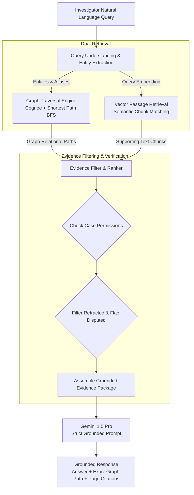

# RedThread Hybrid Recall & RAG System

## 1. Why Hybrid Retrieval is Essential

In complex investigations, evidence is fragmented across separate files:

```
[Document A] : Person A transferred funds to Company X.
[Document B] : Company X operates through Account Y.
[Document C] : Account Y was used in a transaction involving Person B.
[Document D] : Person B is an executive at Organization Z.
```

### The Failure of Vector-Only Retrieval
When an investigator asks: *"How is Person A connected to Organization Z?"*, vector embeddings fail. The cosine similarity between the text describing Person A's wire transfer and the text describing Organization Z's corporate roster is virtually zero. Vector search retrieves neither Document B nor Document C.

### The Power of Hybrid Retrieval
RedThread couples **Graph Traversal** (following explicit attributed edges across documents) with **Vector Retrieval** (capturing nuanced semantic context within passages).

---

## 2. Retrieval & Generation Pipeline



---

## 3. Graph Traversal Algorithms

RedThread implements targeted graph algorithms based on query intent:

| Algorithm | Query Intent | Application |
| :--- | :--- | :--- |
| **Breadth-First Search (BFS)** | *"How is Entity A connected to Entity B?"* | Discovers the shortest unweighted relationship path connecting two entities across case files. |
| **Dijkstra's Algorithm** | *"What is the most reliable connection between A and B?"* | Weighted path traversal where edge weights inversely reflect extraction confidence and evidence strength. |
| **Bounded Neighborhood ($N$-hop)** | *"Explore everything connected to Account AX91 within 2 hops."* | Subgraph expansion for interactive visualization without loading the entire graph. |
| **Connected Components** | *"Are there separate criminal networks in this dataset?"* | Partitions disparate entity clusters to detect independent conspiratorial groups. |

---

## 4. Grounded Synthesis Prompt Design

To eliminate hallucinations, the generation prompt strictly restricts the LLM to supplied evidence:

```markdown
SYSTEM INSTRUCTION:
You are RedThread's verifiable investigative assistant. Your duty is to answer the investigator's query using ONLY the provided verified claims and graph paths.

RULES:
1. Every factual statement in your answer MUST cite one or more valid claim IDs using [Claim #ID].
2. If the provided evidence does not establish a connection between the requested entities, state clearly: "The available evidence does not establish a connection." Do not guess or extrapolate.
3. If any claim in the path is marked DISPUTED, you MUST highlight the dispute and explain the counter-evidence presented.
4. Exclude all external training knowledge about real-world entities.

EVIDENCE PACKAGE:
{verified_claims_json}

GRAPH PATHS:
{traversed_paths_json}

USER QUERY:
{user_query}
```

---

## 5. Recall API Response Contract

```json
{
  "answer": "John Smith is connected to Person B through Global Trade Corp and Account AX91. Wire transfer records indicate John Smith transferred $50,000 to Global Trade Corp [Claim #101]. Global Trade Corp operates through Account AX91 [Claim #142], which was subsequently used in a transaction involving Person B [Claim #205].",
  "confidence": "high",
  "evidence": [
    {
      "claim_id": "claim_101",
      "subject": "John Smith",
      "predicate": "TRANSFERRED_TO",
      "object": "Global Trade Corp",
      "document_id": "doc_88f910a3",
      "document_filename": "wire_transfer_memo.pdf",
      "page": 4,
      "snippet": "John Smith transferred $50,000 to Global Trade Corp through Account AX91."
    },
    {
      "claim_id": "claim_142",
      "subject": "Global Trade Corp",
      "predicate": "OPERATES_THROUGH",
      "object": "Account AX91",
      "document_id": "doc_99a1b2c3",
      "document_filename": "corporate_filing_2025.pdf",
      "page": 11,
      "snippet": "Global Trade Corp maintains operating treasury accounts including Account AX91."
    },
    {
      "claim_id": "claim_205",
      "subject": "Account AX91",
      "predicate": "USED_IN_TRANSACTION_WITH",
      "object": "Person B",
      "document_id": "doc_77c8d9e0",
      "document_filename": "bank_statement_q3.pdf",
      "page": 8,
      "snippet": "Account AX91 was used in a transaction involving Person B."
    }
  ],
  "path": [
    "John Smith",
    "Global Trade Corp",
    "Account AX91",
    "Person B"
  ],
  "warnings": []
}
```
