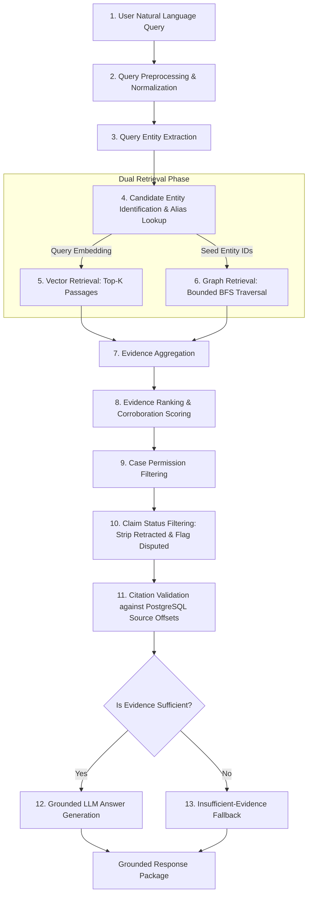

# RedThread Hybrid Recall & RAG System

> **Document Status**: `DESIGN`  
> **Core Retrieval Engine**: 13-stage hybrid graph-vector retrieval, bounded traversal, strict citation validation, and grounded answer synthesis.

---

## 1. Why Hybrid Retrieval is Essential

In complex investigations, evidence is fragmented across separate files:

```
[Document A] : Person A transferred funds to Company X.
[Document B] : Company X operates through Account Y.
[Document C] : Account Y was used in a transaction involving Person B.
[Document D] : Person B is an executive at Organization Z.
```

### The Failure of Vector-Only Retrieval
When an investigator asks: *"How is Person A connected to Organization Z?"*, vector embeddings fail. The cosine similarity between the text describing Person A's wire transfer and the text describing Organization Z's corporate charter is virtually zero. Vector search retrieves neither Document B nor Document C.

### The Power of Hybrid Retrieval
RedThread couples **Graph Traversal** (following explicit attributed edges across documents) with **Vector Retrieval** (capturing nuanced semantic context within passages).

---

## 2. The 13-Stage Retrieval Pipeline



### Stage-by-Stage Specifications:
1. **Query Preprocessing**: Strips whitespace, sanitizes input, and handles query expansion.
2. **Query Entity Extraction**: Uses Gemini to identify explicit names, account numbers, and corporate entities mentioned in the prompt.
3. **Candidate Entity Identification**: Maps extracted query strings to canonical entity UUIDs in `entities` and `entity_aliases`.
4. **Vector Retrieval**: Fetches top-$K$ semantically relevant chunks from `document_chunks` using vector similarity search.
5. **Graph Retrieval**: Identifies connected subgraphs in Cognee starting from candidate entity nodes.
6. **Bounded Graph Traversal (BFS)**: Executes Breadth-First Search up to a fixed depth ($N \le 4$ hops) to discover shortest unweighted paths between seed entities.
7. **Evidence Aggregation**: Merges textual passages and relationship graph edges into an evidence pool.
8. **Evidence Ranking**: Ranks claims based on extraction confidence, document type authority, and path length.
9. **Permission Filtering**: **Crucial Security Step**: Queries PostgreSQL to ensure every claim and document chunk belongs to a case the requesting user is authorized to view.
10. **Claim-Status Filtering**: Removes `RETRACTED` claims from default retrieval; tags `DISPUTED` claims with mandatory dispute warnings.
11. **Citation Validation**: Verifies that character offsets in `claim_sources` map directly to verbatim excerpts in source documents.
12. **Grounded LLM Answer Generation**: Gemini synthesizes the answer, citing only verified `[Claim #ID]` tokens.
13. **Insufficient-Evidence Fallback**: If no path or verified evidence exists, returns: *"The available evidence does not establish a connection."*

---

## 3. Strict Epistemic Grounding Prompt

```markdown
SYSTEM INSTRUCTION:
You are RedThread's verifiable investigative assistant. Your duty is to answer the investigator's query using ONLY the provided verified claims and graph paths.

RULES:
1. Every factual statement in your answer MUST cite one or more valid claim IDs using [Claim #ID].
2. If the provided evidence does not establish a connection between the requested entities, state clearly: "The available evidence does not establish a connection." Do not guess or extrapolate.
3. If any claim in the path is marked DISPUTED, you MUST highlight the dispute and explain the counter-evidence presented.
4. Exclude all external training knowledge about real-world entities.

EVIDENCE PACKAGE:
{verified_claims_json}

GRAPH PATHS:
{traversed_paths_json}

USER QUERY:
{user_query}
```

---

## 4. API Response Contract

```json
{
  "answer": "John Smith is connected to Person B through Global Trade Corp and Account AX91 [Claim #101, #142, #205]. However, Claim #101 is currently disputed.",
  "confidence": "moderate",
  "evidence": [
    {
      "claim_id": "claim_101",
      "subject": "John Smith",
      "predicate": "TRANSFERRED_TO",
      "object": "Global Trade Corp",
      "status": "DISPUTED",
      "document_id": "doc_88f910a3",
      "document_filename": "wire_transfer_memo.pdf",
      "page": 4,
      "snippet": "John Smith transferred $50,000 to Global Trade Corp through Account AX91."
    }
  ],
  "path": [
    "John Smith",
    "Global Trade Corp",
    "Account AX91",
    "Person B"
  ],
  "warnings": [
    "Claim #101 has an open dispute regarding transaction attribution."
  ]
}
```

---

## 5. Related Documents
- [Database Design](database-design.md)
- [Contradiction Management](contradiction-and-claim-lifecycle.md)
- [ADR-003: Hybrid Graph-Vector Recall](decisions/ADR-003-hybrid-graph-vector-recall.md)
- [Evaluation Framework](benchmarks/evaluation-framework.md)
