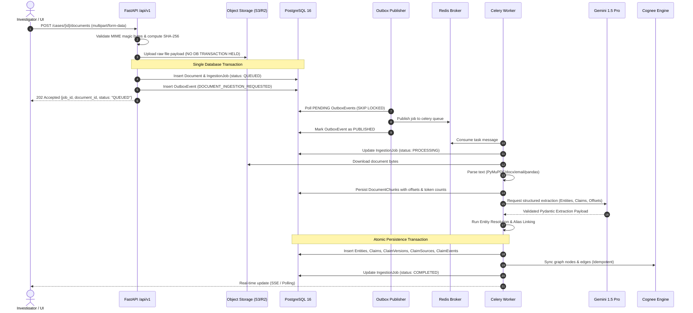
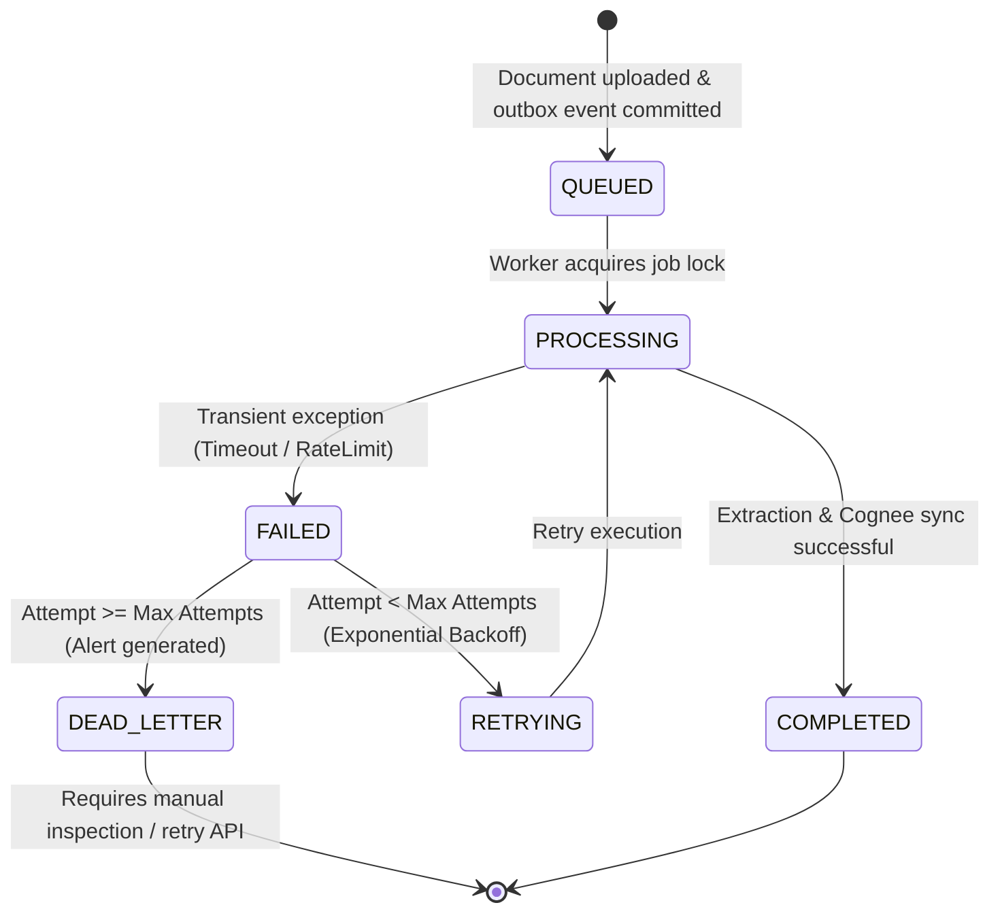

# RedThread Document Ingestion Pipeline Specification

> **Document Status**: `DESIGN`  
> **Core Pipeline**: Asynchronous, reliable document ingestion, structured LLM extraction, transactional outbox publishing, and idempotent graph synchronization.

---

## 1. Overview & Architecture

The ingestion pipeline transforms raw, heterogeneous investigative documents into structured, interconnected, and verifiable knowledge graph entities and claims. Because document parsing, chunking, LLM extraction, and graph synchronization take from several seconds to minutes per document, all processing is performed **asynchronously** via background Celery workers, Redis, and a transactional outbox.

---

## 2. Ingestion Lifecycle & Sequence



---

## 3. Ingestion State Machine

The document ingestion job adheres to a strictly defined state machine ensuring resiliency and recoverability:



---

## 4. Multi-Format Parsers

RedThread supports four primary document formats with granular page and offset tracking:

| Format | Library | Extraction Strategy | Offset Preservation |
| :--- | :--- | :--- | :--- |
| **PDF** | `PyMuPDF` (`fitz`) | Direct page text extraction with layout awareness. Handles multi-column layouts and scans with OCR fallback. | Page number + character start/end index within the page. |
| **DOCX** | `python-docx` | Structured paragraph and table cell traversal. | Paragraph index + character offset. |
| **TXT / MD**| Standard I/O + `chardet` | Character encoding auto-detection (UTF-8, Latin-1) and line normalization. | Global character start/end offset. |
| **EML** | Python `email` module | Extracts headers (From, To, CC, Subject, Date) and parses plain-text/HTML message bodies. | Header boundaries + body character offsets. |
| **CSV** | `pandas` / `csv` | Tabular row-by-row parsing, generating contextualized natural-language row sentences for extraction. | Row index + column header references. |

---

## 5. Structured Extraction with Gemini & Pydantic

During stage 6 of ingestion, chunks (typically 1,500 tokens with 200 token overlap) are processed by Gemini using structured output schemas:

```python
from pydantic import BaseModel, Field
from typing import List, Optional, Dict, Any

class ExtractedEntity(BaseModel):
    name: str = Field(description="Observed entity name in text")
    entity_type: str = Field(description="PERSON, ORGANIZATION, FINANCIAL_ACCOUNT, MONETARY_AMOUNT, etc.")

class ExtractedClaim(BaseModel):
    subject: str = Field(description="Subject entity name")
    predicate: str = Field(description="Action or relationship, e.g., TRANSFERRED_TO, OWNS, EMPLOYED_BY")
    claim_type: str = Field(description="ENTITY_TO_ENTITY or ENTITY_TO_LITERAL")
    target_entity: Optional[str] = Field(None, description="Target entity if object is an entity")
    target_value: Optional[str] = Field(None, description="Literal value if object is a literal (e.g. $50,000)")
    qualifiers: Dict[str, Any] = Field(default_factory=dict, description="Structured attributes: amount, currency, date")
    is_negated: bool = Field(default=False, description="Whether the source explicitly asserts negation")
    quoted_text: str = Field(description="Exact verbatim excerpt from document supporting this claim")
    page_number: int = Field(description="1-based page number")
    doc_start_offset: int = Field(description="0-based character start offset in normalized document")
    doc_end_offset: int = Field(description="0-based character end offset in normalized document")
    chunk_local_start_offset: Optional[int] = Field(None, description="Character start offset in chunk")
    chunk_local_end_offset: Optional[int] = Field(None, description="Character end offset in chunk")
    confidence: float = Field(description="Model extraction confidence score (0.0 to 1.0)")

class ExtractionResult(BaseModel):
    entities: List[ExtractedEntity]
    claims: List[ExtractedClaim]
```

### Epistemic Boundary Rule:
> [!IMPORTANT]
> An LLM-extracted relationship is **never treated as ground truth**. It is recorded in PostgreSQL as an **attributed claim** with its source citation. Only human investigators or verified corroborating evidence can promote or review the claim's status.

---

## 6. Fault Tolerance, Idempotency & Recovery

1. **SHA-256 Content Deduplication**: `uq_case_document_hash` rejects duplicate uploads.
2. **Distributed Job Locks**: Workers acquire a Redis lock on `lock:document:{document_id}` with a TTL of 10 minutes to prevent dual execution by concurrent workers.
3. **Atomic Multi-Table Commits**: Chunks, entities, claims, claim versions, and claim sources commit together. If an error occurs, the transaction rolls back cleanly.
4. **Idempotent Cognee Synchronization**: Graph nodes and edges are synchronized with deterministic UUIDs. Re-running synchronization updates existing nodes without creating duplicates.
5. **Exponential Backoff**:
   $$\text{Delay}(t) = \text{base\_delay} \times 2^{\text{attempt}} + \text{jitter}$$

---

## 7. Related Documents
- [Database Design](database-design.md)
- [Database Transactions](database-transactions.md)
- [Data Consistency](data-consistency.md)
- [ADR-002: Asynchronous Ingestion](decisions/ADR-002-asynchronous-ingestion-pipeline.md)
