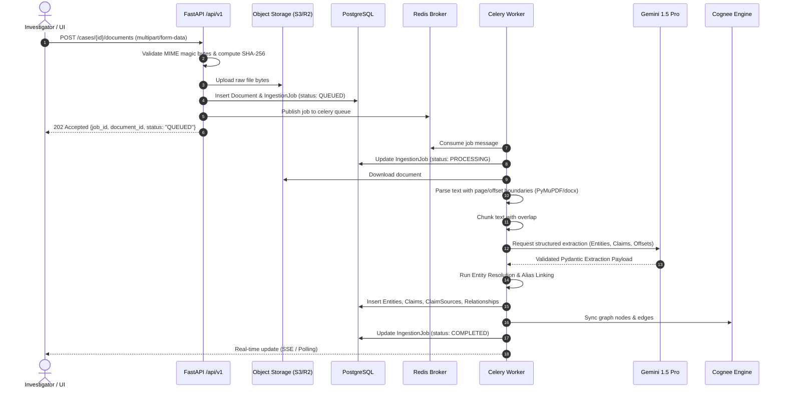
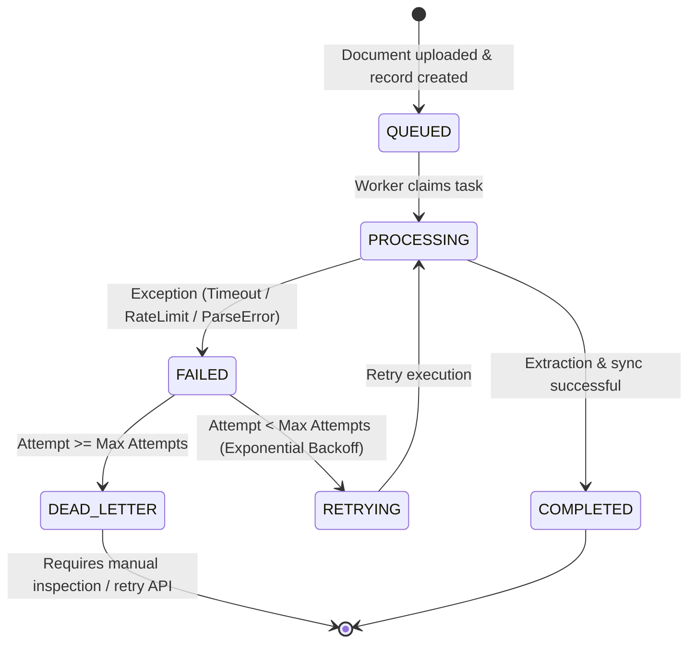

# RedThread Document Ingestion Pipeline

## 1. Overview & Architecture

The ingestion pipeline transforms raw, heterogeneous investigative documents into structured, interconnected, and verifiable knowledge graph entities and claims. Because document parsing, optical chunking, LLM extraction, and graph synchronization can take from several seconds to minutes per document, all processing is performed **asynchronously** via background Celery workers and Redis.

---

## 2. Ingestion Lifecycle



---

## 3. Ingestion State Machine

The document ingestion job adheres to a strictly defined state machine ensuring resiliency and recoverability:



### State Definitions
* **`QUEUED`**: The document metadata has been written to PostgreSQL, the file is securely uploaded in S3, and the task has been dispatched to Redis.
* **`PROCESSING`**: A worker has acquired the job lock and is executing parsing, LLM extraction, or entity resolution.
* **`COMPLETED`**: Entities, claims, sources, and graph edges are successfully persisted in PostgreSQL and Cognee.
* **`FAILED`**: A transient error occurred (e.g., Gemini rate limit, network timeout).
* **`RETRYING`**: The job is awaiting its scheduled backoff timer before re-entering `PROCESSING`.
* **`DEAD_LETTER`**: Exhausted maximum retry attempts (default: 3). Alert recorded in audit logs.

---

## 4. Multi-Format Parsers

RedThread supports five primary document formats with granular page and offset tracking:

| Format | Library | Extraction Strategy | Offset Preservation |
| :--- | :--- | :--- | :--- |
| **PDF** | `PyMuPDF` (`fitz`) | Direct page text extraction with layout awareness. Handles multi-column layouts and scans with OCR fallback. | Page number + character start/end index within the page. |
| **DOCX** | `python-docx` | Structured paragraph and table cell traversal. | Paragraph index + character offset. |
| **TXT / MD**| Standard I/O + `chardet` | Character encoding auto-detection (UTF-8, Latin-1) and line normalization. | Global character start/end offset. |
| **EML** | Python `email` module | Extracts headers (From, To, CC, Subject, Date) and parses plain-text/HTML message bodies. | Header boundaries + body character offsets. |
| **CSV** | `pandas` / `csv` | Tabular row-by-row parsing, generating contextualized natural-language row sentences for extraction. | Row index + column header references. |

---

## 5. Structured Extraction with Gemini & Pydantic

During stage 6 of ingestion, chunks (typically 1,500 tokens with 200 token overlap) are processed by Gemini using structured output schemas:

```python
from pydantic import BaseModel, Field
from typing import List, Optional

class ExtractedEntity(BaseModel):
    name: str = Field(description="Canonical or observed name of entity")
    entity_type: str = Field(description="PERSON, ORGANIZATION, FINANCIAL_ACCOUNT, MONETARY_AMOUNT, etc.")

class ExtractedClaim(BaseModel):
    subject: str = Field(description="Subject entity name")
    predicate: str = Field(description="Action or relationship, e.g., TRANSFERRED_TO, OWNS, EMPLOYED_BY")
    target_entity: Optional[str] = Field(None, description="Target entity if object is an entity")
    target_value: Optional[str] = Field(None, description="Literal value if object is a literal (e.g. $50,000)")
    quoted_text: str = Field(description="Exact verbatim excerpt from document supporting this claim")
    page_number: int = Field(description="1-based page number")
    start_offset: int = Field(description="Character start offset in chunk")
    end_offset: int = Field(description="Character end offset in chunk")
    confidence: float = Field(description="Model extraction confidence score (0.0 to 1.0)")

class ExtractionResult(BaseModel):
    entities: List[ExtractedEntity]
    claims: List[ExtractedClaim]
```

### Critical Epistemic Rule:
> [!IMPORTANT]
> An LLM-extracted relationship is **never treated as an established fact**. It is recorded in PostgreSQL as an **attributed claim** with its document source citation. Only human investigators or verified corroborating evidence can promote or review the claim's status.

---

## 6. Idempotency & Fault Tolerance

1. **SHA-256 Content Deduplication**: Before processing, the document's SHA-256 hash is checked against the target case. If a duplicate is detected, the upload returns the existing document record, preventing redundant LLM inference costs.
2. **Distributed Job Locks**: Workers acquire a Redis lock on `lock:document:{document_id}` with a TTL of 10 minutes to prevent dual execution by concurrent workers.
3. **Transactional Database Commits**: All entities, claims, and claim sources for a document are committed within a single database transaction. If the worker crashes halfway through, the transaction rolls back cleanly, leaving the system in a consistent state for retry.
4. **Exponential Backoff**:
   $$\text{Delay}(t) = \text{base\_delay} \times 2^{\text{attempt}} + \text{jitter}$$
   Default: 5 seconds base delay $\rightarrow$ 10s $\rightarrow$ 20s $\rightarrow$ Dead letter.
