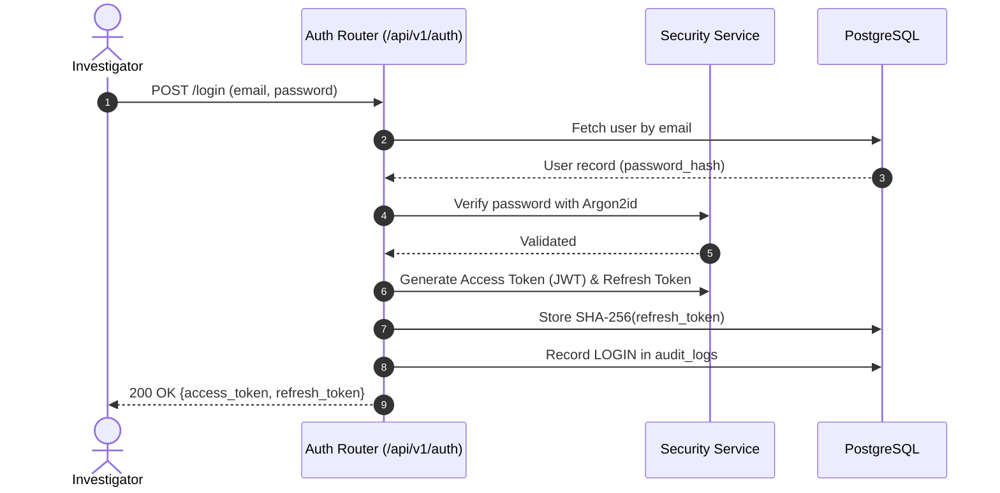

# Module 1: User Authentication & Organization Management

## 1. Purpose & Scope
This module establishes the identity, tenancy, and access governance foundations of RedThread. A production investigative intelligence platform cannot permit arbitrary cross-tenant access. Users belong to Organizations, have specific organizational and case-level roles, and authenticate via secure, rotating tokens.

---

## 2. Key Features
- **User Registration & Organization Creation**: Provision new organizations and initialize primary admin accounts.
- **Argon2id Password Security**: Industry-standard cryptographic password hashing.
- **JWT Session Architecture**: Short-lived access tokens (15 min) and long-lived refresh tokens (7 days) stored as SHA-256 hashes.
- **Token Revocation & Reuse Detection**: Revoking refresh tokens invalidates descendant sessions immediately.
- **Role-Based Access Control (RBAC)**:
  - `ORGANIZATION_ADMIN`: Manages organization details, billing, and user invitations.
  - `INVESTIGATOR`: Creates and manages assigned cases, uploads evidence, executes recall queries.
  - `REVIEWER`: Audits claims, resolves disputes, issues retractions or reinstatements.
  - `VIEWER`: Read-only access to assigned cases, search, and generated reports.
- **Tenant Isolation**: Foreign-key constraints and PostgreSQL Row-Level Security (RLS) ensure cross-tenant data leakage is impossible.

---

## 3. Database Touchpoints
- Tables: `organizations`, `users`, `memberships`, `refresh_tokens`, `audit_logs`.
- Primary Constraint: `UNIQUE(organization_id, user_id)` in `memberships`.

---

## 4. Workflows & Sequence

---

## 5. Security & Edge Case Handling
- **Account Enumeration Defense**: Register and password reset flows respond with generic messages regardless of whether the email exists.
- **IDOR Safeguards**: All subsequent API calls inspect `jwt.organization_id` before querying records.
- **Session Termination**: Logging out permanently flags the refresh token record as `revoked_at = NOW()`.
