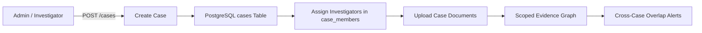

# Module 2: Case Management

## 1. Purpose & Scope
Every investigation in RedThread operates within an isolated logical workspace known as a **Case**. A case owns documents, assigned investigators, extracted entities, and attributed claims. 

> [!IMPORTANT]
> **Core Architectural Decision**: A case is not simply a Cognee dataset string. A case is an application-level domain entity stored in PostgreSQL with strict access control lists, lifecycle states, and metadata.

---

## 2. Key Features
- **Case Provisioning & Configuration**: Unique case identifier (e.g. `CASE-2026-001`), name, description, tags, and sensitivity classification.
- **Investigator Assignment**: Explicit mapping of users to cases (`case_members`), restricting document and graph access to assigned personnel.
- **Case State Lifecycle**: `ACTIVE`, `ARCHIVED`, `CLOSED`.
- **Activity Feed & Metric Aggregation**: Real-time rollups of total ingested documents, extracted entities, identified claims, and active disputes.
- **Cross-Case Intelligence Comparison**: Permitted investigators can view overlapping entities shared between authorized cases without leaking unauthorized context.

---

## 3. Database Touchpoints
- Tables: `cases`, `case_members`, `case_entities`, `documents`, `claims`.
- Constraint: `UNIQUE(organization_id, case_number)` ensures unique numbering within each organization.

---

## 4. Workflows

---

## 5. Engineering Considerations
- **Non-Disclosing 404s**: When a user attempts to access a case belonging to another organization or a case they are not assigned to, the API returns a generic 404 rather than 403, preventing case enumeration.
- **Cascade Rules**: Archiving a case hides it from active listings while preserving all evidence, graph structures, and audit logs.
