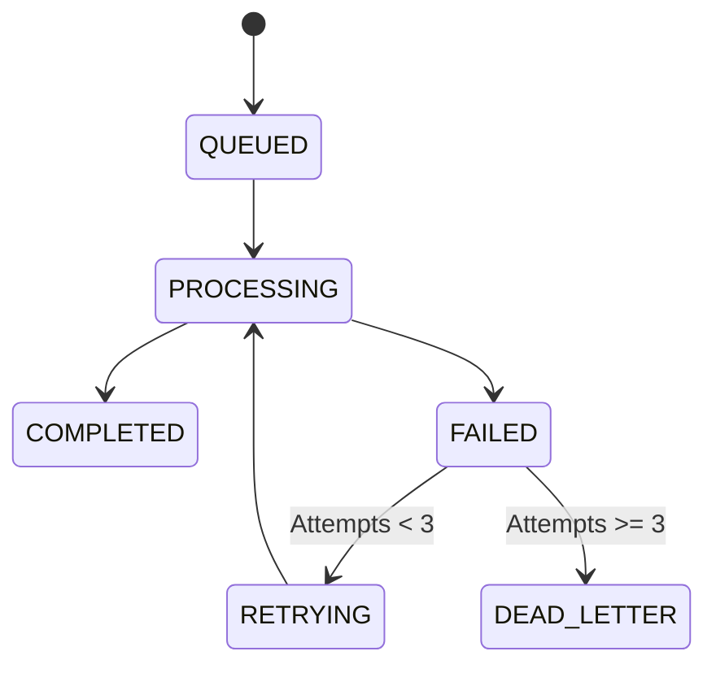

# Module 3: Document Ingestion Pipeline

> **Document Status**: `DESIGN`  
> **Module ID**: `MOD-03`  
> **Responsibility**: Multi-format document parsing, chunking, asynchronous queue dispatch, transactional outbox publishing, and failure recovery.

---

## 1. Purpose & Scope
The Ingestion Pipeline is the asynchronous engine responsible for taking raw, heterogeneous files (PDFs, Word documents, emails, spreadsheets, text memos), validating their integrity, storing them in object storage, chunking their contents, invoking Gemini for structured extraction, and populating PostgreSQL and the Cognee graph engine.

---

## 2. Supported Formats & Parsing Strategies
- **PDF**: PyMuPDF (`fitz`) handles complex multi-column reports and extracts exact page boundaries.
- **DOCX**: `python-docx` extracts paragraphs, tables, and hierarchical headings.
- **TXT / MD**: Unicode normalization and line offset tracking.
- **EML**: Python `email` parser extracts sender, recipient, CC, timestamp, and message body.
- **CSV**: `pandas` converts structured tabular records into contextualized statements with row citations.

---

## 3. Ingestion State Machine

---

## 4. Key Production Requirements
1. **Asynchronous Decoupling**: API upload returns immediately with `202 Accepted` and a `job_id`.
2. **PostgreSQL as State Authority**: Redis acts purely as the message queue transport; persistent job status and attempt history reside in `ingestion_jobs`.
3. **SHA-256 Deduplication**: Files with identical hashes in the same case are deduplicated immediately.
4. **Idempotency**: Workers use distributed locks and single-transaction commits so retried jobs never create duplicate entities or claims.
5. **Transactional Outbox**: Task creation is tied transactionally to database commits via `outbox_events`.

---

## 5. Related Documents
- [Document Ingestion Pipeline](../ingestion-pipeline.md)
- [ADR-002: Asynchronous Ingestion](../decisions/ADR-002-asynchronous-ingestion-pipeline.md)
- [Data Consistency](../data-consistency.md)
