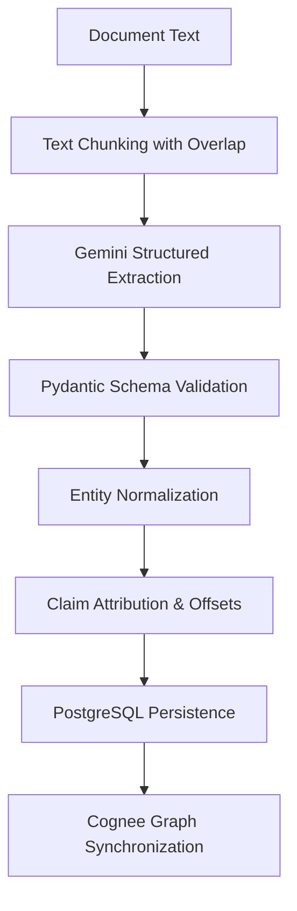

# Module 4: Entity and Relationship Extraction

## 1. Purpose & Scope
This module converts raw unstructured text into structured, normalized entities, relationships, and granular source-attributed claims. 

For example, when parsing:
> *"John Smith transferred $50,000 to Global Trade Corporation through Account AX91 on 12 March 2026."*

The extraction module decomposes the sentence into:
- **Entities**:
  - `John Smith` (`PERSON`)
  - `Global Trade Corporation` (`ORGANIZATION`)
  - `Account AX91` (`FINANCIAL_ACCOUNT`)
  - `$50,000` (`MONETARY_AMOUNT`)
  - `12 March 2026` (`DATE_TIME`)
- **Relationships / Claims**:
  - `John Smith` $\xrightarrow{\text{TRANSFERRED\_TO}}$ `Global Trade Corporation`
  - `John Smith` $\xrightarrow{\text{USED\_ACCOUNT}}$ `Account AX91`
  - `Global Trade Corporation` $\xrightarrow{\text{RECEIVED\_AMOUNT}}$ `$50,000`
- **Source Offsets**:
  - `document_id`: `doc_101`
  - `page_number`: 4
  - `start_offset`: 1240
  - `end_offset`: 1342
  - `quoted_text`: Verbatim sentence above

---

## 2. Extraction Pipeline

---

## 3. Epistemic Boundary: Attributed Claim vs. Fact
An LLM-extracted relationship is **never automatically treated as ground truth**.
- **The System Records**: "Document X claims that Person A transferred funds to Company B."
- **The Human Reviews**: An investigator examines the underlying document to verify, challenge, or corroborate the assertion.
This distinction ensures RedThread operates as an accountable intelligence aid rather than an unverified hallucination engine.
