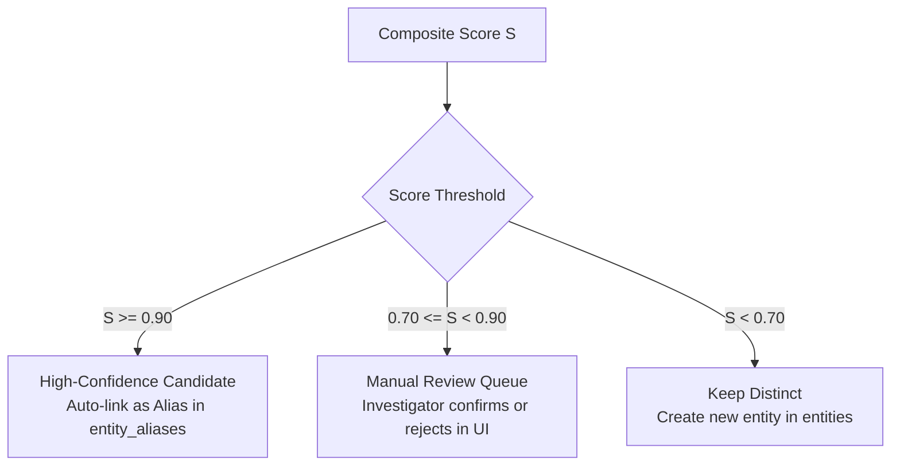

# Module 5: Entity Resolution

## 1. Purpose & Scope
Entity resolution handles ambiguous, abbreviated, or slightly mismatched entity names across disparate documents. In real investigations, a subject may appear as *"Tata Consultancy Services"*, *"TCS"*, or *"Tata Consultancy Services Ltd."*. Conversely, *"Rahul Sharma"* and *"Rahul S. Sharma"* may represent completely different individuals.

Blind exact matching misses vital connections, while uncontrolled merging corrupts downstream evidence trails.

---

## 2. Key Architecture & Scoring Formula

RedThread uses a calibrated weighted scoring model:

$$S = 0.35N + 0.25A + 0.25C + 0.15T$$

Where:
- $N$: Name Similarity (RapidFuzz Token Sort Ratio).
- $A$: Attribute Matching (Tax IDs, phone numbers, addresses, registration keys).
- $C$: Contextual Embedding Similarity (surrounding textual topics).
- $T$: Entity Type Compatibility ($1.0$ if compatible, $0.0$ if conflicting).

---

## 3. Decision Matrix & Action Pathways

---

## 4. Reversible Merges & Unmerge Workflow
An incorrect entity merge can cross-wire unrelated financial accounts or investigation leads.
- **Merge Tracking**: Logged in `entity_merges` with a JSON snapshot of pre-merge relationship graphs.
- **Unmerge Capability**: Re-establishes separate entity records, rewrites relationship pointers, and updates Cognee graph structures without data loss.

For comprehensive details, consult the dedicated [Entity Resolution Specification](file:///home/rushikeshbathe096/hackathons/Redthread/docs/entity-resolution.md) and [ADR-005](file:///home/rushikeshbathe096/hackathons/Redthread/docs/decisions/ADR-005-weighted-entity-resolution.md).
