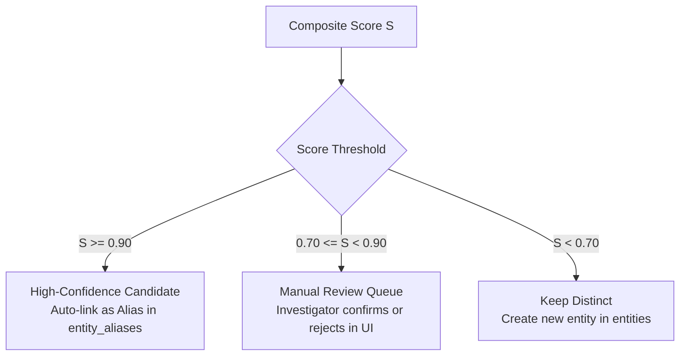

# Module 5: Entity Resolution

> **Document Status**: `DESIGN`  
> **Module ID**: `MOD-05`  
> **Responsibility**: Weighted string/attribute matching, alias indexing, manual review queue, and reversible merge operations.

---

## 1. Purpose & Scope
Entity resolution handles ambiguous, abbreviated, or slightly mismatched entity names across disparate documents. In real investigations, a subject may appear as *"Tata Consultancy Services"*, *"TCS"*, or *"Tata Consultancy Services Ltd."*. Conversely, *"Rahul Sharma"* and *"Rahul S. Sharma"* may represent completely different individuals.

Blind exact matching misses vital connections, while uncontrolled merging corrupts downstream evidence trails.

---

## 2. Key Architecture & Scoring Formula

RedThread uses a calibrated weighted scoring model:

$$S = 0.35N + 0.25A + 0.25C + 0.15T$$

Where:
- $N$: Name Similarity (RapidFuzz Token Sort Ratio).
- $A$: Attribute Matching (Tax IDs, phone numbers, addresses, registration keys).
- $C$: Contextual Embedding Similarity (surrounding textual topics).
- $T$: Entity Type Compatibility ($1.0$ if compatible, $0.0$ if conflicting).

*Note*: $S$ is evaluated as a **heuristic ranking score**, not a calibrated probability.

---

## 3. Decision Matrix & Action Pathways

---

## 4. Reversible Merges & Unmerge Workflow (Pointer-Based Design)
An incorrect entity merge can cross-wire unrelated financial accounts or investigation leads.
- **Pointer-Based Hierarchy**: Merging entity $A$ into $B$ sets `entities.merged_into_id = B`. Claims continue pointing permanently to extracted entity UUIDs without mutation.
- **Merge Event Ledger**: Every merge action is recorded in `entity_merge_events` with actor ID, reason, and timestamps.
- **Cycle Prevention**: Trigger `trg_prevent_entity_merge_cycles` enforces acyclicity before any merge commit.
- **Deterministic Unmerge**: Resetting `entities.merged_into_id = NULL` immediately restores canonical independence without rewriting claims or losing intervening evidence.

---

## 5. Related Documents
- [Entity Resolution Specification](../entity-resolution.md)
- [ADR-005: Weighted Entity Resolution](../decisions/ADR-005-weighted-entity-resolution.md)
- [Database Design](../database-design.md)
