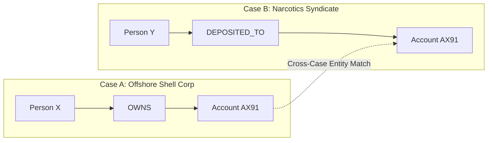

# Module 6: Knowledge Graph & Cross-Case Intelligence

## 1. Purpose & Scope
The knowledge graph models entities as nodes and attributed claims as directed, weighted edges. This module empowers investigators to discover multi-hop paths, uncover hidden conspiratorial networks, and identify cross-case entity overlaps.

---

## 2. Core Graph Operations & Algorithms

| Algorithm | Computational Complexity | Investigative Objective |
| :--- | :---: | :--- |
| **Breadth-First Search (BFS)** | $O(V + E)$ | Uncovers the shortest relational chain connecting two suspicious entities across distinct files. |
| **Dijkstra's Shortest Path** | $O(E + V \log V)$ | Finds the most corroborated path where edge weights reflect evidentiary confidence. |
| **Bounded Neighborhood ($N$-hop)** | $O(b^d)$ | Dynamically expands an entity's local cluster (e.g. 1 or 2 hops) without freezing the client UI. |
| **Connected Components** | $O(V + E)$ | Identifies isolated sub-networks to discover independent syndicates. |
| **Degree Centrality** | $O(V)$ | Surfaces key entities that act as transaction hubs or intermediaries. |

---

## 3. Cross-Case Overlap Intelligence

### Overlap Principles:
1. **Shared Entity Detection**: Automatically surfaces when an entity (e.g. `Account AX91`) appears in two separate cases.
2. **Evidentiary Restraint**: A shared entity does not establish criminal conspiracy on its own. RedThread highlights the overlap as an investigative lead and presents the underlying evidence for human assessment.
3. **Strict Authorization Scoping**: Overlaps are only visible if the requesting user has authorization for both cases.
