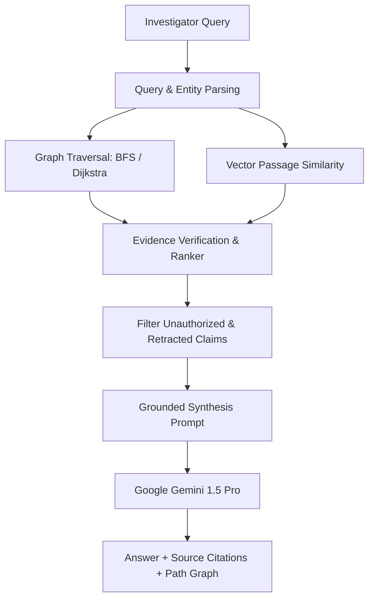

# Module 7: Intelligent Recall & Grounded RAG

## 1. Purpose & Scope
Intelligent Recall is RedThread's conversational AI assistant. It allows investigators to query the evidence base using natural language:
> *"How is John Smith connected to Person B, and what are the sources?"*

The system discovers multi-hop graph paths, pairs them with semantically relevant document chunks, verifies access permissions, and synthesizes an answer with exact citations.

---

## 2. Hybrid Retrieval Architecture

---

## 3. Strict AI Safeguards
- **Zero Extrapolation**: If evidence is missing, the assistant outputs `"Insufficient evidence to establish connection"`.
- **Mandatory Dispute Citations**: Any claim marked `DISPUTED` in the retrieved path is explicitly highlighted with counter-evidence.
- **Traceable Path Output**: The returned `path` array is populated strictly from retrieved graph edges, not hallucinated text strings.

For in-depth details, see [Hybrid Recall & RAG](file:///home/rushikeshbathe096/hackathons/Redthread/docs/hybrid-recall-and-rag.md) and [ADR-003](file:///home/rushikeshbathe096/hackathons/Redthread/docs/decisions/ADR-003-hybrid-graph-vector-recall.md).
