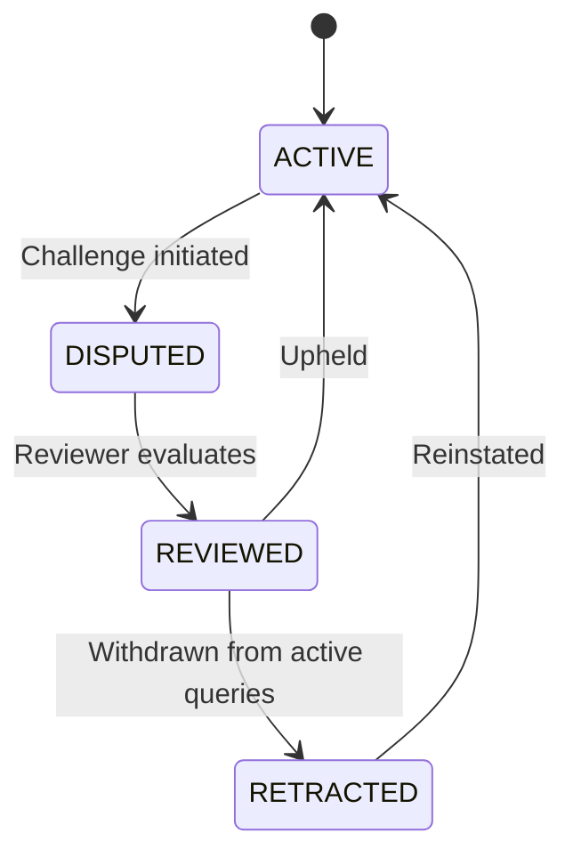

# Module 8: Contradiction Detection & Intelligent Forgetting

> **Document Status**: `DESIGN`  
> **Module ID**: `MOD-08`  
> **Responsibility**: Claim lifecycle state machine, dispute challenges, review decisions, and immutable audit event ledgers.

---

## 1. Purpose & Scope
This module represents RedThread's signature architectural differentiator. In traditional RAG systems, new contradictory information either overwrites old data or causes hallucinations. 

In RedThread, **contradictions do not silently erase historical information**. The system retains both contradictory statements, tracks the dispute explicitly in the claim state machine, and reflects the uncertainty in AI answers.

---

## 2. Claim State Machine & Event Tracking

### Event Logging (`claim_events`)
Every transition writes an immutable event row recording:
- `event_type`: `CLAIM_CHALLENGED`, `CLAIM_REVIEWED`, `CLAIM_RETRACTED`, `CLAIM_REINSTATED`.
- `actor_id`: UUID of the investigator or reviewer.
- `reason`: Justification text explaining the challenge or retraction.
- `metadata`: Counter-document IDs and page references.

---

## 3. Retrieval Impact
- **Active State**: Traversed normally in graph paths.
- **Disputed State**: Traversed with explicit warning flags; LLM answers mention both perspectives.
- **Retracted State**: Excluded from default search and RAG synthesis; retained exclusively in historical audits and report archives.

---

## 4. Related Documents
- [Contradiction Management & Claim Lifecycle](../contradiction-and-claim-lifecycle.md)
- [ADR-004: Versioned Claim Lifecycle](../decisions/ADR-004-claim-lifecycle-and-intelligent-forgetting.md)
- [Database Design](../database-design.md)
