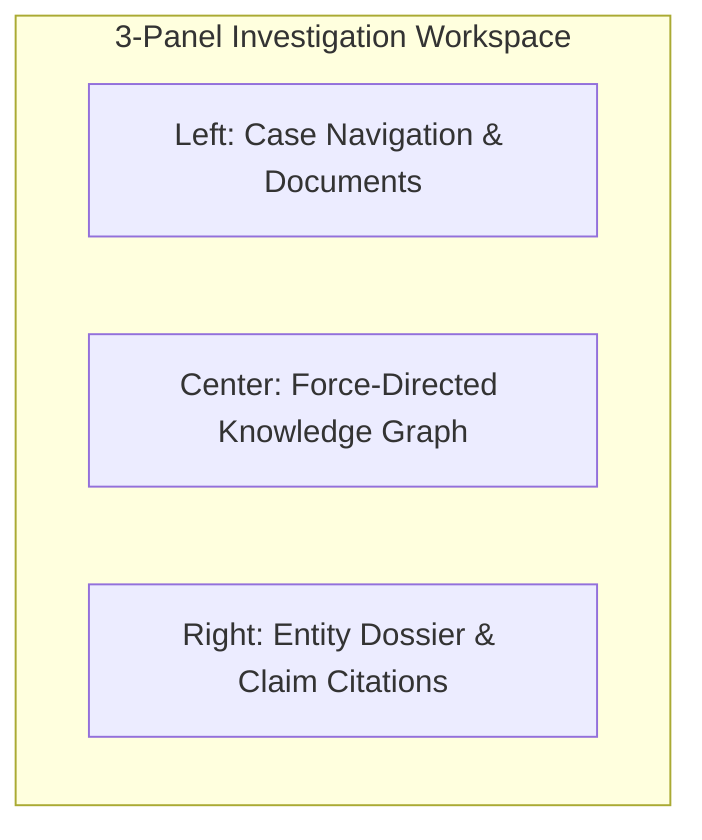

# Module 9: Search, Analytics & Investigation Workspace

## 1. Purpose & Scope
This module provides the investigative workbench and analytics intelligence layer, translating backend graph and claim states into an intuitive user interface.

---

## 2. Key Capabilities
- **Multi-Faceted Search**:
  - Search entities across people, organizations, accounts, and locations.
  - Filter by date range, case number, evidence status (`ACTIVE`, `DISPUTED`), and extraction confidence.
  - Alias search: finding records via known pseudonyms or abbreviations.
- **Analytics Dashboard**:
  - Processing throughput, failure rates, and dead-letter queue alerts.
  - Claim status distributions (active vs. disputed vs. retracted).
  - High-degree entity hubs and cross-case connection counts.
- **Interactive 3-Panel Workspace**:
  - **Left Panel**: Document library, case tree, and query filters.
  - **Center Panel**: Dynamic force-directed knowledge graph or document reader.
  - **Right Panel**: Entity dossier, claim citations, dispute challenge controls, and event audit history.

