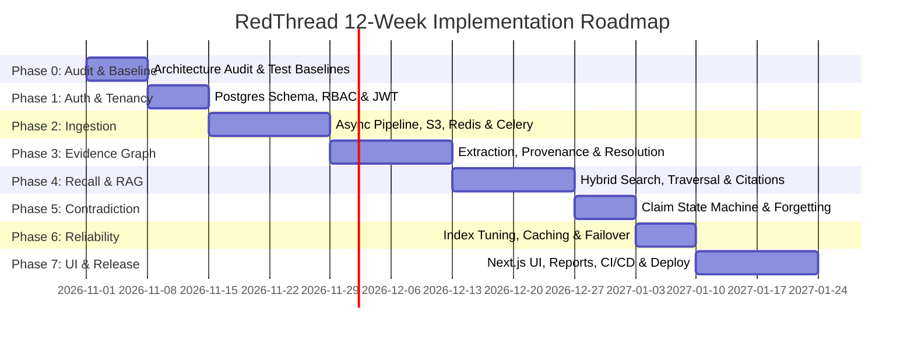
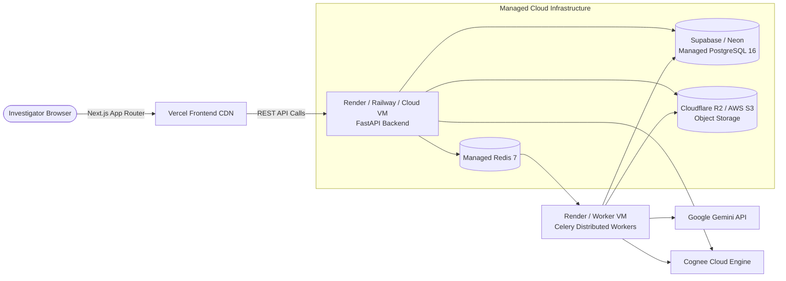

# RedThread Engineering Roadmap & Deployment Guide

## 1. 12-Week Phase-by-Phase Development Plan

### Detailed Phase Breakdown

#### Phase 0: Foundation & Baseline (Week 1)
- Audit existing hackathon codebase, identify state-loss bugs on restart.
- Establish backend test suite baseline (`pytest`) and linting (`ruff`, `mypy`).
- Create Docker Compose environment for local PostgreSQL, Redis, and MinIO.
- *Deliverable*: Deterministic local development environment.

#### Phase 1: Database & Authentication (Week 2)
- PostgreSQL 16 schema creation with SQLAlchemy 2.0 and Alembic.
- User registration, Argon2id password hashing, and JWT access/refresh token rotation.
- Organizations, memberships, and case assignment tables.
- Multi-tenancy enforcement and authorization unit/security tests.
- *Deliverable*: Secure multi-tenant authentication foundation.

#### Phase 2: Document Ingestion Engine (Weeks 3–4)
- S3-compatible storage integration (Cloudflare R2 / AWS S3).
- Format parsers: PyMuPDF (PDF), python-docx (DOCX), email (EML), pandas (CSV).
- Celery worker orchestration with Redis message queue.
- Content hashing (SHA-256) deduplication and idempotent job processing.
- *Deliverable*: Resilient asynchronous document ingestion pipeline.

#### Phase 3: Evidence & Knowledge Graph (Weeks 5–6)
- Gemini structured information extraction with Pydantic schemas.
- Granular offset tracking (document ID, page number, character bounds).
- Weighted entity resolution ($S = 0.35N + 0.25A + 0.25C + 0.15T$) and alias management.
- Synchronization layer between PostgreSQL and Cognee knowledge graph.
- *Deliverable*: Attributed, evidence-backed knowledge graph.

#### Phase 4: Intelligent Recall & Grounded RAG (Weeks 7–8)
- Query understanding and intent classification.
- Dual retrieval: BFS/Dijkstra graph traversal + dense vector similarity.
- Strict grounded generation prompt with automated Claim ID citations.
- Evaluation harness running synthetic benchmark questions.
- *Deliverable*: Verifiable AI investigative assistant with exact citations.

#### Phase 5: Contradiction Management & Forgetting (Week 9)
- Claim state machine (`ACTIVE`, `DISPUTED`, `REVIEWED`, `RETRACTED`).
- Investigator challenge workflow with counter-document attribution.
- Immutable `claim_events` audit trail.
- Modified recall logic: highlighting disputes and filtering retracted claims.
- *Deliverable*: Non-destructive historical evidence management.

#### Phase 6: Performance, Reliability & Hardening (Week 10)
- Database index optimization (GIN for JSONB, composite indexes for case queries).
- Redis caching for frequent entity and alias lookups.
- Worker concurrency tuning, exponential backoff, and dead-letter queue testing.
- Load testing under multi-document upload and traversal stress.
- *Deliverable*: Benchmarked p95 response latencies adhering to SLA targets.

#### Phase 7: UI Integration, Export & Public Release (Weeks 11–12)
- Next.js 15 App Router interface: 3-panel investigation workspace.
- Interactive Force Graph 2D component with real-time dispute styling.
- PDF, CSV, and JSON report generator preserving snapshot evidence states.
- Cloud deployment (Vercel, Render/Railway, Supabase, Cloudflare R2).
- *Deliverable*: Publicly demonstrable portfolio application.

---

## 2. Priority Classification Matrix

| Priority | Modules & Features | Description |
| :--- | :--- | :--- |
| **P0: Must-Have** | Auth & RBAC, Cases, Async Ingestion, Structured Claims, Provenance Offsets, Graph Recall | Core foundation of the product; essential for MVP. |
| **P1: Important** | Entity Resolution, Contradiction Lifecycle, Exponential Retries, Benchmark Harness | Signature differentiators that establish technical depth. |
| **P2: Advanced** | Cross-Case Overlap Alerts, Interactive 3-Panel UI, Report Exports (PDF/JSON), Metrics Dashboard | Professional UX and presentation capabilities. |
| **P3: Future** | Automated Entity Merge Suggestions, Advanced Graph Community Detection, Audio/Video Ingestion | Long-term roadmap enhancements. |

---

## 3. Target Deployment Architecture

---

## 4. Architectural Transformation: Hackathon vs. Production

| Dimension | Current Hackathon Prototype | Target Production Architecture |
| :--- | :--- | :--- |
| **Authentication** | None (public open endpoints) | JWT access (15m) + rotating refresh tokens + Argon2id |
| **Multi-Tenancy** | Single-user demo | Strict Organization and Case boundaries with RLS |
| **Case Model** | Ephemeral dataset strings | First-class relational entities in PostgreSQL |
| **Persistence** | In-memory local state + Cognee | PostgreSQL 16 (ACID source of truth) + S3 Object Storage |
| **Ingestion** | Synchronous (blocks HTTP request) | Asynchronous Celery + Redis with job status machine |
| **Fault Recovery** | Basic try/except, dropped jobs | 3-tier retries with exponential backoff & dead-letter queue |
| **Entity Resolution** | Naive lowercase exact match | Multi-attribute weighted scoring ($S = 0.35N+0.25A+0.25C+0.15T$) |
| **Relationships** | Unattributed graph edges | Granular Claims with document ID, page, and offset citations |
| **Contradictions** | In-memory confidence decay dictionary | Versioned Claim lifecycle (`ACTIVE`, `DISPUTED`, `RETRACTED`) |
| **AI Recall** | Basic vector query | Hybrid BFS/Dijkstra graph traversal + grounded LLM generation |
| **Testing & Evals**| Minimal smoke tests | Unit, integration, security, and 200+ question benchmark harness |
| **Deployment** | Local terminal run (`uvicorn`) | Distributed cloud deployment (Vercel + Render + Supabase + R2) |
