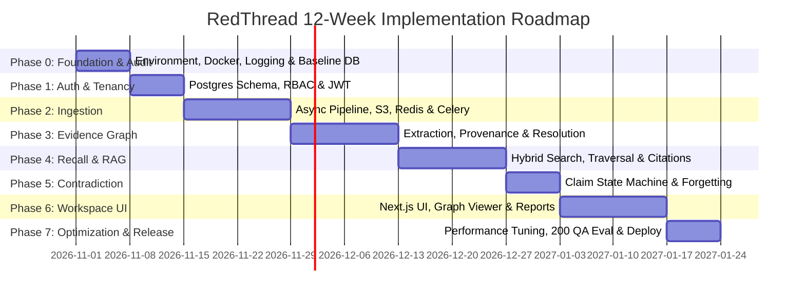

# RedThread Engineering Roadmap & Implementation Plan

> **Document Status**: `DESIGN`  
> **Execution Strategy**: Controlled, phased engineering plan from foundation audit to production release.

---

## 1. 12-Week Phase-by-Phase Roadmap

---

## 2. Phase-by-Phase Deliverables & Scope

### Phase 0: Repository Foundation & Test Baselines (Week 1)
- Clean existing repository structure without destroying working code.
- Configure Pydantic `BaseSettings` environment loading (`.env`).
- Deploy local infrastructure via `infrastructure/docker-compose.yml` (PostgreSQL 16, Redis 7, MinIO).
- Configure structured JSON logging with request tracing IDs.
- Initialize SQLAlchemy 2.0 async engine and Alembic migrations.
- Build initial database schema (`users`, `organizations`, `cases`, `documents`, `claims`, `claim_sources`, `claim_events`, `outbox_events`).
- Establish baseline test suite in `backend/tests/`.
- *Acceptance Gate*: Docker Compose boots cleanly, Alembic migrates to latest schema, and baseline tests pass.

### Phase 1: Authentication & Multi-Tenancy (Week 2)
- Implement user registration and login endpoints (`/api/v1/auth`).
- Argon2id password hashing and JWT access (15m) / rotating refresh (7d) tokens.
- Organization creation and membership invitation workflows.
- Case workspace creation and investigator assignment (`case_members`).
- Multi-tenancy authorization dependencies and non-disclosing 404 guards.
- Implement PostgreSQL Row-Level Security (RLS) policies.
- *Acceptance Gate*: Tenant isolation and RBAC security tests pass with 100% coverage.

### Phase 2: Document Ingestion Pipeline (Weeks 3–4)
- S3-compatible object storage adapter (Cloudflare R2 / MinIO).
- Implement parsers for PDF (PyMuPDF), DOCX (python-docx), TXT, and EML.
- Celery worker orchestration with Redis task transport.
- Implement Transactional Outbox pattern for zero-loss task dispatch.
- Document content hashing (SHA-256) and case deduplication checks.
- Job state machine (`QUEUED`, `PROCESSING`, `COMPLETED`, `FAILED`, `RETRYING`, `DEAD_LETTER`).
- Exponential backoff and retry policies.
- *Acceptance Gate*: Asynchronous upload returns `202 Accepted` $< 1000\text{ ms}$; multi-page PDF successfully chunks and stores.

### Phase 3: Knowledge Extraction & Entity Resolution (Weeks 5–6)
- Gemini 1.5 Pro structured extraction pipeline using Pydantic schemas.
- Granular offset tracking (document ID, page number, character start/end coordinates).
- Weighted entity resolution ($S = 0.35N + 0.25A + 0.25C + 0.15T$).
- Alias indexing in `entity_aliases` and manual review queue.
- Reversible entity merge and unmerge operations with `entity_merges` snapshots.
- Idempotent PostgreSQL-to-Cognee graph synchronization worker.
- *Acceptance Gate*: Entities and claims committed to PostgreSQL and synced to Cognee; unmerge restores pre-merge state.

### Phase 4: Knowledge Graph & Hybrid Recall (Weeks 7–8)
- Query understanding: entity extraction and intent parsing.
- Dual retrieval: BFS bounded graph traversal ($N \le 4$) in Cognee + vector semantic passage retrieval.
- Permission-aware graph filtering stripping unauthorized case nodes before return.
- Grounded answer synthesis prompt with verified `[Claim #ID]` citations.
- Insufficient-evidence fallback for unanswerable questions.
- Benchmark runner initialized with test questions.
- *Acceptance Gate*: Multi-hop questions return verified graph path and page-level citations; unanswerable queries return fallback message.

### Phase 5: Contradiction Management & Claim Lifecycle (Week 9)
- Claim state machine: `ACTIVE`, `DISPUTED`, `RETRACTED`.
- Separation of review outcomes: `PENDING`, `UPHELD`, `REJECTED`, `INCONCLUSIVE`.
- Investigator dispute challenge endpoint with counter-document attribution.
- Immutable `claim_events` audit trail.
- Modified recall logic: highlighting dispute warnings and excluding retracted claims from normal answers.
- *Acceptance Gate*: Before-and-after contradiction test verifies disputed claim triggers dispute warnings and counter-citations.

### Phase 6: Frontend Investigation Workspace (Weeks 10–11)
- Next.js 15 App Router interface: 3-panel workspace (Case Navigation, Graph View, Evidence Dossier).
- Interactive Force Graph 2D component with real-time dispute styling (amber dashed edges).
- TanStack Query v5 state management, optimistic updates, and cache invalidation.
- Claim challenge and review modals.
- Frozen investigation report generation (PDF, JSON, CSV).
- *Acceptance Gate*: Playwright E2E browser tests pass complete end-to-end investigation workflow.

### Phase 7: Optimization, Benchmark & Production Readiness (Week 12)
- Database index tuning (GIN for JSONB, composite indexes for case queries).
- Redis caching for frequent entity lookups and canonical alias resolution.
- Execute complete 200-question benchmark suite; measure Precision@5, Recall@5, MRR, nDCG@10, and Faithfulness.
- Measure latency SLAs under concurrent investigator workloads.
- Automated GitHub Actions CI/CD pipeline for backend and frontend.
- Cloud deployment (Vercel + Render/Railway + Neon + Cloudflare R2).
- *Acceptance Gate*: Full benchmark report generated; p95 latency targets met; all documentation verified.

---

## 3. Priority Classification Matrix

| Priority | Modules & Features | Description |
| :--- | :--- | :--- |
| **P0: Must-Have** | Auth & RBAC, Cases, Async Ingestion, Structured Claims, Provenance Offsets, Graph Recall | Core foundation of the product; essential for MVP. |
| **P1: Important** | Entity Resolution, Contradiction Lifecycle, Exponential Retries, Benchmark Harness | Signature differentiators that establish technical depth. |
| **P2: Advanced** | Cross-Case Overlap Alerts, Interactive 3-Panel UI, Report Exports (PDF/JSON), Metrics Dashboard | Professional UX and presentation capabilities. |
| **P3: Future** | Automated Entity Merge Suggestions, Advanced Graph Community Detection, Audio/Video Ingestion | Long-term roadmap enhancements. |

---

## 4. Architectural Transformation: Hackathon vs. Production

| Dimension | Current Hackathon Prototype | Target Production Architecture |
| :--- | :--- | :--- |
| **Authentication** | None (public open endpoints) | JWT access (15m) + rotating refresh tokens + Argon2id |
| **Multi-Tenancy** | Single-user demo | Strict Organization and Case boundaries with RLS |
| **Case Model** | Ephemeral dataset strings | First-class relational entities in PostgreSQL |
| **Persistence** | In-memory local state + Cognee | PostgreSQL 16 (ACID source of truth) + S3 Object Storage |
| **Ingestion** | Synchronous (blocks HTTP request) | Asynchronous Celery + Redis with job status machine |
| **Fault Recovery** | Basic try/except, dropped jobs | 3-tier retries with exponential backoff & dead-letter queue |
| **Entity Resolution** | Naive lowercase exact match | Multi-attribute weighted scoring ($S = 0.35N+0.25A+0.25C+0.15T$) |
| **Relationships** | Unattributed graph edges | Granular Claims with document ID, page, and offset citations |
| **Contradictions** | In-memory confidence decay dictionary | Versioned Claim lifecycle (`ACTIVE`, `DISPUTED`, `RETRACTED`) |
| **AI Recall** | Basic vector query | Hybrid BFS/Dijkstra graph traversal + grounded LLM generation |
| **Testing & Evals**| Minimal smoke tests | Unit, integration, security, and 200+ question benchmark harness |
| **Deployment** | Local terminal run (`uvicorn`) | Distributed cloud deployment (Vercel + Render + Supabase + R2) |

---

## 5. Related Documents
- [System Architecture](architecture.md)
- [Definition of Done](definition-of-done.md)
- [Implementation Status](implementation-status.md)
- [Deployment & Operations](deployment-and-operations.md)
