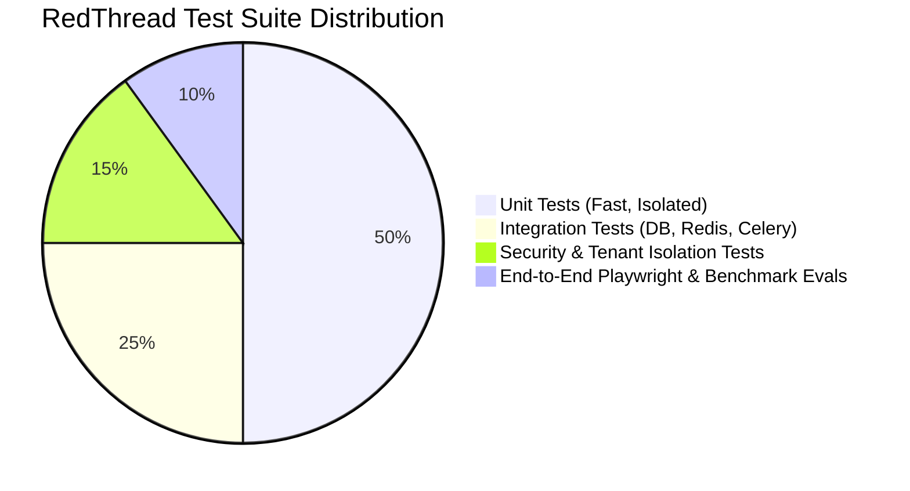

# RedThread Testing Strategy & Quality Assurance Plan

> **Document Status**: `DESIGN`  
> **Testing Principle**: Every layer—from cryptographic primitives to multi-hop graph retrieval—must be validated with reproducible, automated test suites.

---

## 1. Testing Pyramid



---

## 2. Test Suite Categories & Specifications

### 2.1 Unit Tests (`backend/tests/unit/`)
* **Focus**: Pure logic with zero network dependencies.
* **Coverage**:
  - `test_security.py`: Argon2id password hashing, JWT generation, expired token rejection.
  - `test_chunking.py`: Offset calculations and sliding window text chunking.
  - `test_entity_resolution.py`: Weighted formula $S = 0.35N + 0.25A + 0.25C + 0.15T$, edge cases in RapidFuzz token sorting.
  - `test_traversal.py`: BFS shortest-path discovery and cycle prevention on simulated adjacency graphs.
  - `test_pydantic_schemas.py`: Validation of structured Gemini extraction payloads.

### 2.2 Integration Tests (`backend/tests/integration/`)
* **Focus**: Component interactions with PostgreSQL (via test transaction rollback) and Redis.
* **Coverage**:
  - `test_auth_api.py`: User registration, login, refresh rotation, and logout.
  - `test_case_api.py`: Case creation, member assignment, and case archiving.
  - `test_document_ingestion.py`: Asynchronous task dispatch, outbox event generation, and job state transitions.
  - `test_claim_lifecycle.py`: Claim creation $\rightarrow$ dispute $\rightarrow$ review $\rightarrow$ retraction $\rightarrow$ `claim_events` audit trail.

### 2.3 Security & Multi-Tenancy Tests (`backend/tests/security/`)
* **Focus**: Strict validation of tenant isolation, RBAC, and IDOR defenses.
* **Key Test Scenarios**:
  - **Cross-Tenant Case Access**: User in Org A attempts `GET /api/v1/cases/{case_b_id}` $\rightarrow$ Expects `404 Not Found` (non-disclosing).
  - **Role Elevation**: User with `VIEWER` role submits `POST /api/v1/claims/{id}/challenge` $\rightarrow$ Expects `403 Forbidden`.
  - **File Spoofing Defense**: Uploading an executable payload disguised as `.pdf` $\rightarrow$ Expects `400 Bad Request` (Magic byte check fails).
  - **Graph Leakage**: Traversal results from Cognee cross-checked against case boundaries; unassigned case nodes stripped.

### 2.4 AI Retrieval & Citation Verification Tests (`backend/tests/evaluation/`)
* **Focus**: Groundedness, hallucination prevention, and citation accuracy.
* **Verification**:
  - Validates that 100% of cited `[Claim #ID]` references correspond to active database claims.
  - Verifies that quoted text snippets match the source document text within the recorded character offsets.
  - Unanswerable test cases verify that the model returns `"Insufficient evidence"` rather than hallucinating.

### 2.5 End-to-End (E2E) Browser Workflows (`frontend/e2e/`)
* **Tool**: Playwright with TypeScript.
* **Flows**:
  1. Investigator registers and creates a case.
  2. Uploads sample investigative PDF and monitors real-time ingestion status.
  3. Explores interactive knowledge graph and opens entity details panel.
  4. Asks a multi-hop recall question and verifies citation highlights.
  5. Challenges an extracted claim and verifies visual dispute styling (amber dashed lines).
  6. Exports frozen investigation PDF report.

---

## 3. Test Execution Commands

```bash
# Run unit tests only
PYTHONPATH=. venv/bin/pytest backend/tests/unit/ -v

# Run integration tests (requires local test PostgreSQL & Redis)
PYTHONPATH=. venv/bin/pytest backend/tests/integration/ -v

# Run security & tenant isolation tests
PYTHONPATH=. venv/bin/pytest backend/tests/security/ -v

# Run the 200-question evaluation benchmark
python -m backend.app.evaluation.benchmark \
    --dataset backend/app/evaluation/datasets/investigative_bench_v1.json \
    --output backend/tests/evaluation/reports/latest.json

# Run Playwright E2E tests
cd frontend && npx playwright test
```

---

## 4. Related Documents
- [Security Model](security-model.md)
- [Threat Model](threat-model.md)
- [Database Design](database-design.md)
- [Evaluation Framework](benchmarks/evaluation-framework.md)
